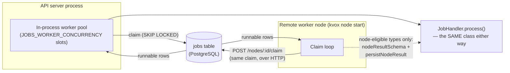

# System Architecture

**Web Application Foundation**
**Version:** 1.0
**Last Updated:** January 2026

This document provides a comprehensive architectural overview of this web application foundation, designed for AI-assisted development with specialized coding agents.

---

## Table of Contents

1. [Executive Summary](#1-executive-summary)
2. [System Overview](#2-system-overview)
3. [Architecture Principles](#3-architecture-principles)
4. [Technology Stack](#4-technology-stack)
5. [Component Architecture](#5-component-architecture)
6. [Data Architecture](#6-data-architecture)
7. [Security Architecture](#7-security-architecture)
8. [API Architecture](#8-api-architecture)
9. [Frontend Architecture](#9-frontend-architecture)
10. [Infrastructure Architecture](#10-infrastructure-architecture)
11. [Observability Architecture](#11-observability-architecture)
12. [Background Job Queue & Worker Fleet](#12-background-job-queue--worker-fleet)
13. [Testing Architecture](#13-testing-architecture)
14. [Agent-Based Development Model](#14-agent-based-development-model)
15. [Development Workflows](#15-development-workflows)
16. [Appendices](#16-appendices)

---

## 1. Executive Summary

### Purpose

This is a production-grade web application template that establishes:

- **Secure Authentication**: OAuth 2.0 with Google (extensible to other providers)
- **Fine-Grained Authorization**: Role-Based Access Control (RBAC) with permissions
- **Flexible Configuration**: JSONB-based settings framework for system and user preferences
- **Enterprise Observability**: OpenTelemetry instrumentation with traces, metrics, and structured logs
- **Agent-Friendly Development**: Modular architecture designed for AI coding agent collaboration

### Key Characteristics

| Aspect | Description |
|--------|-------------|
| **Architecture Style** | Monorepo with API-first design |
| **Hosting Model** | Same-origin (UI and API share base URL) |
| **Auth Strategy** | OAuth 2.0 + JWT with refresh token rotation |
| **Access Control** | Email allowlist + RBAC: the system role `admin` plus the organization roles `org_admin`, `contributor` and `viewer` (single-organization mode) |
| **Identity** | The platform identity slice (`@marinoscar/platform-api/identity`), mounted by `IdentityModule.forRoot`; KVox owns no auth, users, allowlist, PAT or device-auth code (see §7.6) |
| **Data Storage** | PostgreSQL with Prisma ORM |
| **Extensibility** | JSONB settings, modular NestJS structure |

### Target Audience

- **AI Coding Agents**: Primary consumers for automated development tasks
- **Backend Developers**: NestJS/Node.js engineers
- **Frontend Developers**: React/TypeScript engineers
- **DevOps Engineers**: Infrastructure and deployment specialists
- **Security Teams**: Security review and compliance

---

## 2. System Overview

### High-Level Architecture

```
┌─────────────────────────────────────────────────────────────────────────────┐
│                              NGINX REVERSE PROXY                             │
│                           (Security Headers, Routing)                        │
│                              http://localhost:3535                           │
├────────────────────────────────────┬────────────────────────────────────────┤
│         /* → Frontend (Web)        │           /api/* → Backend (API)       │
├────────────────────────────────────┼────────────────────────────────────────┤
│                                    │                                        │
│  ┌──────────────────────────────┐  │  ┌──────────────────────────────────┐  │
│  │       REACT FRONTEND         │  │  │       NESTJS + FASTIFY           │  │
│  │                              │  │  │                                  │  │
│  │  ┌────────────────────────┐  │  │  │  ┌────────────────────────────┐  │  │
│  │  │      Pages/Routes      │  │  │  │  │    Controllers/Guards      │  │  │
│  │  │  • Login               │  │  │  │  │  • AuthController (pkg)    │  │  │
│  │  │  • Home                │  │  │  │  │  • UsersController (pkg)   │  │  │
│  │  │  • User Settings       │  │  │  │  │  • SettingsController      │  │  │
│  │  │  • System Settings     │  │  │  │  │  • HealthController        │  │  │
│  │  │  • Device Activation   │  │  │  │  └────────────────────────────┘  │  │
│  │  └────────────────────────┘  │  │  │                                  │  │
│  │                              │  │  │  ┌────────────────────────────┐  │  │
│  │  ┌────────────────────────┐  │  │  │  │    Services/Business       │  │  │
│  │  │  Contexts/State        │  │  │  │  │    Logic Layer             │  │  │
│  │  │  • AuthProvider (pkg)  │  │  │  │  │  • AuthService (pkg)       │  │  │
│  │  │  • ShellRoot (pkg)     │  │  │  │  │  • UsersService (pkg)      │  │  │
│  │  │  • SettingsContext     │  │  │  │  │  • SettingsService         │  │  │
│  │  └────────────────────────┘  │  │  │  │  • AllowlistService (pkg)  │  │  │
│  │                              │  │  │  └────────────────────────────┘  │  │
│  │  ┌────────────────────────┐  │  │  │                                  │  │
│  │  │  Material UI (MUI)     │  │  │  │  ┌────────────────────────────┐  │  │
│  │  │  • Components          │  │  │  │  │    Prisma ORM              │  │  │
│  │  │  • Theming             │  │  │  │  │  • Database Access         │  │  │
│  │  │  • Responsive Design   │  │  │  │  │  • Query Building          │  │  │
│  │  └────────────────────────┘  │  │  │  │  • Migrations              │  │  │
│  │                              │  │  │  └────────────────────────────┘  │  │
│  └──────────────────────────────┘  │  └──────────────────────────────────┘  │
│                                    │                │                       │
│              Port 5173             │                │      Port 3000        │
└────────────────────────────────────┴────────────────┼───────────────────────┘
                                                      │
                                                      ▼
                                     ┌────────────────────────────────┐
                                     │        POSTGRESQL              │
                                     │                                │
                                     │  Tables:                       │
                                     │  • users, user_identities      │
                                     │  • roles, permissions          │
                                     │  • user_roles, role_permissions│
                                     │  • organizations, memberships  │
                                     │  • user_settings               │
                                     │  • system_settings             │
                                     │  • refresh_tokens              │
                                     │  • device_codes                │
                                     │  • allowed_emails              │
                                     │  • kvox_allowlist_reminders    │
                                     │  • audit_events                │
                                     │                                │
                                     │           Port 5432            │
                                     └────────────────────────────────┘
                                                      │
                                                      ▼
                                     ┌────────────────────────────────┐
                                     │    TELEMETRY STACK (optional)  │
                                     │                                │
                                     │  • OTEL Collector              │
                                     │  • GreptimeDB (Storage)        │
                                     │  • Explorer + dashboard in the │
                                     │    app (/admin/settings)       │
                                     │   Port 14000 (GreptimeDB UI)   │
                                     └────────────────────────────────┘
```

`(pkg)` marks the parts that ship in the `@marinoscar/platform-*` packages and are mounted by KVox rather than written in it (§7.6).

### Request Flow

```
┌──────┐    ┌───────┐    ┌─────────────┐    ┌──────────────┐    ┌────────────┐
│Client│───▶│ Nginx │───▶│ JwtAuthGuard│───▶│ RolesGuard   │───▶│ Controller │
└──────┘    └───────┘    └─────────────┘    └──────────────┘    └────────────┘
                              │                    │                   │
                              ▼                    ▼                   ▼
                         Validate JWT       Check Roles/        Business Logic
                         Load User          Permissions         Response
```

Before any of these, the host core's request-id middleware and `MaintenanceGuard` (the only global guard) run on every route. The guards below are the platform's (`@marinoscar/platform-api/identity`), applied by the
`@Auth(...)` decorator on every KVox controller; there is no global JWT guard, so a route
with neither `@Auth` nor `@Public()` is refused by the `identity` conformance suite.

---

## 3. Architecture Principles

### 3.1 Separation of Concerns

| Layer | Responsibility | Location |
|-------|---------------|----------|
| **Presentation** | User interaction, rendering, UX | `apps/web/` |
| **API Gateway** | HTTP handling, validation, auth | `apps/api/src/*/controllers/` |
| **Business Logic** | Domain rules, orchestration | `apps/api/src/*/services/` |
| **Data Access** | Database operations, queries | Prisma via services |
| **Infrastructure** | Routing, containers, config | `infra/` |

**Rule**: Frontend handles presentation only. All business logic resides in the API.

### 3.2 Same-Origin Hosting

All components served from the same base URL via Nginx reverse proxy:

| Path | Component | Purpose |
|------|-----------|---------|
| `/` | Frontend (React) | User interface |
| `/api/*` | Backend (NestJS) | REST API |
| `/api/docs` | Scalar API reference | Interactive API documentation |
| `/api/openapi.json` | OpenAPI spec | Machine-readable API schema |

**Benefits**: No CORS complexity, simplified cookie handling, unified deployment.

### 3.3 Security by Default

- **Authentication Required**: All API endpoints require JWT unless explicitly marked `@Public()`
- **Authorization Enforced**: RBAC guards verify roles/permissions before controller execution
- **Input Validated**: Zod schemas validate all request payloads
- **Secrets Protected**: Environment variables only, never committed to source

### 3.4 API-First Design

- **Contract-Driven**: OpenAPI specification generated from code annotations
- **Versioned**: API paths support future versioning (`/api/v1/`)
- **Consistent**: Standardized response format for success and errors
- **Documented**: Every endpoint documented with OpenAPI decorators; the published
  document is assembled in `apps/api/src/openapi/` and linted by Spectral in CI
  (see [API.md § How the document is built](API.md#how-the-document-is-built))

### 3.5 Observable by Design

- **Traced**: OpenTelemetry auto-instrumentation for all HTTP and DB operations
- **Metered**: Request counts, durations, error rates exposed as metrics
- **Logged**: Structured JSON logging with correlation IDs
- **Health-Checked**: Liveness and readiness endpoints for orchestration

---

## 4. Technology Stack

### 4.1 Core Technologies

| Component | Technology | Version | Purpose |
|-----------|------------|---------|---------|
| **Runtime** | Node.js | 24+ (LTS) | Server runtime |
| **Language** | TypeScript | 6.x | Type safety |
| **Backend Framework** | NestJS | 11.x | API structure |
| **HTTP Adapter** | Fastify | 5.x | High-performance HTTP |
| **Frontend Framework** | React | 19.x | UI rendering |
| **UI Library** | Material UI (MUI) | 9.x | Component library |
| **Database** | PostgreSQL | 16+ | Data persistence |
| **ORM** | Prisma | 7.x | Database access |

### 4.2 Authentication & Security

| Component | Technology | Purpose |
|-----------|------------|---------|
| **OAuth Strategy** | Passport.js | OAuth flow handling |
| **OAuth Provider** | Google OAuth 2.0 | Primary identity provider |
| **Token Format** | JWT (HS256) | Stateless authentication |
| **Validation** | Zod | Runtime schema validation |
| **Security Headers** | Helmet (via Nginx) | HTTP security headers |

### 4.3 Infrastructure

| Component | Technology | Purpose |
|-----------|------------|---------|
| **Containerization** | Docker | Application packaging |
| **Orchestration** | Docker Compose | Local development environment |
| **Reverse Proxy** | Nginx | Routing, SSL termination, headers |
| **Observability** | OpenTelemetry + GreptimeDB (platform telemetry slice) | Traces, metrics, logs; explorer and dashboard in the app |
| **Logging** | Pino | Structured JSON logging |

### 4.4 Testing

| Component | Technology | Purpose |
|-----------|------------|---------|
| **Backend Unit Tests** | Jest + jest-mock-extended | Service/guard testing with mocked Prisma |
| **Backend Integration** | Jest + Supertest | HTTP endpoint testing with mocked database |
| **Prisma Mocking** | jest-mock-extended (DeepMockProxy) | Type-safe database mocking |
| **Frontend Tests** | Vitest + React Testing Library | Component and context testing |
| **Frontend API Mocking** | MSW (Mock Service Worker) | Network request interception |
| **E2E (Optional)** | Playwright | Full system testing |

**Key Testing Characteristics:**
- Backend tests use **mocked PrismaService** by default (no real database required)
- Integration tests verify full HTTP request/response cycle with mocked data layer
- Frontend tests run in jsdom environment with MSW intercepting API calls
- Coverage thresholds: 70% minimum for frontend (enforced in vitest.config.ts)

---

## 5. Component Architecture

### 5.1 Repository Structure

```
./
├── apps/
│   ├── api/                          # Backend API (NestJS + Fastify)
│   │   ├── src/
│   │   │   ├── platform/             # Bindings of the platform packages
│   │   │   │   ├── platform-host.ts          # definePlatformHost (Auth, Public)
│   │   │   │   ├── platform-host.module.ts   # PlatformHostModule.forRoot
│   │   │   │   ├── audit-sink.adapter.ts     # AUDIT_SINK -> audit_events
│   │   │   │   ├── system-settings-store.adapter.ts
│   │   │   │   ├── doctor.config.ts
│   │   │   │   ├── identity/         # IdentityModule.forRoot + its host ports
│   │   │   │   ├── settings/         # SettingsModule.forRoot + host ports (data, profile images)
│   │   │   │   ├── storage/          # StorageModule.forRoot + StorageConfigModule + ProfileImageModule + key-prefix manifest
│   │   │   │   ├── jobs/             # JobsModule.forRoot + NodesModule.forRoot + their host ports (the queue and fleet are the platform's)
│   │   │   │   ├── credentials/      # CredentialsModule (+ user/org) and the purpose manifest
│   │   │   │   └── ai/               # AiModule.forRoot, AiHostModule (binds AI_TARGET_RESOLVER), the ai namespace extension
│   │   │   ├── app-registrations/    # KVox permissions, user-owned models, ownership, AI features (ai.ts)
│   │   │   ├── ai-port/              # host glue for KVOX_AI: PlatformAiRuntime, PlatformTaskModelSource, AiReadinessService, KvoxAiTargetResolver, KvoxAiSettings, /api/ai-tasks/* (the model mechanics are @marinoscar/kvox-ai)
│   │   │   ├── allowlist-reminders/  # KVox-owned reminder routes (side table)
│   │   │   ├── kvox-objects/         # Ownership side table, managed-objects gateway, multipart routes, files list, delete veto, transcript upload processor
│   │   │   ├── settings/             # registry/ (namespace manifests) only
│   │   │   ├── health/               # Health check module
│   │   │   ├── prisma/               # Prisma service
│   │   │   ├── common/               # Shared utilities
│   │   │   │   ├── constants/
│   │   │   │   ├── filters/
│   │   │   │   └── interceptors/
│   │   │   ├── config/               # Configuration module
│   │   │   └── main.ts               # Application entry
│   │   ├── prisma/
│   │   │   ├── fragments/            # Web-edition side tables, plus generated kvox.*.prisma copies from packages/kvox-db
│   │   │   ├── schema/               # The composed Prisma schema (platform.* and app.*)
│   │   │   ├── migrations/           # Migration history (platform and domain directories are installed copies)
│   │   │   ├── kvox.lock             # Hashes of the installed domain migrations (kvox-db)
│   │   │   ├── catalog/              # permissions.json, system-settings-defaults.json
│   │   │   ├── seed.ts               # seedPlatform, then seedApp
│   │   │   └── seed-app.ts           # KVox rows (built-in note templates)
│   │   ├── test/                     # Integration tests
│   │   └── Dockerfile
│   │
│   └── web/                          # Frontend (React + MUI)
│       ├── src/
│       │   ├── components/           # Reusable UI components
│       │   ├── pages/                # Page components
│       │   ├── identity/             # Bindings of the packaged identity UI (AuthProvider, Login, Users)
│       │   ├── contexts/             # React context providers (no auth context: it is the platform's)
│       │   ├── hooks/                # Custom hooks
│       │   ├── services/             # API client
│       │   ├── theme/                # MUI theme configuration
│       │   ├── types/                # TypeScript types
│       │   └── __tests__/            # Component tests
│       └── Dockerfile
│
├── docs/                             # Documentation
│   ├── ARCHITECTURE.md               # This document
│   ├── SECURITY-ARCHITECTURE.md      # Security details
│   ├── API.md                        # API reference
│   ├── DEVELOPMENT.md                # Development guide
│   ├── TESTING.md                    # Testing guide
│   ├── DEVICE-AUTH.md                # Device auth guide
│   └── specs/                        # Implementation specifications
│       ├── 01-project-setup.md
│       ├── 02-database-schema.md
│       └── ... (24 specs total)
│
├── infra/                            # Infrastructure configuration
│   ├── compose/
│   │   ├── base.compose.yml          # Core services
│   │   ├── dev.compose.yml           # Development overrides
│   │   ├── prod.compose.yml          # Production overrides
│   │   ├── telemetry.compose.yml     # Telemetry stack (collector + GreptimeDB), copied from the platform
│   │   ├── vps.telemetry.compose.yml # VPS hardening for the telemetry stack, copied from the platform
│   │   ├── postgres-init/            # First-start role and extension scripts (10-application-role.sh, 20-kvox-extensions.sh)
│   │   └── .env.example              # Environment template
│   ├── nginx/
│   │   └── nginx.conf                # Reverse proxy config
│   └── otel/
│       └── otel-collector-config.yaml
│
├── .claude/                          # AI agent configuration
│   └── agents/
│       ├── backend-dev.md            # Backend specialist
│       ├── frontend-dev.md           # Frontend specialist
│       ├── database-dev.md           # Database specialist
│       ├── testing-dev.md            # Testing specialist
│       └── docs-dev.md               # Documentation specialist
│
├── AGENTS.md                         # Shared AI assistant rules (nested ones in apps/*)
├── CLAUDE.md                         # Claude Code additions (imports AGENTS.md)
└── README.md                         # Project overview
```

### 5.2 Backend Module Structure

Each NestJS module follows a consistent pattern:

```
module-name/
├── module-name.module.ts         # Module definition
├── module-name.controller.ts     # HTTP endpoints
├── module-name.service.ts        # Business logic
├── dto/                          # Data Transfer Objects
│   ├── create-item.dto.ts
│   └── update-item.dto.ts
├── interfaces/                   # TypeScript interfaces
├── guards/                       # Module-specific guards
└── module-name.controller.spec.ts  # Unit tests
```

**Host ports.** The domain is being packaged as `@marinoscar/kvox-api` slices that reach everything outside the domain (AI, object store, jobs, identity, notifications, events, the database, settings, secrets, audit) through ports declared in `@marinoscar/kvox-api/ports`. `src/platform-kvox/` holds the web edition's adapters, one per port over a platform slice, and `PlatformKvoxModule` (global, imported before every domain module; a missing binding stops the boot). It is the only place that names the platform for these ports. Contract, adapters and conformance suite: [specs/kvox-ports.md](specs/kvox-ports.md).

**Slice bindings.** `src/kvox/kvox.module.ts` is the one module `AppModule` imports for the domain: `PlatformKvoxModule` first, then each slice's configuration (`src/kvox/<slice>/<slice>.config.ts`, a `<Slice>Module.forRoot({...})` call and the only place the application configures that slice), then the parts of a slice that use the platform and so stay in the application. Today only `transcription` (issue #492): `transcription.config.ts`, the system-settings declaration, the credential purpose, the onboarding step and facts, and the Doctor check. `src/kvox/auth-documenter.ts` makes a route the slices guard with `KvoxAuth` appear in the API document exactly as one guarded by the platform's `@Auth(...)`. Each slice's permission set, when it has one, is registered in `src/app-registrations/kvox-permissions.ts`, and `test/kvox/prisma-shape.typecheck.ts` proves the application's Prisma client satisfies every slice's narrowed client type.

### 5.3 Frontend Component Structure

```
components/
├── ComponentName/
│   ├── ComponentName.tsx         # Component implementation
│   ├── ComponentName.test.tsx    # Component tests
│   └── index.ts                  # Barrel export

pages/
├── PageName/
│   ├── PageName.tsx              # Page component
│   ├── PageName.test.tsx         # Page tests
│   └── index.ts                  # Barrel export
```

### 5.4 Storage Subsystem

Object storage (uploads, avatars, renditions, exports, backups, the node data plane) is the platform's storage slice, `@marinoscar/platform-api/storage`, mounted by this application in `apps/api/src/platform/storage/`. The application adds a thin layer of its own in `apps/api/src/kvox-objects/` for what the platform does not model. Nothing in `apps/api/src/storage/` remains: that folder was this application's own stack and was deleted in #469.

#### Architecture Overview

```
┌─────────────────────────────────────────────────────────────────────┐
│  Platform storage slice (@marinoscar/platform-api/storage)          │
│  ├── Objects API  /api/storage/objects  (init, complete, abort,     │
│  │                simple upload, list, download, delete, metadata)  │
│  ├── Storage config  /api/admin/storage-config  (+ /admin/settings/ │
│  │                storage in the web app)                           │
│  ├── Resolving STORAGE_PROVIDER  (S3 / R2 / S3-compatible driver,   │
│  │                chosen at runtime from the `storage` settings     │
│  │                namespace + the credential store)                 │
│  ├── ObjectProcessorRegistry  → storage.object.process job          │
│  ├── storage.cleanup.stale-uploads job + cron (enqueue only)        │
│  ├── Key-prefix registry  (every prefix the deployment writes)      │
│  └── ProfileImageModule  (avatars)                                  │
├─────────────────────────────────────────────────────────────────────┤
│  Application layer (apps/api/src/kvox-objects/)                     │
│  ├── KvoxManagedObjects  (the ONLY code that reads/writes           │
│  │                storage_objects; always inside runInOrg)          │
│  ├── KvoxObjectOwnershipStore  (kvox_object_ownership)              │
│  ├── KvoxMultipartController  (POST/GET .../upload/parts)           │
│  ├── KvoxS3PartLister  (S3 ListParts)                               │
│  ├── KvoxFilesController  (GET /api/kvox/files)                     │
│  ├── managed-delete.hook  (Fastify onRequest: 409 on managed delete)│
│  └── (the transcripts slice's upload hook runs from the platform    │
│       adapter's one ObjectProcessor, platform-kvox/object-store)    │
├─────────────────────────────────────────────────────────────────────┤
│  Host bindings (apps/api/src/platform/storage/)                     │
│  ├── storage.config.ts  (StorageModule.forRoot, StorageConfigModule,│
│  │                       ProfileImageModule.forRoot)                │
│  ├── storage-host.module.ts  (STORAGE_SYSTEM_DATA → PrismaSystem…)  │
│  └── storage-key-prefix.manifest.ts                                 │
└─────────────────────────────────────────────────────────────────────┘
```

**Runtime-configured.** There is no storage environment variable for the bucket. The active driver and its non-secret settings are the `storage` system-settings namespace; the secret access key is in the credential store (`credentials`, purpose `storage`), encrypted with `SECRETS_ENCRYPTION_KEY`. An administrator edits both at `/admin/settings/storage`, and the resolving provider re-reads them on a short cache, so a change needs no restart. While nothing usable is saved, every storage call answers 503. The environment keeps only `STORAGE_PART_SIZE`, `MAX_FILE_SIZE`, `ALLOWED_MIME_TYPES` and `SIGNED_URL_EXPIRY`. Operator steps: [`runbooks/storage-configuration.md`](runbooks/storage-configuration.md).

**Tenancy.** `storage_objects` and `storage_object_chunks` are organization tables with forced row-level security. Every application read or write goes through `runInOrg` (or the job's `JobScope`), and only `KvoxManagedObjects` does it; a grep-based tripwire spec fails when any other file outside the platform bindings touches `prisma.storageObject`. The API connects as an ordinary `NOSUPERUSER NOBYPASSRLS` role since #471, so these policies apply ([7.10](#710-platform-db-backup-and-telemetry-slices-and-the-application-role)).

#### Upload Flow

**1. Resumable Upload (Large Files)**:
   - Client calls the platform's `POST /api/storage/objects/upload/init` with file metadata (a transcript, note or graph upload goes through `KvoxManagedObjects.initManagedUpload`, which wraps it and writes the ownership row)
   - Server creates the DB record, starts the multipart upload, returns the deployment-wide `partSize` and presigned URLs for the **first ten parts**
   - Client uploads parts directly to the bucket (bypasses the application server), asking `POST /api/storage/objects/:id/upload/parts` (application route, up to 100 part numbers per call) for the rest as it goes
   - To resume, or to complete, the client asks `GET /api/storage/objects/:id/upload/parts` (application route, S3 `ListParts`) for the parts the bucket holds. The web client never reads a part's `ETag`, which a browser cannot do cross-origin without bucket CORS
   - Client calls the platform's `POST /api/storage/objects/:id/upload/complete` with that list; the server finalizes the upload and queues `storage.object.process`

**2. Simple Upload (Small Files < 100MB)**:
   - Client sends file via multipart/form-data to `/api/storage/objects`
   - Server streams directly to the bucket
   - Processing is queued on completion

**Part size.** One number for the whole deployment (`STORAGE_PART_SIZE`, default 10 MiB). It is not stored per upload, so it must never change while uploads are in flight, and `partSize x 10,000` must cover the largest accepted file. The rule and its check are in the runbook.

#### Processing Pipeline

Post-upload processing is a queue job, not an event:

```
Upload completes (platform)
         ↓
storage.object.process job (queued in the completing transaction)
         ↓
ObjectProcessorRegistry: every processor whose canProcess() matches
         ↓
the web edition's port processor (kvox.ports.uploaded) fans the event to
TranscriptUploadHook (@marinoscar/kvox-api/transcripts): if the object is
transcripts-owned, enqueue transcription.submit / media.audio.transcode
         ↓
Status updated: ready | failed
```

**Key Features:**
- Pluggable processors registered through `ObjectProcessorRegistry` (queue rule 1: a processor only enqueues, it never downloads)
- Runs in the job queue with retries, not in an `@OnEvent` listener (the old `storage.object.uploaded` and `storage.object.upload_aborted` events are gone, and the `on-event-no-io` conformance suite enforces it)
- **Aborted uploads** emit nothing, so `transcripts.housekeeping` (every 10 minutes) marks `uploading` transcripts whose source object is aborted, gone or stale as `failed` (`upload_aborted`); a cancelled transcript upload therefore shows as failed up to one cycle later

#### Object ownership

`kvox_object_ownership (object_id, org_id, managed_by, created_at)` marks the objects other modules own (`transcripts`, `notes`, `graph`). It replaced the `storage_objects.managed_by` column and is keyed `(object_id, org_id)` because the platform requires the composite key for a foreign key into an organization table (a foreign-key check bypasses RLS). It is a system table (`kind: 'system'`, `orgReference: 'orgId'`) with no policy of its own. Effects:

- `GET /api/kvox/files` lists a user's plain uploads minus owned objects; the platform's own list still shows them to their owner
- A Fastify `onRequest` hook answers `409 { details: { reason: 'managed_by_module', module } }` for `DELETE /api/storage/objects/:id` on an owned object, before the platform handler runs
- `KvoxManagedObjects.deleteManaged(id, module)` is the only way an owner deletes its object

The deliberate differences from the platform slice (the hook, the files route, the two multipart routes, the part-size rule, the composite key) are listed in [`platform-adoption/local-exceptions.md`](platform-adoption/local-exceptions.md).

#### Database Schema

**storage_objects** (platform table):
- File metadata, status, storage key, provider and bucket the bytes live in
- Owner reference (`uploaded_by_id`) and `org_id`
- Processing results in JSONB metadata field
- No `managed_by` and no `part_size` (both dropped in #469)

**storage_object_chunks** (platform table):
- Part number, ETag, size; the platform records the parts when an upload completes
- Composite key `(object_id, org_id)` to the object

**kvox_object_ownership** (application table): see above.

#### Module Structure

```
apps/api/src/platform/storage/
├── storage.config.ts                # StorageModule.forRoot, StorageConfigModule, ProfileImageModule.forRoot
├── storage-host.module.ts           # STORAGE_SYSTEM_DATA host port
└── storage-key-prefix.manifest.ts   # uploads, avatars, node-outputs, database-backups, transcripts, notes, graph

apps/api/src/kvox-objects/
├── kvox-objects.module.ts
├── kvox-managed-objects.service.ts  # the only reader/writer of storage_objects
├── kvox-object-ownership.store.ts   # kvox_object_ownership
├── kvox-multipart.controller.ts     # POST/GET /api/storage/objects/:id/upload/parts
├── kvox-s3-part-lister.ts           # ListPartsCommand
├── kvox-files.controller.ts         # GET /api/kvox/files
└── managed-delete.hook.ts           # 409 on a managed DELETE
```

The transcripts code is the `@marinoscar/kvox-api/transcripts` slice (`packages/kvox-api/src/transcripts/`, `TranscriptsModule.forRoot`, issue #493); its web-edition binding is `apps/api/src/kvox/transcripts/` (the module configuration, the platform sharing, the notification templates, the onboarding step and the events bridge).

---

## 6. Data Architecture

### 6.1 Entity Relationship Diagram

```
┌────────────────────┐       ┌────────────────────┐
│       users        │       │   user_identities  │
├────────────────────┤       ├────────────────────┤
│ id (PK, UUID)      │──┐    │ id (PK, UUID)      │
│ email (UNIQUE)     │  │    │ user_id (FK)       │──┘
│ display_name       │  └───▶│ provider           │
│ provider_display   │       │ provider_subject   │
│ profile_image_url  │       │ provider_email     │
│ provider_image_url │       │ created_at         │
│ is_active          │       └────────────────────┘
│ created_at         │
│ updated_at         │       ┌────────────────────┐
└────────────────────┘       │    user_settings   │
         │                   ├────────────────────┤
         │                   │ id (PK, UUID)      │
         │                   │ user_id (FK, UNIQUE)│◀─┐
         │                   │ value (JSONB)      │  │
         │                   │ version            │  │
         ▼                   │ updated_at         │  │
┌────────────────────┐       └────────────────────┘  │
│    user_roles      │                               │
├────────────────────┤                               │
│ user_id (FK, PK)   │───────────────────────────────┘
│ role_id (FK, PK)   │──┐
└────────────────────┘  │    ┌────────────────────┐
                        │    │       roles        │
                        │    ├────────────────────┤
                        └───▶│ id (PK, UUID)      │
                             │ name (UNIQUE)      │
                             │ description        │
                             └────────────────────┘
                                       │
                                       ▼
                             ┌────────────────────┐
                             │  role_permissions  │
                             ├────────────────────┤
                             │ role_id (FK, PK)   │
                             │ permission_id (PK) │──┐
                             └────────────────────┘  │
                                                     │
                             ┌────────────────────┐  │
                             │    permissions     │  │
                             ├────────────────────┤  │
                             │ id (PK, UUID)      │◀─┘
                             │ name (UNIQUE)      │
                             │ description        │
                             └────────────────────┘

┌────────────────────┐       ┌────────────────────┐
│  system_settings   │       │   refresh_tokens   │
├────────────────────┤       ├────────────────────┤
│ id (PK, UUID)      │       │ id (PK, UUID)      │
│ key (UNIQUE)       │       │ user_id (FK)       │
│ value (JSONB)      │       │ token_hash (UNIQUE)│
│ version            │       │ expires_at         │
│ updated_by_user_id │       │ created_at         │
│ updated_at         │       │ revoked_at         │
└────────────────────┘       └────────────────────┘

┌────────────────────┐       ┌────────────────────┐
│   allowed_emails   │       │    device_codes    │
├────────────────────┤       ├────────────────────┤
│ id (PK, UUID)      │       │ id (PK, UUID)      │
│ email (UNIQUE)     │       │ device_code_hash   │
│ added_by_id (FK)   │       │ user_code (UNIQUE) │
│ added_at           │       │ user_id (FK)       │
│ claimed_by_id (FK) │       │ client_info (JSONB)│
│ claimed_at         │       │ status             │
│ notes              │       │ expires_at         │
└────────────────────┘       │ last_polled_at     │
                             └────────────────────┘

┌─────────────────────────────┐
│  kvox_allowlist_reminders   │   no foreign key: keyed by allowed_emails.id,
├─────────────────────────────┤   orphans are swept on read
│ allowed_email_id (PK, UUID) │
│ reminder_count              │
│ last_reminder_at            │
│ updated_at                  │
└─────────────────────────────┘

┌────────────────────┐
│    audit_events    │
├────────────────────┤
│ id (PK, UUID)      │
│ actor_user_id (FK) │
│ action             │
│ target_type        │
│ target_id          │
│ meta (JSONB)       │
│ created_at         │
└────────────────────┘

┌────────────────────┐       ┌────────────────────────┐
│  storage_objects   │       │ storage_object_chunks  │
├────────────────────┤       ├────────────────────────┤
│ id (PK, UUID)      │──┐    │ id (PK, UUID)          │
│ owner_id (FK)      │  │    │ object_id (FK)         │──┘
│ name               │  └───▶│ part_number            │
│ size               │       │ e_tag                  │
│ mime_type          │       │ size                   │
│ storage_key        │       │ status                 │
│ storage_provider   │       │ created_at             │
│ upload_id          │       │ completed_at           │
│ status             │       └────────────────────────┘
│ metadata (JSONB)   │
│ created_at         │
│ updated_at         │
└────────────────────┘
```

Both tables are platform organization tables (`org_id`, composite key `(id, org_id)`). The application's own `kvox_object_ownership (object_id, org_id)` hangs off `storage_objects` with a cascade; see [5.4](#54-storage-subsystem).

### 6.2 JSONB Schema Definitions

#### User Settings Shape

Served by the platform settings slice (`/api/user-settings`, section 7.7). `theme` and `profile` are core fields;
`dataTables`, `navigation`, `notifications` and `onboarding` (platform namespaces) and `graph` (KVox's) are optional
namespaces, present only once set, in that stored key order.

```json
{
  "theme": "light | dark | system",
  "profile": {
    "displayName": "string | null",
    "imageSource": "none | provider | upload",
    "imageObjectId": "uuid | null"
  }
}
```

`imageSource` selects which picture represents the user (no picture, the OAuth
provider's picture, or one uploaded via `POST /api/user-settings/profile-image`);
`imageObjectId` is the uploaded avatar's storage object id, present only when
relevant. Rows written before this shape existed carry `useProviderImage`/
`customImageUrl` instead — normalized to the shape above on every read rather
than by a data migration (by the platform's `profile-image` helpers, `@marinoscar/platform-api/storage`, which replaced `apps/api/src/common/profile-image/` in #469).

#### System Settings Shape

`system_settings.value` — the JSONB column itself — holds `notifications`,
`jobs`, `nodes`, `databaseBackup` and `maintenance` (the platform's declarations)
followed by KVox's `transcription` and `ai`; the shapes of those two are in
[`docs/API.md`](API.md#get-system-settings) and their specs. The order is the stored key order: a new
namespace is appended, never inserted. (Two earlier namespaces,
`ui` and `features`, were removed by issue #366: nothing at runtime ever read
either one, so they were dropped from the schema, DTOs and seed rather than
kept as dead weight — see `docs/specs/settings-ui.md` for the settings-UI
side of that cleanup.)

```json
{
  "notifications": {
    "browserEnabled": true,
    "disabledEvents": []
  },
  "jobs": {
    "history": { "retentionDays": 30, "purgeEnabled": true },
    "stuckThresholdMinutes": 30
  },
  "nodes": {
    "staleHeartbeatSeconds": 90,
    "offlineStaleMultiplier": 4,
    "offlineRetentionDays": 30,
    "jobSecretBrokerEnabled": false
  },
  "databaseBackup": {
    "enabled": false,
    "frequency": "daily",
    "dayOfWeek": 0,
    "dayOfMonth": 1,
    "timeOfDay": "02:00",
    "timezone": "UTC",
    "retentionCount": 7,
    "storageProvider": "s3",
    "runStaleMinutes": 120,
    "compressionLevel": 6,
    "restoreRollbackMode": "retain_database",
    "oldDatabaseRetentionHours": 48,
    "nodeOffloadEnabled": false
  },
  "maintenance": {
    "enabled": false,
    "message": "This service is temporarily unavailable for scheduled maintenance. Please try again shortly.",
    "allowAdmins": true,
    "startedAt": null,
    "startedById": null
  }
}
```

`GET/PUT/PATCH /api/system-settings` (platform `SystemSettingsService`, row key `global`) project this stored row into
a response that adds a `security` block on the way out —
see [`docs/API.md`](API.md#get-system-settings) for the full response shape.

`security` is derived, read-only configuration — `jwtAccessTtlMinutes` and
`refreshTtlDays` are read from the `JWT_ACCESS_TTL_MINUTES` /
`JWT_REFRESH_TTL_DAYS` environment variables via `ConfigService`, not from the
database. It is never written to `system_settings.value`: the write schemas
(the schemas composed from the namespace registry) don't declare it,
so a client that sends it has the key silently stripped by the global
`ZodValidationPipe` before the request reaches the settings service.

> Since #470 the dispatcher, the policy functions and the SSE stream named in
> the next two paragraphs are the platform's (`NotificationPolicyService`,
> `policyChannels`, `isBrowserToastAllowed` in `@marinoscar/platform-api/notifications`);
> the declaration of the `notifications` namespace is the platform's too
> (`NOTIFICATIONS_SYSTEM_SETTINGS`). The stored shape and the enforcement points
> are unchanged. See [7.9](#79-platform-email-and-notifications-slices).

`notifications` (issue #225, epic #215) is a modelled block rather than an
entry in an open, untyped map — the now-removed `features` namespace was
exactly that shape (`z.record(z.string(), z.boolean())`, no schema, no
default, no place to document semantics, deliberately owned by downstream
forks for their own operational flags), and a framework-level,
security-adjacent gate like this one needs a real type, a real default, and
somewhere for its semantics to live. It is stored and editable as of #225, and
as of #226 it is enforced: `browserEnabled` and `disabledEvents` are read once
per dispatch by a new `NotificationPolicyService` and applied through
`notification-policy.ts`'s `policyChannels` and `isBrowserToastAllowed`
functions, consulted at three call sites — the dispatcher's channel
resolution, `GET /api/notifications/events`'s advertised channels, and the
SSE stream's `toast` field — so the matrix, the dispatch decision, and the
delivered toast can never disagree. Mandatory events (e.g.
`security.role_changed`) are the deliberate exception: their `notifications`
row is always written regardless of policy, since the row itself is the
record of a privilege or security change the user must not be able to make
disappear; only the browser toast is suppressed for them.

### 6.3 Database Design Principles

| Principle | Implementation |
|-----------|---------------|
| **UUID Primary Keys** | All tables use UUID v4 for primary keys |
| **Timestamptz** | All timestamps use `timestamptz` for timezone awareness |
| **JSONB for Flexibility** | Settings stored as JSONB for schema-less extensibility |
| **Cascade Deletes** | Foreign keys cascade on user deletion |
| **Soft Deletes** | Users deactivated via `is_active` flag, not hard deleted |
| **Audit Trail** | `audit_events` table logs all security-relevant actions |

### 6.4 Table inventory

Every table the schema defines beyond the ERD in §6.1, with the cascade, indexing and hand-written-SQL decisions that are not visible from `schema.prisma` alone.

The domain tables below (transcripts, notes, search, the `kg_*` graph tables, Ask) are declared in `packages/kvox-db/schema/kvox.<slice>.prisma`, created by the migrations in `packages/kvox-db/migrations/`, and their raw-SQL indexes, extensions (`vector`, `pg_trgm`) and other special objects are inventoried in that package's `raw-sql-indexes.json`, `extensions.json` and `schema-objects.json` ([README, Data](../packages/kvox-db/README.md#data)). The app holds installed copies proven by `prisma/kvox.lock`.


- `users` - User accounts with profile info
- `user_identities` - OAuth provider identities (provider + subject)
- `roles` / `permissions` / `role_permissions` - RBAC
- `user_roles` - User-to-system-role assignments. Only the system role `admin` lives here now; `contributor`, `viewer` and `org_admin` are **organization** roles held on `memberships.role_id` (platform migration `0024_split_system_org_roles` moved them; see §7.3)
- `organizations` / `memberships` - The platform's tenancy tables. KVox runs in single-organization mode (`TENANCY_MODE` unset): one default organization, and every user has one membership in it whose role is their org role
- `system_settings` - Global app settings (JSONB), read and written by the platform settings slice (`systemRowKey` `global`, unchanged shape). Namespaces on the `global` row, in stored key order: `notifications`, `jobs`, `nodes`, `databaseBackup`, `maintenance` (platform declarations; the jobs slice also registers a `retention` namespace, one `{ enabled, days }` policy per growing table, which the 01:00 `RetentionPurgeTask` reads, registered in `apps/api/src/settings/registry/system-settings.manifest.ts`), then `transcription` (KVox's, `app-registrations/settings.ts`) and `ai` (the platform AI slice's namespace, extended by KVox's `KVOX_AI_SETTINGS_EXTENSION` with `taskModels`, `graphEnabled`, `defaultModel` and the limits, #473; a deployment that has not yet run the migration command of `runbooks/ai-platform-migration.md` still carries the previous `provider` and `providers` blocks, which the platform salvages on read). ⚠ Adding one means declaring it in its module (`SystemSettingsNamespace`) and appending it to `app-registrations/settings.ts` — see [DEVELOPMENT.md](DEVELOPMENT.md#settings-namespace-registry); the platform's settings conformance suite iterates the registry. The `ai` namespace carries no API key (a test walks its schema for a secret-looking name) and, besides the platform's fields (provider slots, key policy, call defaults, limits), holds the fields KVox adds: `taskModels` (a per-task model and optional `reasoningEffort` for connected-knowledge tasks, absent key meaning "use `defaultModel`", replaced wholesale on write), `graphEnabled` (default `false`, the spending switch for connected knowledge), `defaultModel`, `maxInputTokens`/`maxOutputTokens` (`number | null`, `null` meaning the selected model's own maximum governs), `requestTimeoutMs`, `reasoningEffort` and `maxDocumentBytes` (the ceiling on one uploaded note source document; it lives in the AI namespace rather than in a storage setting because the reason to bound it is token cost on the uploading user's own vendor account, not disk). The enabled-model list is the `ai_models` table, not a settings field. See `docs/specs/notes.md` §2.5, §2.8 and §3.3.
- `user_settings` - Per-user settings (JSONB), served by the platform settings slice. Optional namespaces in stored key order: `dataTables`, `navigation`, `notifications` (platform), then `onboarding` (the platform onboarding slice's, #481) and `graph` (KVox), both listed in `app-registrations/settings.ts`. `onboarding` (issue #272, epic
  #271): the caller's own first-run **intent** — `welcomeSeenAt`, `checklistDismissedAt`,
  `adminDismissedAt`, `skipped[]` — never readiness, which is derived rather than stored (see
  the `### Onboarding` group of [`API.md`](API.md#onboarding) and [`docs/specs/onboarding.md`](specs/onboarding.md)). Absent from
  the default user-settings document on purpose: absent is how "never onboarded" is spelled (the platform's
  declaration has no default). Also `graph` (issue #369): per-user connected-knowledge
  preferences — `extraction.autoExtract`, `resolution.{mode,autoLinkThreshold,newThreshold,
  adjudication}`, `domains.{work,personal}` (`personal` default `false`, #383) — absent means every default, resolved by
  `GraphPreferencesService`; see `docs/specs/ontology.md` §10
- `credentials` - Encrypted `(purpose, name)` secrets an administrator enters at runtime (SMTP password, VAPID private key, the speech-to-text provider key). Owned by the platform credentials slice (`CredentialsService`, `@marinoscar/platform-api/credentials`); the same table and the same ciphertext as before the slice was adopted (issue #466), so no row was rewritten. `updatedByUserId` is `SetNull`. Never returned by any endpoint. The platform's `user_credentials` and `org_credentials` tables exist and stay empty: this app keeps no per-user or per-organization secret there (AI keys live in `user_ai_credentials`), and `org_settings` likewise stays empty in single-organization mode
- `audit_events` - Action audit log
- `refresh_tokens` - JWT refresh tokens (hashed)
- `allowed_emails` - Allowlist for access control. A platform table: KVox does not extend it. It no longer has the `reminder_count` / `last_reminder_at` columns (dropped by the `kvox_allowlist_reminders` migration, issue #465)
- `kvox_allowlist_reminders` - Allowlist invitation-reminder bookkeeping (issue #301, moved by #465): `allowed_email_id` (UUID primary key), `reminder_count`, `last_reminder_at`, `updated_at`. Keyed by an allowlist row id with **no foreign key**, because the platform's `AllowedEmail` model cannot be extended and a SQL-only FK would show as drift. Orphans are therefore possible: `GET /api/allowlist/reminders` deletes rows whose entry no longer exists (one bounded `DELETE ... WHERE NOT EXISTS`) before it reads, and no caller trusts a row without the join. Written by the KVox-owned `POST /api/allowlist/:id/reminder` with an `INSERT ... ON CONFLICT` that increments in the database, so two admins pressing the button at once cannot both write the same count. A manual, admin-pressed resend, not a scheduler: there is deliberately no cron or job type behind it
- `device_codes` - Device authorization codes (RFC 8628)
- `storage_objects` - File metadata, status, storage references. A platform **organization table with forced row-level security** (`org_id`, composite key `(id, org_id)`); the application reads and writes it only through `KvoxManagedObjects`, inside `runInOrg`. It carries no `part_size` and no `managed_by` any more (both columns dropped in #469): the part size is one deployment-wide number (`STORAGE_PART_SIZE`, an operator rule: never change it while uploads are in flight, [`runbooks/storage-configuration.md`](runbooks/storage-configuration.md) section 5), and ownership moved to `kvox_object_ownership`
- `kvox_object_ownership` - Which module owns a storage object (issue #469): `object_id` (UUID primary key), `org_id`, `managed_by` (`'transcripts'`, `'notes'` or `'graph'`; plain `text`, no enum, no CHECK, the same reasoning as `jobs.subject_type`), `created_at`, indexed on `managed_by`. A composite foreign key `(object_id, org_id)` into `storage_objects` with `ON DELETE CASCADE`: the platform requires the composite key for any link into an organization table, because a foreign-key check bypasses RLS. Registered as a `kind: 'system'` model with `orgReference: 'orgId'` and no policy of its own. It is what excludes an object from `GET /api/kvox/files` and what makes a generic `DELETE` answer 409. The data migration copied every non-null `managed_by` into it before the columns were dropped
- `storage_object_chunks` - Multipart upload chunk tracking. A platform organization table; the platform records the parts when an upload completes
- `personal_access_tokens` - User-created long-lived API tokens (hashed)
- `jobs` - The background queue (epic #254). `subject_type`/`subject_id` are both plain
  `text`, nullable, no FK either way — a job's subject is polymorphic (a storage object
  today, something else tomorrow), and a fork's own tables cannot be enumerated by a
  Prisma relation. `attempts` is charged **at claim time**, not on completion or failure —
  see `job-claim.service.ts` — so a process that dies mid-run (OOM kill, hard crash) still
  bounds its retries; a job read inside `process()` always sees its own attempt already
  counted. Two indexes exist **only** in `migration.sql`, not in `schema.prisma`, because
  Prisma cannot express a partial unique index: `jobs_active_dedup_uniq_idx` (`dedup_key`
  `WHERE status IN ('pending','running') AND dedup_key IS NOT NULL`) is the actual dedup
  enforcement, and `database_backup_runs_active_uniq_idx` below is its counterpart. This is
  deliberate, intentional schema drift — do not "fix" it by adding a `@@unique` to the model.
- `job_stats_rollup` - One row per job type, incrementally accumulating succeeded/failed
  counts and duration sums so lifetime stats survive the history purge. `sumDurationMs` is
  `Float`, not `BigInt`, to avoid crashing `JSON.stringify` at read time.
- `worker_nodes` - Registered worker node fleet (epic #254): identity, declared
  `eligibleTypes`/`concurrency`, operator `status` (`online`/`draining`/`offline`/`disabled`).
  Health is never stored — it is derived from `lastHeartbeatAt` at read time.
- `node_credentials` - `nod_…` bearer credentials a worker node authenticates with. Mirrors
  `personal_access_tokens`' hash/prefix/show-once shape, minus a mandatory expiry (a node
  runs unattended for months; revocation, not a clock, is the control).
- `job_node_secrets` - One row per short-lived, job-scoped credential a node has been issued
  (epic #345, issue #349). Records the broker `kind`, the credential's **handle** (e.g. a
  minted PostgreSQL role name) and its `expiresAt`/`revokedAt` — **never the credential's
  material**; the table has no column that could hold one. `@@unique([jobId, kind])` makes a
  second grant for the same job and broker unrepresentable, so a re-request while the lease
  is live extends the existing grant instead of minting a second. Three revocation paths can
  set `revokedAt`: the job-settle listener, `NodeSecretSweepTask`'s cron, and `VALID UNTIL`
  itself at the database level, which is why the row's `expiresAt` is bounded by the job's
  lease rather than being a clock of its own.
- `database_backup_runs` - One row per backup/restore attempt, with its own heartbeat and
  stale window — **not** a `jobs` row, because the lease reaper's `stuckThresholdMinutes`
  (default 30 min) would reset a legitimately multi-hour `pg_dump`/restore to pending and
  start a second one against the same storage key. At most one active run (`pending` or
  `running`) is enforced by `database_backup_runs_active_uniq_idx`, the same
  raw-SQL-only partial unique index pattern as `jobs` above — never by a `findFirst`
  before the insert, which cannot close the race a concurrent request needs closed.
- `transcripts` - One row per uploaded recording (issue #24, epic #19). Three
  independent status enums (`status`, `transcriptionStatus`, `playbackStatus`) rather than
  one, because transcode and transcription run **concurrently** and a single enum would need
  one member per combination of the two — the same `worker_nodes`-style split of "stated
  intent" from "sub-pipeline progress." `orgId` (issue #485, NOT NULL, `Cascade`) is the
  organization the platform sharing slice decides the transcript's access in; every row carries
  the default organization in single-organization mode. `ownerId` **cascades** on user deletion (a transcript
  has no meaning, and this app grants no path to read it, once its owner is gone — there is
  deliberately no `transcripts:read_any`); `sourceObjectId`/`playbackObjectId`/
  `rawResultObjectId` all **restrict** instead, the opposite direction of ownership: they
  point sideways into `storage_objects` (a different module's table), and only
  `transcript.purge` deleting the transcript row first may ever free one, never an unrelated
  storage cleanup. See `docs/specs/transcription.md` §3.1 and the block comment above the
  `Transcript` model for the full reasoning, including the honestly-stated gap between a raw
  cascading user delete (removes SQL rows only) and `transcript.purge` (also removes the
  storage/provider data). `title_search_vector` (issue #174, epic #164) is a `GENERATED ALWAYS
  AS (to_tsvector('english', coalesce(title, ''))) STORED` column with its own GIN index — a
  transcript's title must be full-text searchable even when no child segment matches at all, so
  it needs its own vector rather than folding into the segment vector below. Generated, not
  trigger-maintained: a trigger does not fire under `pg_restore`'s `session_replication_role =
  replica`, so a restored database would come back with a silently empty search index. Hand-written
  in `migration.sql` only — Prisma has no DSL for a generated column's expression — the same
  intentional schema drift as `jobs`/`database_backup_runs`/`transcript_speakers`. See
  `docs/specs/search.md` §2. `speaker_identities` (JSONB, default `{}`, issue #323) maps speaker
  id to display name for a speaker **identified** rather than corrected — naming "Speaker A" as
  "Oscar" writes here and to the live speaker row without bumping `current_version`, and
  `materialize()` overlays this map onto any speaker still at its placeholder at every version;
  see `docs/specs/transcription.md` §4.6. `recorded_at` (issue #352, `timestamptz`, `NOT NULL`,
  indexed `(owner_id, recorded_at desc)`) is when the recording was made — defaulting to the
  upload instant and backfilled from `created_at`, owner/editor-correctable via `PATCH
  /api/transcripts/{id}` without moving `current_version` — and is the meeting date connected
  knowledge reads (`docs/specs/ontology.md` §5.4).
- `transcript_speakers` - One row per diarized voice in a transcript. `label` is nullable —
  the provider's own diarization letter (`"A"`) for an AI-detected speaker, `NULL` for one a
  user created directly. Unique per transcript **among labelled rows only**, via the same
  hand-written **partial** unique index pattern `jobs_active_dedup_uniq_idx` and
  `database_backup_runs_active_uniq_idx` already establish (`transcript_speakers_transcript_
  id_label_key`, `WHERE label IS NOT NULL`) — Prisma's `@@unique` DSL cannot express the
  `WHERE` clause, so it lives hand-written in `migration.sql` only. This is the **one**
  Prisma-inexpressible constraint issue #24 adds; every other uniqueness constraint on the
  transcript tables is a plain `@@unique`.
- `transcript_segments` - One row per line of transcript text. `id` is **stable across
  edits** — a `segment.split` keeps it on the earlier half specifically so a bookmark, an
  export reference, or a stale concurrent-editor `rev` still names something real.
  `speakerId` **restricts**: a speaker cannot be deleted while a segment still names it,
  `speaker.merge` re-points every segment away first. `ordinal` is a **gap-based float**, not
  a dense integer sequence, so inserting a segment only needs the midpoint between its two
  neighbours rather than renumbering every later row on every split. `wordsAlignment`
  (`exact`/`interpolated`/`none`) records how much of the per-word timing survived the last
  text edit — a token-level LCS diff, not a heuristic re-run on every read. `search_vector`
  (issue #174, epic #164) is a `GENERATED ALWAYS AS (to_tsvector('english', coalesce(text, '')))
  STORED` column, GIN-indexed, unweighted — a segment has no title of its own to weight against,
  unlike `notes.search_vector` below. Same generated-column-not-trigger reasoning as
  `transcripts.title_search_vector` above; see `docs/specs/search.md` §2.
- `transcript_versions` - The append-only correction history `materialize()` replays
  (`docs/specs/transcription.md` §4.4): `ops` holds the **concrete** edits this version
  applied (never the abstract `find_replace` call itself — §4.2 — so replaying history stays
  correct even if the matching logic changes later), `authorId` is `NULL` **only** for the AI
  ingest version, and nothing ever deletes a row here short of purging the whole transcript.
  `@@unique([transcriptId, version])` is the sequence itself; `@@unique([transcriptId,
  clientBatchId])` is a retried-save idempotency key that needs **no** hand-written partial
  index — Postgres's standard NULLS-DISTINCT behaviour already lets any number of
  `NULL`-`clientBatchId` versions (ingest, restore) coexist for free.
- `grants` (the platform sharing slice's table, `resource_type = 'transcript'`; issue #485,
  which retired `transcript_shares` and the `TranscriptShareRole` enum) - A transcript share is
  one active `viewer`/`editor` user grant, unique per `(resource, user)` by the platform's
  partial index `grants_active_user_uniq_idx`. The table is org-scoped under forced row-level
  security; `transcripts` itself carries `org_id` (the organization the decision is made in) but
  is **not** under row-level security. `TranscriptAccessService` delegates to `AccessPolicy` and
  combines a share with `transcripts:write` for `edit`-level access — a share alone can raise a
  viewer's ceiling, never grant authority this app's own RBAC withholds from their role.
- `transcript_exports` - One row per rendered export file, content-addressed by
  `(transcriptId, version, format, optionsHash)` (the index this issue declares specifically
  for `POST /:id/exports`'s reuse check, per `docs/specs/transcription.md` §8.5) so an
  identical repeat request returns the existing file instead of re-rendering. `jobId` is
  `@unique`/nullable/`SetNull`, mirroring `DatabaseBackupRun.jobId` exactly: this row's own
  7-day expiry is independent of `job.history.purge`'s retention schedule for the underlying
  `jobs` row.
- `transcript_name_checks` - One row per AI name-check **run** (issues #328/#330, epic #326):
  `mode` (`standard`/`thorough`), `status`, `basedOnVersion`, the resolved `terms` checked for,
  denormalized `candidateCount`/`suggestionCount`, cost accounting, and `jobId`
  (`@unique`/nullable/`SetNull`, mirroring `TranscriptExport.jobId`). `requestedById` is
  `SetNull`, not `Cascade` — a run is kept as transcript history after its requester is gone,
  matching `TranscriptVersion.authorId`. See
  [`docs/specs/transcript-name-correction.md`](specs/transcript-name-correction.md)
- `transcript_name_suggestions` - One row per **proposed** correction a run produced: the
  segment and the `TranscriptSegment.rev` its `start`/`end` offsets were computed against
  (the same `rev`-pinning shape `TranscriptVersion` uses), `original`/`replacement`, `source`
  (`'phonetic'`/`'discovery'`), and `status` (`pending`/`accepted`/`rejected`/`stale`).
  Accepting one never writes `transcript_segments.text` directly — it becomes an ordinary
  `segment.update_text` op through the same `/operations` path every other correction uses
- `user_ai_keys`, `ai_models`, `ai_runs`, `ai_usage_events` - The platform AI slice's tables (`@marinoscar/platform-db`, composed into `apps/api/prisma/schema/platform.ai.prisma`). `user_ai_keys` holds one encrypted provider key per `(user_id, provider)` (`encryptSecret(rawKey, 'ai_user_key')`; `user_id` **cascades**, which is why a personal key is its own table rather than a row in `credentials`, which has no foreign key to `users`); it is never returned by any endpoint, `GET /api/ai/keys` shows a hint only. `ai_models` is the catalogue of models an administrator enabled, with the capability flags (`structured_output`, `tools`) and limits `KvoxAi.readiness` reads. `ai_runs` and `ai_usage_events` record the calls, one usage row per provider round trip, carrying the KVox feature id. KVox's own table `user_ai_credentials` (issue #47) held the keys before #474 moved them to `user_ai_keys`; #477 dropped it (migration `drop_user_ai_credentials`, irreversible except from a backup). Design: [`specs/notes.md`](specs/notes.md) §4.2, §9.
- `notes` - One AI-generated, user-correctable document per row (issue #48, epic #45),
  generated from a transcript, another note, or an uploaded document. `ownerId` **cascades**
  on user deletion — a note has no meaning and this app grants no path to read it once its
  owner is gone, mirroring `transcripts.owner_id` and the deliberate absence of
  `notes:read_any`. `sourceTranscriptId`/`sourceNoteId`/`sourceObjectId` all **restrict**
  instead, the opposite direction: they point sideways into another module's table, and only
  `note.purge` deleting the note row first may ever free one. `notes.body` is a denormalized
  copy of the `note_versions` row at `currentVersion` — kept in the same transaction that
  appends a version — so `GET /api/notes/:id` answers "what does this note say right now"
  with a single-row read. See `docs/specs/notes.md` §4.1 and the block comment above the
  `Note` model. `search_vector` (issue #174, epic #164) is a single `GENERATED ALWAYS AS (...)
  STORED` column, GIN-indexed, combining `setweight(to_tsvector(title), 'A') ||
  setweight(to_tsvector(body), 'B')` — weighted, unlike `transcript_segments.search_vector`,
  because a hit in the user's own title is stronger evidence than a hit in the AI-generated body,
  and `ts_rank_cd` can reflect that asymmetry when it is computed over one combined vector. Same
  generated-column-not-trigger reasoning as the transcript columns above; see
  `docs/specs/search.md` §2.
- `note_templates` - The reusable "recipe" (instructions, output format, structure, tone,
  length, an optional per-template model) a note is generated from (issue #48, epic #45).
  `ownerId IS NULL` means **built-in**: seeded, readable by every user, and immutable through
  the API under every role (`PATCH`/`DELETE` answer 403, never 404 — see `docs/API.md`'s Note
  Templates section for the full reasoning). `PATCH`/`DELETE` on another user's own template
  answers 404. Deleting a template that notes still reference **archives** it instead
  (`isArchived`) rather than deleting the row, so a note never loses its `templateId`.
- `note_generations` - The durable buffer the SSE stream (issue #52) reads from, never the
  delivery mechanism itself: `note.generate` (issue #49) appends every delta to `content` on
  the way past, so a generation completes identically whether or not anyone is watching.
  `noteId` is nullable — `NULL` for a **template preview** (issue #50), which has no note to
  belong to, is never listed in `GET /api/notes`, and is hard-deleted by `notes.housekeeping`
  at its 10-minute TTL. `errorClass` is a proper enum (`auth`/`refusal`/`rate_limit`/`other`)
  matching the `KvoxAiError` taxonomy of `packages/kvox-api/src/ports/ai.port.ts` — the SSE layer's own `NoteStreamErrorClass` adds two
  wire-only values, `timeout` and `gone`, that never exist in this column because neither is a
  property of the generation (see [`specs/notes.md`](specs/notes.md), the streaming contract). `systemPrompt`/
  `userContent`/`sourceVersion`/`contextCapturedAt` (issue #307) snapshot exactly what was sent
  to the AI provider, written before the call so a failure still records it; `NULL` on a row
  from before this feature, deliberately never backfilled.
- `note_versions` - The append-only correction history (issue #48, epic #45). **A full body
  snapshot per row, not an operation log** — unlike `transcript_versions`, deliberately: a
  note is a page or two of prose, so storing the whole markdown body per save costs kilobytes
  and needs no reducer to read back, and `GET /api/notes/:id/versions/:version` is a
  single-row read. `authorId: NULL` means the AI, the same convention
  `transcript_versions.author_id` established. `kind` is `ai_generated` / `edit` / `restore`.
- `note_exports` - One row per rendered export file, content-addressed by `(noteId, version,
  format, optionsHash)`, mirroring `transcript_exports` field for field (issue #54,
  `docs/specs/notes.md` §8). `jobId` is `@unique`/nullable/`SetNull`; the row's own 7-day
  expiry is independent of `job.history.purge`'s retention schedule for the underlying `jobs`
  row.
- `user_hidden_note_templates` - Per-user, per-template "hide from my picker" preference
  (issue #310, epic #306), `@@id([userId, templateId])`, both FKs **Cascade**. A join table
  rather than a `user_settings` namespace (real FK integrity, plain indexed `WHERE user_id =`
  queries, no cap, no settings-namespace declaration cost) and rather than reusing
  `note_templates.is_archived` (that column is shared by every viewer; hiding is per-user and
  must never affect anyone else's picker, built-in included). Hiding is a listing preference
  only — it never gates create/regenerate/preview reading the template by id.
- `kg_entities` - The Connected Knowledge graph foundation's node table — Person, Organization,
  Project, Meeting (issue #351, epic #344), plus Topic and Product (ontology 1.3.0), `type` a plain ontology key (#350), never a Prisma
  enum, so a new type costs zero migrations. `embedding vector(1536)` reuses `SearchEmbedding`'s
  exact model/dimension contract rather than a second convention; `merged_into_id` self-relation
  (SetNull) is set once §7's entity resolution merges this row into another. `owner_id` **Cascade**
  — the same reasoning `notes.owner_id`/`transcripts.owner_id` establish, and there is deliberately
  no `graph:read_any`. `pg_trgm` (new to this codebase — see `docs/specs/ontology.md` §10) backs
  `kg_entities_label_trgm_idx`, and `kg_entities_embedding_hnsw_idx` mirrors
  `search_embeddings_embedding_hnsw_idx`'s own hand-written discipline; both live only in
  `migration.sql`, never in `schema.prisma`, the same intentional drift `jobs`/`transcript_speakers`
  already establish.
- `kg_entity_aliases` - A separate table, not an array column, so an alias carries its own
  indexed exact/fuzzy lookup (`normalized`, produced by #355's `normalizeAlias()` — this
  **replaces** `citext`, not installed and not needed) plus its own provenance (`source`).
  `entity_id`/`owner_id` both Cascade. `kg_entity_aliases_normalized_trgm_idx` is hand-written
  (`gin_trgm_ops`), alongside the label index above.
- `kg_relations` - Every graph edge (§5.2's sixteen types, plain text `type`, never enum). A
  relation's `from` side is **exactly one of** a resolved entity (`from_id`) or a diarized
  speaker awaiting identification (`from_speaker_id`, a real FK into `transcript_speakers`,
  Cascade) — enforced by `kg_relations_one_source_chk`, with `from_speaker_id` restricted to
  `IDENTIFIED_AS` by `kg_relations_speaker_type_chk` and to one edge per speaker by the
  hand-written partial unique `kg_relations_speaker_link_uniq_idx`. `valid tstzrange` (§5.4) is
  `Unsupported` — Prisma cannot read or write it at all, so every write goes through
  `$executeRaw` inside the same transaction as the `create`, and every read through `$queryRaw`
  (`lower`/`upper`/`lower_inc`/`upper_inc`); `kg_relations_valid_gist_idx` is what makes the
  containment/overlap queries this shape exists for actually fast. No inverse row is ever stored
  (§5.2).
- `kg_items` - `Commitment`/`Decision`/`Risk`/`Claim`/`PersonFact` in **one** table, distinguished by
  `kind` (the one real Prisma enum among this graph's `type`/`kind` columns — see `kg_entities`
  above for why the others stay plain text). `meeting_id` (SetNull, backs `CREATED_IN`/
  `DECIDED_IN`), `owner_person_id`/`counterparty_id`/`subject_id` (Cascade) all point sideways
  into `kg_entities`. `sensitivity` is non-NULL **iff** `kind = 'person_fact'`
  (`kg_items_sensitivity_chk`); a `claim`/`person_fact` always carries a `subject_id`
  (`kg_items_subject_required_chk`). `kg_items_live_statement_uniq_idx` (hand-written partial
  unique, scoped to `accepted`/`edited` rows with a subject) is the §8 "known, skipped" dedup
  guard — a verbatim restatement attaches evidence instead of inserting a duplicate.
  `valid`/`embedding` mirror `kg_relations`/`kg_entities` exactly, including the `Unsupported`
  raw-SQL contract and the hand-written GiST/HNSW indexes.
- `kg_evidence` - The §5.3 citation contract. `subject_kind`/`subject_id` are **polymorphic, no
  FK** — the identical `jobs.subject_type`/`subject_id` pattern. Every real anchor FK
  (`transcript_id`/`segment_id`/`note_id`/`import_object_id`) is **SetNull, not Restrict** — a
  deliberate divergence from most of this schema's sideways pointers: an evidence row is a
  citation that must survive losing what it pointed to, and `quote` (NOT NULL) is precisely what
  keeps it readable once every anchor has gone to NULL. There is deliberately **no CHECK**
  requiring any anchor to be present. `char_start`/`char_end` are offsets into the cited **note
  version body** when `note_id` is set, or into the cited **segment's text** when `segment_id` is
  set — NULL means the whole segment, and on a **note** citation both NULL means the note's
  Context field (#440, no body offsets to give); #363 relies on this exact convention. A hand-written
  **deferred constraint trigger** (#355, `kg_assert_has_evidence`, intentional schema drift)
  refuses at `COMMIT`, with SQLSTATE `23514`, any `accepted`/`edited` entity, relation or item
  left with no evidence row — so write the subject and its evidence in one transaction, and
  delete evidence **after** (or together with) its subject, never before.
- `kg_mentions` - The coarse `MENTIONS` shortcut (§5.2), distinct from `kg_evidence`'s precise
  per-claim citation — `entity_id`/`note_id`/`transcript_id` all **Cascade** (the opposite of
  `kg_evidence` above: a mention has no meaning once either side is gone). Exactly one source
  document per row (`kg_mentions_one_source_chk`).
- `kg_proposals` - One row per extraction/import/resolution run, with the **complete** proposal
  status/kind sets landed by this migration (issue #351) so #363/#364/#366/#387 never need
  `ALTER TYPE … ADD VALUE`. Only `kind = 'extraction'` has a note;
  `kg_proposals_note_source_chk` keys on `note_version`, **never** `note_id` — `note_id` is
  `SetNull` and can only go NULL after the note is hard-deleted, while `note_version` never
  changes, so the CHECK stays satisfied across that delete. Two hand-written partial uniques cap
  concurrency: at most one `draft` and at most one `extracting` proposal per note, plus at most
  one `extracting` **import** proposal per owner (scoped by `owner_id`, since an import has no
  note). `commit_log` is #366's internal undo record, never serialized to clients. `job_id`
  mirrors `TranscriptExport.jobId` (`@unique`, nullable, SetNull).
- `kg_proposal_items` - One row per proposed entity/relation/item/`closing` edit.
  `merge_into_id` (SetNull into `kg_entities`) is set **iff** `decision = 'merge_into'`
  (`kg_proposal_items_merge_into_chk`) — losing the target clears the override rather than
  blocking the delete. `payload` is always a JSON object (`kg_proposal_items_kind_payload_chk`).
  `committed_ref_id` is polymorphic, no FK — the `kg_entities`/`kg_relations`/`kg_items` row this
  item became once committed.
- `kg_merges` - One row per merge (§7), with the full reversal payload. `survivor_id`/`merged_id`
  both Cascade into `kg_entities` — a merge record has no meaning once either entity it names is
  gone.
- `kg_distinct_pairs` - Confirmed-not-the-same pairs (§7), `@@id([ownerId, aId, bId])`.
  `kg_distinct_pairs_order_chk` (`a_id < b_id`, hand-written — Prisma cannot express a
  cross-column CHECK) canonicalizes an unordered pair so `(a, b)` and `(b, a)` can never both
  exist as two different rows for the same fact.
- `kg_attribute_defs` - One row per user-defined attribute (§17.3): entity type, key, label,
  kind, extractability, sensitivity. `@@unique([ownerId, entityType, key])`; `owner_id` Cascade,
  the same reasoning every other `kg_*` table's `owner_id` follows.
- `kg_entity_digests` - §9.2's precomputed entity brief — "precompute once, read cheaply."
  `entity_id` is the **primary key**, not a separate `id`: exactly one digest per entity, always
  replaced in place, never versioned. Written **only** by the `kg.entity_digest` job (#372,
  `EntityDigestHandler`); `GET /api/graph/entities/:id/brief` (`EntityBriefService`) reads it and
  triggers a refresh by enqueueing, never by writing this table itself.
- `kg_entity_views` - `(user_id, entity_id, last_viewed_at)`, plain `@@unique([userId,
  entityId])` — §9.2's "recently viewed" list. The **one** table in this graph keyed on
  `user_id`, not `owner_id`: which entities a viewer has looked at is a per-viewer fact, not an
  ownership fact. Upserted by `EntityViewService` (#372) from the brief GET whenever
  `markViewed` and no `as_of` — after the response is assembled, so a visit's own delta is
  computed against the previous one, never itself.
- `kg_graph_layouts` - One row per computed whole-graph layout snapshot (issue #371), read by
  `GET /api/graph/overview` and never by anything else. A **cache of derived data, never a
  source of truth** — `clusters`/`positions` hold ids and numbers only, **no label is ever
  stored**, so a renamed, merged or forgotten entity never shows a stale name through this
  table; the overview joins labels live instead. `owner_id` **Cascade**, the same reasoning
  every other `kg_*` table's `owner_id` follows. Only the newest **two** rows per owner are
  kept — the handler prunes the rest in the same transaction that inserts the new one — so this
  is a handful of rows per owner, not a growing history. `source_updated_at` is
  `max(updated_at)` over the owner's `kg_entities`/`kg_relations` at the moment the snapshot was
  computed, stamped **before** the read starts; `GET /api/graph/overview` compares it against a
  fresh count to report `stale: true` without ever recomputing itself. The `clusters` JSON
  also carries the optional `connectors` array (the top 50 approximate-betweenness nodes: ids and
  numbers only), computed by the same `kg.graph_layout` job and read by `GET /api/graph/insights`.
- `kg_exports` - One row per requested RDF export of an owner's graph (issue #386), mirroring
  `note_exports`: `format` (`jsonld`/`turtle`/`nquads`), `status`
  (`pending`/`running`/`ready`/`failed`), **content-addressed** on `graph_fingerprint` (sha256 over the
  ontology version, the format, the namespace and the owner's `kg_*` max `updated_at` + row counts — a
  plain non-unique `(owner_id, format, graph_fingerprint)` index, like `note_exports_lookup_idx`),
  `stats` (counts only), a short `error_message`, `expires_at` = request + 7 days. `owner_id` Cascade;
  `object_id` **Restrict** into a graph-owned storage object (`kvox_object_ownership.managed_by = 'graph'`) (the sweep and `kg.purge` clear it
  first); `job_id` `@unique`/SetNull. No hand-written SQL.
- `ask_conversations` - One saved Ask conversation (issue #376, epic #348). `owner_id`
  **Cascade**; `scope_entity_id` **SetNull** into `kg_entities` — forgetting or merging the
  scoped entity drops the link, never the conversation; `title` null until the first message.
- `ask_messages` - One turn. `content` is the assistant's durable stream buffer (append-only
  while streaming — the `note_generations` contract); `tool_calls`/`citations` JSONB,
  `error_class`, `finish_reason` (`stop | step_cap | token_cap | time_cap`; non-`stop` =
  "stopped early"), `job_id` `@unique`/SetNull like `transcript_exports.job_id`;
  `conversation_id` Cascade. `ask_messages_one_running_turn_uniq_idx` (hand-written partial
  unique, `migration.sql` only — intentional drift) allows one `pending`/`streaming` assistant
  turn per conversation; #378 maps its violation to 409 `ask_turn_running`.

---

## 7. Security Architecture

### 7.1 Authentication Flow

Sign-in, sessions, personal access tokens, the device flow, users and the allowlist
are served by the **platform identity slice**, not by KVox code (§7.6). The sequence
below is the Google flow that slice implements. `GET /api/auth/providers` lists
`google` when `GOOGLE_CLIENT_ID` and `GOOGLE_CLIENT_SECRET` are set; Google is built in,
and an extra provider would use the platform's `registerAuthProvider`
(`GET /api/auth/{providerId}` and `.../callback`).

```
┌─────────┐          ┌─────────┐          ┌─────────┐          ┌─────────┐
│  User   │          │ Frontend│          │   API   │          │ Google  │
└────┬────┘          └────┬────┘          └────┬────┘          └────┬────┘
     │                    │                    │                    │
     │  1. Click Login    │                    │                    │
     │───────────────────▶│                    │                    │
     │                    │                    │                    │
     │                    │ 2. Redirect to     │                    │
     │                    │    /api/auth/google│                    │
     │                    │───────────────────▶│                    │
     │                    │                    │                    │
     │                    │                    │ 3. Redirect to     │
     │◀───────────────────┼────────────────────┼────────────────────│
     │                    │                    │    Google OAuth    │
     │                    │                    │                    │
     │  4. Grant Consent  │                    │                    │
     │────────────────────┼────────────────────┼───────────────────▶│
     │                    │                    │                    │
     │                    │                    │ 5. Callback with   │
     │                    │                    │◀───────────────────│
     │                    │                    │    auth code       │
     │                    │                    │                    │
     │                    │                    │ 6. Exchange code   │
     │                    │                    │    for tokens      │
     │                    │                    │───────────────────▶│
     │                    │                    │                    │
     │                    │                    │◀───────────────────│
     │                    │                    │    User profile    │
     │                    │                    │                    │
     │                    │                    │ 7. Check allowlist │
     │                    │                    │    Provision user  │
     │                    │                    │    Generate JWT    │
     │                    │                    │    Store refresh   │
     │                    │                    │                    │
     │                    │ 8. Redirect with   │                    │
     │                    │◀───────────────────│                    │
     │                    │    access token    │                    │
     │                    │    + refresh cookie│                    │
     │                    │                    │                    │
     │ 9. Authenticated   │                    │                    │
     │◀───────────────────│                    │                    │
     │                    │                    │                    │
```

### 7.2 Token Strategy

| Token Type | Storage (Client) | Storage (Server) | Lifetime | Purpose |
|------------|-----------------|------------------|----------|---------|
| **Access Token** | Memory only | None (stateless) | 15 min | API authorization |
| **Refresh Token** | HttpOnly cookie | SHA256 hash in DB | 14 days | Obtain new access tokens |

**Security Properties:**
- Access tokens never touch localStorage (XSS protection)
- Refresh tokens in HttpOnly cookies (JavaScript cannot access)
- Refresh token rotation on each use (reuse detection)
- Database allows server-side revocation

### 7.3 RBAC Model

Roles come in two scopes, and a permission is held through exactly one of them.

| Role | Scope | Held in | Meaning |
|------|-------|---------|---------|
| `admin` | system | `user_roles` | Deployment operator: users, roles, system settings, jobs, nodes, backups |
| `org_admin` | org | `memberships.role_id` | Everything a contributor can do, plus manage the organization's members and invites |
| `contributor` | org | `memberships.role_id` | Standard member: own settings and storage, AI, the KVox product features |
| `viewer` | org | `memberships.role_id` | Least privilege (the default for a new user): the KVox product features, own settings |

```
        SYSTEM SCOPE (user_roles)                  ORG SCOPE (memberships.role_id)

        ┌───────────────┐             ┌───────────────┐ ┌───────────────┐ ┌───────────────┐
        │     ADMIN     │             │   ORG_ADMIN   │ │  CONTRIBUTOR  │ │    VIEWER     │
        │ system perms: │             │ org perms +   │ │ own settings, │ │ own settings, │
        │ users, rbac,  │             │ members,      │ │ storage, AI,  │ │ read storage, │
        │ allowlist,    │             │ invites,      │ │ sharing,      │ │ + the KVox    │
        │ jobs, nodes,  │             │ groups admin  │ │ + the KVox    │ │ domain perms  │
        │ settings ...  │             │ + KVox domain │ │ domain perms  │ │ (below)       │
        └───────┬───────┘             └───────┬───────┘ └───────┬───────┘ └───────┬───────┘
                │                             └─────────────────┴─────────────────┘
                │                                               │
                └──────────── a user holds both ────────────────┘
                     (an admin is also org_admin of the default organization)
```

**How a user's permissions are computed.** The principal's permission set is the union of the
permissions of its system roles (`user_roles`) and the permissions of the role on its membership
in the active organization. An org-scoped permission is therefore only ever reached through a
membership. The system role `admin` carries **no** org-scoped permission of its own: an admin
reaches them through the `org_admin` membership that platform migration
`0024_split_system_org_roles` gave them, and a new admin gets that membership from the platform
(`PUT /api/users/:id/roles` with `admin` sets the system role and `org_admin` on the default
organization's membership; `contributor` or `viewer` set the membership role, the highest named
winning). `@Auth({ roles: ['admin'] })` therefore means "a deployment operator"; an org role never
satisfies it.

**KVox's domain permissions are org-scoped app permissions.** `transcripts:read|write`,
`notes:read|write`, `note_templates:read|write` and `graph:read|write` are declared in
`apps/api/src/app-registrations/permissions.ts` (`KVOX_PERMISSIONS`, each `scope: 'org'` with
`defaultGrants: ['org_admin', 'contributor', 'viewer']`; the `transcripts:*` pair is the
transcripts slice's `TRANSCRIPTS_PERMISSIONS`, registered as the `kvox-transcripts` set in
`app-registrations/kvox-permissions.ts`, same scope and grants, same catalog order) and registered with
`registerPlatformPermissions` in `app-registrations/registrations.ts`, which every entry point
imports first. `common/constants/roles.constants.ts` derives `ROLES`, `PERMISSIONS` and
`PermissionName` from the registries, so a permission string cannot drift from what the seed
writes and what the guards check. The seed (`prisma/seed.ts`: `seedPlatform`, then `seedApp`) writes
roles, permissions and grants from the committed catalog `prisma/catalog/permissions.json`,
regenerated with `npm run catalog:permissions`; migration `kvox_scope_domain_permissions` set the
eight rows to scope `org` and removed `admin`'s direct grants on them. Roles are listed by
`GET /api/roles` (any signed-in user), each with its scope and whether the role-assignment routes
may assign it.

The same registrations declare the user-owned model inventory
(`app-registrations/user-owned-models.ts`) and the classification of every KVox model
(`app-registrations/model-ownership.ts`), which the `user-owned-data` conformance suite checks.

#### Permission catalog

The complete set of roles and permission strings the API enforces. The machine-readable catalog, with each permission's scope and each role's grants, is `apps/api/prisma/catalog/permissions.json`; this list explains the ones with a design decision behind them.

##### Roles
- **Admin** (system): operate the deployment: users, roles, the allowlist and all system settings
- **Org admin** (org): everything a contributor can do, plus manage the organization's members and invites
- **Contributor** (org): standard capabilities, manage own settings
- **Viewer** (org): least privilege (default), manage own settings

##### Key permissions
- `system_settings:read/write` - System settings access
- `user_settings:read/write` - User settings access
- `users:read/write` - User management
- `rbac:manage` - Role assignment
- `allowlist:read/write` - Allowlist management (Admin only). `allowlist:write` also gates `POST /api/allowlist/:id/reminder` and `allowlist:read` gates `GET /api/allowlist/reminders` (KVox-owned routes, §7.5)
- `storage:read/write/delete` - Storage object access (own objects)
- `storage:read_any/write_any/delete_any` - Storage object access (all objects, Admin only)
- `storage_config:read/write` - The object-storage configuration (provider, bucket, keys): view vs. change, test and provision. Platform permissions, system scope, **admin only**, deliberately distinct from `storage:*` (which gates object access and every member holds) and from `system_settings:*`. `storage_config:read` gates the Storage card, the exact string `StorageConfigController` enforces
- `jobs:read/write` - Background job queue: inspect vs. retry/reset/delete
- `nodes:read/write` - Worker node fleet: audit vs. register/claim/revoke. **Split from
  `jobs:*`, not folded into it** — "what work is queued" and "which machines are attached
  to this deployment" are different questions, and a Settings UI Pattern rule 3 card gated
  on `jobs:read` would be advertising a permission the nodes controller never checks
- `db_backup:read/write/restore` - Database backup: inspect vs. schedule/trigger/cancel/delete
  vs. **restore or roll back**. `:restore` is a **third**, deliberately separate permission —
  not part of `:write` — because scheduling a nightly dump and replacing the live database
  are not the same authority, and a deployment must be able to grant the first to someone
  it does not trust with the second. Folding it into `:write` would let every existing
  `db_backup:write` holder silently acquire the ability to roll back production
- `broadcasts:read/write` - Admin notification broadcasts (epic #319)
- `push:read/write` - Web Push (VAPID) configuration: generate, rotate, enable/disable
  (epic #355). **Not a reuse of `system_settings:*`** — generating/rotating key material
  has a real, described blast radius (every existing subscriber goes dark until it
  re-subscribes) that should not ride along with routine settings edits, mirroring why
  `broadcasts:*` and `nodes:*` were split out rather than folded into
  `system_settings:*`/`jobs:*`
- `transcripts:read/write` - Audio transcription (issue #24, epic #19): read your own
  transcripts and shares vs. create/edit/delete them. **Org-scoped, granted to `org_admin`,
  `contributor` and `viewer`** (an `admin` reaches them through the `org_admin` membership) — the opposite posture from every pair above: recording and
  correcting a transcript is the core product action, not an operational surface, and this
  app's default role is Viewer. `transcripts:write` is the *additional* check
  `TranscriptAccessService` applies for `edit`-level access on top of a share — a viewer
  share can never grant editing no matter what a future role holds. **There is deliberately
  no `transcripts:read_any`**, unlike every other "any"-scoped permission in this table: a
  transcript is somebody's private recorded conversation, not shared infrastructure, so no
  permission string exists for an admin (or anyone) to read one they do not own or hold a
  share on — out of scope for this feature, not merely unused. No access answers **404,
  never 403** (`docs/specs/transcription.md` §6.1) — a 403 would confirm the transcript
  exists, which a stranger has no business learning about a private conversation.
- `notes:read/write` - AI-generated notes (issue #48, epic #45), mirroring `transcripts:*`
  exactly and for the identical reason: generating a note is the core product action this
  epic exists to enable, and a fresh account's default role is Viewer. `notes:read` gates
  every note read (list, get, versions, the generation stream, `GET /api/ai-tasks/config`);
  `notes:write` gates create/regenerate/edit/delete **and**
  `POST /api/note-templates/:id/preview` — a preview reads a template but its action is
  generating real content through the caller's own AI key, the same mechanism `note.generate`
  runs, so it is gated by the permission that governs generating, not by the template CRUD
  permission. **There is deliberately no `notes:read_any`, not even for an admin** — a note
  is derived from somebody's private conversation, exactly like a transcript, and no
  permission string for reading another user's note exists anywhere in this design, for any
  role, ever. `NoteAccessService.require` answers a caller with no access a plain **404**,
  never 403, for the identical reason `TranscriptAccessService` does.
- `note_templates:read/write` - Note template CRUD (issue #48, epic #45). A **separate pair**
  from `notes:*`, not folded in — two different controllers with two different write
  surfaces (editing a recipe versus generating content). `note_templates:write` gates
  creating, editing and deleting a user's **own** custom templates only; it does not gate
  built-ins, which are immutable through the API regardless of any permission any role holds
  — a built-in's `PATCH`/`DELETE` answers **403**, a deliberate divergence from `notes:*`'s
  404-never-403 posture, because a built-in template's existence is public by design (it is
  in every account's own catalogue) while another user's template's existence is private.
  Both permissions are org-scoped and granted to all three org roles.
- `sharing:read/write` - The platform sharing slice (issue #485): `GET /api/grants/shared-with-me`
  and the records you can share (`sharing:read`), and `POST|PATCH|DELETE /api/grants` (`sharing:write`).
  Org-scoped; the platform grants them to Admin and Contributor (`sharing:read` to Viewer too), and
  the app seed adds `viewer -> sharing:write` (`VIEWER_SHARING_GRANTS`) so a new account can still
  share its own recording. What anyone may share is bounded by the resource type: only the owner of a
  transcript holds its `share` action. `groups:*` routes are mounted by the slice but have no UI here.
- `ai:use` - Call AI through the platform AI slice (every `/api/ai/*` route carries `AiEnabledGuard` and this permission). Org-scoped, granted to **Admin, Contributor and Viewer** by the app seed (#473): every member may use AI, and spending is still bounded by the caller's own key. `ai_config:read/write` - The deployment `ai` policy, provider slots, model catalogue and usage report. System scope, **Admin only**. `GET`/`PUT /api/ai-tasks/settings` (task models, #473) are gated on this pair; `GET /api/ai-tasks/config` stays on `notes:read`
- `graph:read/write` - Connected knowledge (issue #354, epic #344): read your own graph
  (entities, relations, facts, proposals, the effective ontology) vs. curate it (commit
  proposals, edit/merge/forget entities, manage attribute definitions). **Org-scoped and granted to all three
  org roles**, mirroring `notes:*`, and delivered through the idempotent seed, never a migration.
  **There is deliberately no `graph:read_any`**, for the notes/transcripts reason: a graph is
  derived from somebody's private conversations. `GraphAccessService.require` answers no
  access with a byte-identical **404** per kind; `edit` on the caller's own row without
  `graph:write` is the one **403**.

### 7.4 Access Control Layers

The guards and the decorators that drive them (`@Auth`, `@Public`, `@CurrentUser`) come from
`@marinoscar/platform-api/identity`. `@Auth()` means any signed-in user, `@Auth({ permissions: [...] })`
requires all of the listed permissions, `@Auth({ roles: [...] })` any of the listed roles, and
`@Public()` opts a route out. There is no global JWT guard: every KVox route carries one of them.

```
Request → Nginx → JwtAuthGuard → RolesGuard → PermissionsGuard → Controller
            │           │             │              │
            │           │             │              └── Check @Permissions()
            │           │             │                  AND logic (all required)
            │           │             │
            │           │             └── Check @Roles() decorator
            │           │                 OR logic (any role matches)
            │           │
            │           └── Validate JWT, load user+roles+permissions
            │               Check user is active
            │
            └── Security headers, rate limiting (optional)
```

### 7.5 Email Allowlist

The allowlist is the platform's (`allowed_emails`, `/api/allowlist`). Before sign-in completes:

1. Check if email matches `INITIAL_ADMIN_EMAIL` (bypass check)
2. Check if email exists in `allowed_emails` table
3. If not found, reject with "Email not authorized" (the callback redirects with `error=not_allowlisted`)
4. If found, proceed with user provisioning
5. Mark allowlist entry as "claimed" with user ID

**Management:**
- Admins add emails via `/api/allowlist` before users can login
- Claimed entries cannot be removed (protects existing users)
- Use user deactivation (`is_active: false`) to revoke access
- `INITIAL_ADMIN_EMAIL` is automatically added to the allowlist during database seeding

**Admin UI:**
- Manage the allowlist at `/admin/settings/users` (`/admin/users` still redirects here)
- Three tabs: **Users** (existing registered users), **Allowlist** (pre-authorize email addresses for future logins) and **Reminders** (KVox's own tab, below)

**Status tracking:**
- **Pending**: email added to the allowlist but the user has not logged in yet
- **Claimed**: the user has logged in and created an account

**Invitation reminders (KVox-owned, issue #301).** The one allowlist feature with no platform seam.
`POST /api/allowlist/:id/reminder` (`allowlist:write`) re-emails an unclaimed invitee, and
`GET /api/allowlist/reminders?ids=` (`allowlist:read`) reports the counts. They live in
`apps/api/src/allowlist-reminders/` (`AllowlistRemindersModule`, controller, service) and keep their
state in the side table `kvox_allowlist_reminders` (§6.4). The service reads the entry through
`PrismaService.allowedEmail` (read only), answers 404 for a missing entry and 409 with
`details.reason: 'already_claimed'` for a claimed one, increments the count in the database, writes the audit
action `allowlist.reminder_sent` through the platform `AUDIT_SINK`, and fires the
`allowlist.invitation_reminder` notification **after** the write commits, outside any transaction.
The paths do not collide with the platform's `/api/allowlist` routes. In the web app the Reminders
tab is appended to the packaged Users page through `slots.Tabs`
(`apps/web/src/identity/usersPageSlots.ts`).

### 7.6 Platform identity slice

KVox carries no identity code of its own. `IdentityModule.forRoot` (`apps/api/src/platform/identity/identity.config.ts`)
serves `/api/auth/*`, `/api/users`, `/api/allowlist`, `/api/pat`, `/api/auth/device/*`, `/api/roles`, the organization
routes and, outside production, `POST /api/auth/test/login`, in single-organization mode (`TENANCY_MODE` unset). It reads
the unchanged environment variables (`JWT_SECRET`, `GOOGLE_*`, `INITIAL_ADMIN_EMAIL`, `DEVICE_*`) through
`identityConfiguration()` in `config/configuration.ts`; a missing `JWT_SECRET` is a boot error.

The slice reaches KVox through host ports, bound in `apps/api/src/platform/identity/identity-host.module.ts`. The
bindings are deliberately thin, so the issues that move the underlying services into the platform change only
the binding:

| Port | KVox binding | Replaced by |
|------|--------------|-------------|
| `IDENTITY_NOTIFIER` | `IdentityNotifierAdapter` over the platform `NotificationsService` (`security.role_changed`, `user.welcome`, `allowlist.invitation`; org invitations log and drop in single-org mode); the events are registered in `notifications-registry/identity.notifications.ts` ([7.9](#79-platform-email-and-notifications-slices)) | stays while identity reaches notifications through `IDENTITY_NOTIFIER` |
| `IDENTITY_JOBS` | `IdentityJobsAdapter`: registers `auth.token.cleanup` and `device-auth.code.cleanup` into `JobHandlerRegistry`, enqueues through `JobsService` | #470 |
| `USER_DEFAULTS`, `IDENTITY_PROFILE_IMAGES` | `KvoxUserDefaults` (the settings slice's default user-settings document) and the platform's profile-image helpers (`ProfileImageModule`, #469) | none left (profile images removed in #469) |
| `IDENTITY_NODE_CREDENTIALS` | `NodeCredentialService` | #470 |

`PlatformHostModule.forRoot` (`apps/api/src/platform/platform-host.module.ts`) supplies the core ports identity needs:
`AUDIT_SINK` (`audit-sink.adapter.ts`, writes `audit_events`), the system-settings store
(`system-settings-store.adapter.ts`, over the platform `SystemSettingsService` since #466) and `PLATFORM_PRISMA`. Because identity
needs the doctor check registry, the packaged `GET /api/admin/doctor` (`system_settings:read`, read-only) is mounted
too; since #464 it is configured in `doctor/doctor.config.ts` ([7.8](#78-platform-host-core-about-and-doctor)). The shims are listed in
[`platform-adoption/local-exceptions.md`](platform-adoption/local-exceptions.md).

On the web, `AuthProvider` comes from `@marinoscar/platform-web/identity/headless` (mounted by
`apps/web/src/identity/IdentityProviders.tsx` with `client={api}` and the push-unsubscribe `onBeforeLogout`), and
Login, Callback, Activate, Tokens and Users are the packaged pages from `@marinoscar/platform-web/identity/ui`. KVox
binds only the Login page (`identity/LoginPage.tsx`, the `BrandMark` in the `Logo` slot), the Users page (the Reminders
tab) and the test login page (`/testing/login`).

### 7.7 Platform settings and credentials slices

Settings and the encrypted credential store are the platform's slices, not KVox code (issue #466, epic #462). KVox
registers what is its own and binds two host ports.

| Concern | Owner | Where in KVox |
|---------|-------|---------------|
| Routes `/api/system-settings`, `/api/user-settings`, `/api/org-settings`, merge, `If-Match`, the audit row per system write | platform settings slice | `platform/settings/settings.config.ts` (`SettingsModule.forRoot`, global, `systemRowKey` `'global'`, `orgLayer` `'auto'`) |
| `notifications`, `jobs`, `nodes`, `databaseBackup`, `maintenance` (system) and `dataTables`, `navigation`, `notifications` (user) declarations | platform | listed in stored key order in `settings/registry/{system,user}-settings.manifest.ts`; `databaseBackup.storageProvider` default `s3` kept through `APP_SYSTEM_SETTINGS_DEFAULTS` |
| `transcription` (system) and `graph` (user) declarations | KVox | `kvox/transcription/transcription.system-settings.ts`, `graph/graph.user-settings.ts`, assembled in `app-registrations/settings.ts` with the platform's `onboarding` declaration (#481); the platform requires a `merge` per namespace, so the old service merges live in the declarations |
| `ai` (system) namespace | platform AI slice, extended by KVox | `KVOX_AI_SETTINGS_EXTENSION` in `platform/ai/ai-settings.extension.ts`, listed in `APP_SYSTEM_SETTINGS_EXTENSIONS` (#473) |
| Encrypted `(purpose, name)` store, the AES-256-GCM cipher, the boot-time `SECRETS_ENCRYPTION_KEY` check | platform credentials slice and `core` | `platform/credentials/credentials.config.ts` (`CredentialsModule`, not global; `UserCredentialsModule`, `OrgCredentialsModule` mounted and unused), `main.ts` calls `verifyEncryptionKeyAtStartup` from `@marinoscar/platform-api/core` |
| Credential purposes `smtp`, `email_ses`, `push_vapid` | platform definitions (strings equal the ones KVox always stored) | `platform/credentials/credential-purposes.manifest.ts` |
| Credential purpose `transcription` | KVox | registered in `kvox.manifest.ts` under `[registry:credential-purposes]` (the base-domain-boundary test forbids `platform/credentials` importing `transcription`) |
| Per-user AI keys | platform AI slice | `user_ai_keys`, written and resolved by the platform (`/api/ai/keys`); never in `credentials`. KVox code never reads one: the `KVOX_AI` port (#475, #579) passes the user id and the platform resolves the key. The former `user_ai_credentials` table was dropped by #477 |

A purpose is also the AES-GCM sub-key domain, so a purpose string is permanent. The cipher is byte-compatible with the one
KVox ran before (verified in both directions on existing ciphertext), which is why adopting the slice needed no data
migration.

Registration order matters. `settings/registry/index.ts` registers every namespace as an import side effect and must run
before `SettingsModule.forRoot()` composes the request bodies and the OpenAPI document, so every entry point reaches it
through `kvox.manifest.ts`. A platform slice that later mounts and tries to register its own `jobs` or `nodes` key finds KVox's
registration first and leaves it alone; keep that order. The platform's declarations are supersets of the schemas KVox stored
before, so `APP_SYSTEM_SETTINGS_EXTENSIONS` is empty.

Temporary shims, with the issue that removes each, are in
[`platform-adoption/local-exceptions.md`](platform-adoption/local-exceptions.md): the `ai` declaration (#473), the
`user-settings.namespace-changed` interceptor (`platform/settings/user-settings-change.interceptor.ts`, which re-emits the
event the platform service does not), and nothing for database backup (its shim was removed in #471). The profile-image adapter was removed in #469.

On the web, the hub (`SettingsHub`) and the Profile and Appearance pages come from `@marinoscar/platform-web/settings/ui`,
and the `useSystemSettings` and `useUserSettings` hooks from `@marinoscar/platform-web/settings/headless`; KVox keeps the two
registries (`config/adminSections.tsx`, `config/userSettingsSections.tsx`) and the `UserSettingsHubPage` and
`Admin/SettingsHubPage` bindings ([`specs/settings-ui.md`](specs/settings-ui.md)).

### 7.8 Platform host core, About and Doctor

The host plumbing is the platform's host slice (`@marinoscar/platform-api/host`) and Doctor slice (`@marinoscar/platform-api/doctor`), not KVox code (issue #464, epic #462). KVox's own health, About, OpenAPI helper, maintenance, envelope, error filter and request-id files were deleted.

| Concern | Owner | Where in KVox |
|---------|-------|---------------|
| Event bus, `AppMetricsService`, `GET /api/health`, `/live`, `/ready`, maintenance (`GET\|PUT /api/admin/maintenance`), the `{ data, meta }` envelope, the request log, the error filter, request ids | `PlatformHostCoreModule.forRoot` | `platform/host-core.config.ts`, mounted where the old health module sat so the OpenAPI path order is stable |
| `MaintenanceGuard` | host core | The application's **only** `APP_GUARD`. KVox declares no `APP_GUARD`, `APP_FILTER` or `APP_INTERCEPTOR` of its own for these concerns, and the `host` conformance suite refuses an undeclared global guard |
| `GET /api/admin/about` | `AboutModule.forRoot` | `platform/about/about.config.ts` (`resolveApiVersion` from `openapi/version.ts`) |
| `/api/docs`, `/api/openapi.json` | `registerPlatformDocs(app, APP_OPENAPI, logger)` in `main.ts` | `openapi/document.ts` is only `APP_OPENAPI`; `openapi/tags.ts` and `version.ts` stay |
| `GET /api/admin/doctor`, `GET /api/admin/doctor/support-bundle` | `DoctorModule.forRoot` with `supportBundle: { appSlug }` | `doctor/doctor.config.ts` |

The routes and the environment (`MAINTENANCE_MODE`, `DEPLOY_INFO_PATH`, optional `EVENT_BUS_ADAPTER`) are unchanged. `allow-during-maintenance.decorator.ts` is a one-line re-export from `@marinoscar/platform-api/core`, so every `@AllowDuringMaintenance()` use compiles as before. Maintenance behaviour: [`specs/maintenance-mode.md`](specs/maintenance-mode.md).

What KVox adds through registries (`app-registrations/host.ts`, imported first by `host-core.config.ts` because the registries freeze when the application bootstraps):

- An About group **Transcription** (provider id and model only, never a key; provider `none` when unset) and a group **Deployment**. `platform/about/deploy-extras.ts` recovers the fields the CLI writes and the platform reader drops (`app.repoUrl`, `remote.sha`, the boolean `run.completed`, `run.attemptedAt`, `adoptedAt`, `host.cpuModel|diskBytes|nodeVersion`).
- Two Doctor checks, each a provider that registers itself with `DoctorCheckRegistry` in `onModuleInit`. `<APP_SLUG>.db.extensions` (`doctor/checks/db-extensions.doctor-check.ts`, in `doctor/doctor-checks.module.ts`) fails when `vector` or `pg_trgm` is missing. `<APP_SLUG>.transcription.configured` (`kvox/transcription/transcription-configured.doctor-check.ts`, provided by `TranscriptionBindingModule`) warns when no provider or no stored key exists; it lives in the application's `kvox/` folder because base code must not import domain code and the `@marinoscar/kvox-api/transcription` slice imports no platform class.

#### Doctor

`GET /api/admin/doctor` (`system_settings:read`) runs every registered check and returns one row per check with `pass`, `warn`, `fail` or `skip`, a remedy and the settings page that fixes it; the response is always HTTP 200. The route is **read-only by contract**: a check selects and describes, and never creates, alters or writes (no row, object or audit event, no mail or push, no model call), and the `doctor-read-only` conformance suite proves it for KVox's own checks too. Checks are time-bounded (5000 ms unless declared otherwise) and a check whose dependency failed is reported as `skip`. The support bundle (`GET /api/admin/doctor/support-bundle`) is a redacted JSON diagnostic file named after `APP_SLUG`. On the web, the packaged page is bound at `/admin/settings/doctor` and its card is appended to the Operations group of `config/adminSections.tsx` ([9.7](#97-admin-settings-groups)).

> **`db.rls_role` passes since #471.** The check wants an ordinary `NOSUPERUSER NOBYPASSRLS` database role, and the API now connects as one (`APP_DB_USER`, default `kvox_app`; see [7.10](#710-platform-db-backup-and-telemetry-slices-and-the-application-role)). A deployment that has not switched yet still reports `fail`: follow [`runbooks/application-role.md`](runbooks/application-role.md). Do not "fix" a failure by loosening or removing the check.

Temporary shims in this slice, each with its removal issue in [`platform-adoption/local-exceptions.md`](platform-adoption/local-exceptions.md): `platform/http/not-modified.interceptor.ts` (a `304` must skip the envelope), `platform/about/about-contributors.module.ts` (hands the `SettingsResolver` to the Transcription contributor) and, on the web, the `isFeatureEnabled` read in `platform/platformHost.tsx`. Known gap: `kvox deploy about` cannot read the new About response until #482.

On the web, `PlatformHostProvider` (`apps/web/src/platform/platformHost.tsx`, inside `AuthProvider`), `MaintenanceGate`, `MaintenanceBanner`, `InstallPrompt`, `UpdatePrompt`, the About and Maintenance pages (`@marinoscar/platform-web/host/ui`) and the Doctor page (`@marinoscar/platform-web/doctor/ui`) replaced the local components, hooks and pages.


### 7.9 Platform email and notifications slices

Email, notifications, broadcasts and Web Push are the platform's slices (`@marinoscar/platform-api/email`, `/notifications`; `@marinoscar/platform-web/notifications/{headless,ui}` and `/email/ui`), not KVox code (issue #470, epic #467). KVox's own `apps/api/src/email/` and `apps/api/src/notifications/` folders and the matching web files were deleted. Routes, permissions, table names (`notifications`, `notification_deliveries`, `push_subscriptions`, `notification_broadcasts`) and every persisted string (event keys, channel ids, template names, the `push_vapid` purpose, the `webPush` settings key, the job types `admin.broadcast.start` and `admin.broadcast.chunk`) are unchanged, so no data moved.

| Concern | Owner | Where in KVox |
|---------|-------|---------------|
| `/api/notifications/*` (inbox, SSE, push subscriptions, `config`, `events`, `channels`), `/api/admin/push-config/*` (including `POST test`), the dispatcher (`notify`, `notifyNow`, `notifyAddress`, `notifyPermissionHolders`), the email, browser and push channels, the preference matrix, retention jobs | platform notifications slice | `platform/notifications/notifications.config.ts` (`NotificationsModule.forRoot`, a global mount); host ports in `platform/notifications/notifications-host.module.ts` (`NOTIFICATIONS_EVENT_BUS` over the host `EVENT_BUS`, `NOTIFICATIONS_METRICS` over `AppMetricsService`) |
| `/api/admin/broadcasts/*`, `admin.broadcast` and `admin.broadcast_critical`, the two broadcast job handlers | platform `BroadcastsModule` | mounted in `app.module.ts` |
| `jobs.job_failed`, `nodes.node_offline` | platform `OPS_NOTIFICATIONS`, `NODES_NOTIFICATIONS` | registered in the manifest |
| `/api/email-settings`, the SMTP and SES transports, the nine platform templates (`test-email`, `broadcast`, `job-failed`, `node-offline`, `backup-failed`, `restore-completed`, `user-welcome`, `role-changed`, `allowlist-invitation`) | platform email slice | `platform/email/email.config.ts` (`EmailModule.forRoot(EMAIL_MODULE_OPTIONS)`), `platform/email/email.options.ts` (layout theme from `packages/shared/identity.json`, brand mark from `email-templates/brand-logo.ts`) |
| Email templates of the application | KVox | `apps/api/src/email-templates/` (`KVOX_EMAIL_TEMPLATES`, the `EmailTemplateDataMap` augmentation) |
| Event declarations: `user.welcome`, `allowlist.invitation`, `security.role_changed`, `allowlist.invitation_reminder`, `db_backup.backup_failed`, `db_backup.restore_completed`, `transcripts.*`, `notes.*`, `export.ready`, `export.failed` (bell and Web Push, no email; #532) | KVox | `apps/api/src/notifications-registry/*.notifications.ts`, each entry a `registerNotification` registration copied verbatim (key, label, description, channels, `defaultEnabled`, `mandatory`) |
| The registration order | KVox | `platform/notifications/notification.manifest.ts`: platform channels, `configureEmailRendering`, platform email templates, `registerEmailTemplates(KVOX_EMAIL_TEMPLATES)`, then `registerNotifications([...])` |

A module that sends a notification injects the platform `NotificationsService` and imports nothing (the mount is global); every call stays after the triggering write commits, outside `$transaction`, which the `after-commit` conformance suite scans for (this application's allowlist is empty). The recipe for a new event is the [`add-notification` skill](../.claude/skills/add-notification/SKILL.md); the design is in [`specs/browser-notifications.md`](specs/browser-notifications.md) and [`specs/notification-broadcasts.md`](specs/notification-broadcasts.md).

Email templates register in this order: the platform's first, then the application's (`allowlist-invitation-reminder` now follows `restore-completed`). `GET /api/notifications/events` returns an additive `declaredChannels` array on every event. Registration order matters in the same way as for settings (7.7): the registries freeze when the application bootstraps, so `notification.manifest.ts` is imported by `notifications.config.ts` before `NotificationsModule.forRoot` composes. Two registrations of one event key throw `DUPLICATE_ID` at import. The credential purposes `smtp`, `email_ses` and `push_vapid` are registered in `platform/credentials/credential-purposes.manifest.ts` (7.7). The `notifications` namespaces are declared by the platform and listed in the settings manifests (7.7).

Differences a reader of the old code would not expect: Web Push reads **no environment variables** and Amazon SES reads no credentials from the environment (VAPID keys, the SES access key ID and the SES secret are configured only at `/admin/settings/push` and `/admin/settings/email`; `S3_REGION` survives only as the default SES region); every email carries the brand mark and the brand colour follows `identity.json`; the platform's `role-changed` template replaces the app's, while `user-welcome` and `allowlist-invitation` stay as registered overrides (`registerKvoxEmailTemplateOverrides` in `email-templates/`); the broadcast routes accept `broadcasts:*` or `org_broadcasts:*` (so **`org_admin` reaches broadcasts**) instead of requiring the `admin` role; the preferences matrix now lists `allowlist.invitation_reminder` after `security.role_changed`; `POST /api/admin/broadcasts/:id/resume` and `GET /api/notifications/channels` are new. See [`API.md`](API.md#notifications) and [`platform-adoption/local-exceptions.md`](platform-adoption/local-exceptions.md).

On the web, `configureNotificationsWeb` (`apps/web/src/platform/notifications.ts`, imported in `main.tsx`), `NotificationProvider` (inside `AuthProvider`), the packaged `NotificationBell` (mounted in the `actions` slot of the packaged `ShellAppBar` by `Layout.tsx`; the breakpoint gate is the package's), `NotificationPermissionBanner`, `UserNotificationsPage`, `NotificationSettingsPage`, `PushConfigPage`, `BroadcastsPage` and the email settings page replaced the local components, hooks, services and pages. `apps/web/src/sw.ts` keeps the workbox precache, the denylisted navigation route, `clientsClaim` and the `SKIP_WAITING` handshake, and replaces its notification listeners with `registerNotificationServiceWorkerHandlers(self, { icon, badge })` from `@marinoscar/platform-web/notifications/service-worker`. The worker always shows a real push (even with a focused client); the page raises no OS toast for a focused tab or a frame flagged `pushed`; the tag is the notification id, so a repeated push replaces its toast. No local exception is needed.

### 7.10 Platform db-backup and telemetry slices, and the application role

Issue #471 replaced three KVox implementations with platform slices and changed
the identity the API uses to reach PostgreSQL.

**Database backup and restore.** `@marinoscar/platform-api/db-backup` is the
engine, the schedule, retention, the restore (pre-flight gates, swap, rollback),
the four job types and `/api/admin/db-backup/*`. KVox's `apps/api/src/db-backup/`
is deleted. `apps/api/src/platform/db-backup/` (`db-backup.config.ts`,
`db-backup-host.module.ts`) mounts it with `DbBackupModule.forRoot({ appName:
APP_NAME, imports: [DbBackupHostModule] })` and binds the notifier, maintenance
mode, metrics and deployment-mode ports; `apps/api/src/app-registrations/db-backup.ts`
registers the restore gate `kvox-extensions` and records the carry-over decision
(none). Every dump and restore carries `--enable-row-security` **and**
`PGOPTIONS=-c app.rls_bypass=on`. Design: [`specs/database-backup.md`](specs/database-backup.md)
(§17, §18) and [`specs/database-restore.md`](specs/database-restore.md) (§2.8, §8.7.1).
On the web, `/admin/settings/db-backup` lazy-loads the packaged `DbBackupPage`
from `@marinoscar/platform-web/db-backup/ui`, wrapped in
`DbBackupWebAdaptersProvider` (`apps/web/src/platform/dbBackupAdapters.ts`).

**Telemetry.** `initializeOtel` from `@marinoscar/platform-api/otel-core/sdk`
runs in `apps/api/src/instrumentation.ts` (service name from
`common/otel/telemetry-identity.ts`, `OTEL_SERVICE_NAME=kvox-api`), and the
`@Trace()` decorator is `otel-core`'s. `TelemetryModule.forRoot` from
`@marinoscar/platform-api/telemetry` (mounted in `apps/api/src/platform/telemetry/`)
adds the GreptimeDB store, the explorer, the dashboard, metric groups, Doctor
checks and the `telemetry.*` jobs, behind `/api/admin/telemetry/*` and
`/api/telemetry/config` (permissions `telemetry:read|write|query`). The
`telemetry` system-settings namespace and the GreptimeDB credential purpose are
registered by KVox; the GreptimeDB passwords live in the credential store at
runtime and the `GREPTIME_*` environment variables are only the deployment
default. The AI adapter (`TelemetryAiAdapter`) is a shim: `POST /api/admin/telemetry/assistant/stream` answers `403 AI_DISABLED` until #472. The Pino logger in `common/logger/` stays (the platform has no Pino setup; `initializeOtel` only forwards Pino records to OTLP). The telemetry routes are `/api/admin/telemetry/{config,status,query,schema,export,assistant/stream,connection,connection/test,stack,stack/deploy,dashboard/*,store}` and `GET /api/telemetry/config`, tag `Telemetry`.

**The application database role.** The API connects as `kvox_app`
(`APP_DB_USER`), an ordinary role created `NOSUPERUSER NOBYPASSRLS CREATEDB
CREATEROLE` that owns the database and every table. A superuser skips every
policy, so as `postgres` the forced row-level security on `storage_objects`,
`storage_object_chunks`, `ai_runs`, `ai_usage_events` and the group, grant and
organization-settings tables (platform migrations `0025` to `0029`) would be
inert. `CREATEDB` is what restore needs; `CREATEROLE` is what the node-offload
broker needs. The extensions `vector` and `pg_trgm` stay owned by the
bootstrap superuser: on a fresh volume `postgres-init/10-application-role.sh`
(copied from the platform, never hand-edited) creates the role and
`postgres-init/20-kvox-extensions.sh` creates the extensions before the first
migration; an existing deployment follows
[`runbooks/application-role.md`](runbooks/application-role.md). The bootstrap
login stays `postgres` and is used for administration only. Design and Doctor
check: [`SECURITY-ARCHITECTURE.md`](SECURITY-ARCHITECTURE.md) (Tenant isolation).

### 7.11 Platform AI slice

AI is the platform's slice (`@marinoscar/platform-api/ai`), mounted in `apps/api/src/platform/ai/` (`AiModule.forRoot({ imports: [AiHostModule], providers: ['openai'], perUserDefaultModel: false })`, issue #473, epic #472). `perUserDefaultModel` is `false` because the model is chosen per task. The application adds a thin layer in `apps/api/src/ai-port/`; the previous `apps/api/src/ai/` stack (the `AiProvider` interface, its registry, the hand-written OpenAI client, `/api/ai-settings`, `/api/ai-credentials` and the `user_ai_credentials` table) was removed in #477, and `apps/api/src/ai/` no longer exists.

| Concern | Owner | Where in KVox |
|---------|-------|---------------|
| Routes `/api/ai/config`, `/api/ai/keys`, `/api/ai/features`, `/api/admin/ai/usage`, the `ai_models` catalogue, usage rows | platform AI slice | `platform/ai/ai.config.ts` |
| The `ai` namespace; task models, `graphEnabled`, `defaultModel`, limits | platform, extended | `KVOX_AI_SETTINGS_EXTENSION` (`platform/ai/ai-settings.extension.ts`) |
| Which model a call runs on | KVox, as the `AI_TARGET_RESOLVER` port | `KvoxAiTargetResolver` (`ai-port/`) over `chooseTaskModel` of `@marinoscar/kvox-ai`, bound in `AiHostModule` |
| Nine registered features (group `kvox`) | KVox | `app-registrations/ai.ts`; ids to task keys in `packages/kvox-ai/src/features/features.ts` |
| `AiError` to the port's `KvoxAiError` class | KVox, packaged | `toKvoxAiError` in `@marinoscar/kvox-ai` (`errors` slice); the 409/400 route bodies are `ai-port/kvox-ai-errors.ts` |
| `GET /api/ai-tasks/config`, `GET`/`PUT /api/ai-tasks/settings` | KVox | `ai-port/ai-tasks.controller.ts` |
| The one way code reaches a model | KVox | `KVOX_AI` (`KvoxAiPort` of `@marinoscar/kvox-api/ports`), bound to `createKvoxAi` of `@marinoscar/kvox-ai` in `platform-kvox/ai/web-kvox-ai.ts` (wrapped by `TracedKvoxAiPort`) over `PlatformAiRuntime`, which calls `AiService.forUser` (#475, #579) |

**AI call path (#475).** Feature code (notes, transcripts, search, the graph) injects `KVOX_AI` and calls `capabilities`, `resolveTask`, `generateText`, `generateStructured`, `chat`, `embed` or `countTokens` with a feature name; it imports no platform AI type, and a guard spec (`test/ai/ai-port-boundary.spec.ts`) fails on one outside the host glue. `createKvoxAi` holds the model mechanics (strict schemas, the chat mapping, task-to-model choice, the error classes); its `PlatformAiRuntime` calls `AiService.forUser(userId, { orgId, jobId, feature })`, so the platform resolves the user's key from `user_ai_keys`, runs its gates, records one usage row per round trip and traces the call. Every failure leaves as a `KvoxAiError`. `chat` (the Ask loop) is one platform `stream()` call per turn (#476).

**AI settings pages (#477).** The web side is the platform's too (`@marinoscar/platform-web/ai/ui`): the admin `AI` card (`/admin/settings/ai`, `ai_config:read`, no `feature` because it is the switch) renders `AiConfigPage` with KVox's task-model, graph and ceiling sections in its `Sections` slot; `AI models` and `AI usage` (`ai_config:read`, `feature: 'ai'`) are the platform's `AiModelsPage` and `AiUsagePage`; the per-user `AI Provider` card (`/settings/ai`, `ai:use`, `feature: 'ai'`) is `UserAiKeysPage`. The web client reads `GET /api/ai-tasks/config` through `useAiTasksConfig` (`keyConfigured`, `available`, `graphEnabled`, the model list), which also gates the `knowledge` destination. Registry rationale: [`specs/settings-ui.md`](specs/settings-ui.md) §8.

Design, the feature table, the mapping table and the port contract: [`specs/notes.md`](specs/notes.md) §2.8 "Platform AI slice" and "`KvoxAi` call path"; the package: [`packages/kvox-ai/README.md`](../packages/kvox-ai/README.md), [ADR-0005](decisions/0005-ai-architecture-shared-harness.md). Embeddings: [`specs/search.md`](specs/search.md) §11.

### 7.12 Platform exports slice ("Download your data")

A user's copy of their own data is the platform's exports slice (`@marinoscar/platform-api/exports`, `@marinoscar/platform-web/exports/ui`), mounted in `apps/api/src/platform/exports/` (issue #532, Part B of #479). It adds `GET /api/exports/sources`, `POST|GET /api/exports`, `GET /api/exports/:id`, the server-only job types `export.run` and `export.purge` (the daily expiry cron only enqueues) and the object-key prefixes `exports/users/` and `exports/orgs/`; the web page is `/settings/data-export`.

| Concern | Owner | Where in KVox |
|---------|-------|---------------|
| Routes, jobs, writers (`json`, `csv`, `xlsx`), the `user-data` and `org-data` sources, redaction | platform exports slice | `platform/exports/exports.config.ts` (`ExportsModule.forRoot`, `datamodel: Prisma.dmmf.datamodel`, `appSlug: APP_SLUG`) |
| The bypass client and the notifier | KVox, as the slice's ports | `platform/exports/exports-host.module.ts` (`EXPORTS_SYSTEM_DATA` over `PrismaSystemService.forSystem`, `EXPORTS_NOTIFIER` over `NotificationsService`); not global |
| What `user-data` writes | the user-owned registry | `export: 'include'` entries of `app-registrations/user-owned-models.ts` |
| What the app adds | KVox | `platform/exports/kvox-content.source.ts` (`kvox-content`: transcript speakers and segments, note versions, Ask messages, non-sensitive attribute definitions, each tied to the user through its parent row) |
| `export.ready`, `export.failed` | platform events, KVox registration | `notifications-registry/exports.notifications.ts` |

The policy (which model is included, excluded, omitted, and why; a `sensitive` PersonFact never leaves the deployment) is [`specs/data-export.md`](specs/data-export.md). Endpoints: [`API.md`](API.md#exports).

---

## 8. API Architecture

### 8.1 Endpoint Categories

| Category | Base Path | Auth Required | Description |
|----------|-----------|---------------|-------------|
| **Health** | `/api/health/*` | No | Liveness/readiness probes |
| **Auth** | `/api/auth/*` | Varies | OAuth, JWT, sessions |
| **Users** | `/api/users/*` | Yes (Admin) | User management |
| **Settings** | `/api/user-settings/*` | Yes | User preferences |
| **System Settings** | `/api/system-settings/*` | Yes (Admin) | App configuration |
| **Allowlist** | `/api/allowlist/*` | Yes (Admin) | Access control |

### 8.2 Complete Endpoint Reference

#### Authentication Endpoints

All of the routes in this subsection through "Allowlist" below are served by the platform identity slice (§7.6)
except the two reminder routes, which KVox owns.

| Method | Path | Auth | Purpose |
|--------|------|------|---------|
| `GET` | `/api/auth/providers` | Public | List enabled OAuth providers |
| `GET` | `/api/auth/google` | Public | Initiate Google OAuth |
| `GET` | `/api/auth/google/callback` | Public | OAuth callback handler |
| `GET` | `/api/auth/{providerId}` | Public | Initiate sign-in with an extra registered provider (404 for an unknown one) |
| `GET` | `/api/auth/{providerId}/callback` | Public | Callback of an extra registered provider |
| `POST` | `/api/auth/switch-org` | JWT | Re-issue the session for another organization the caller belongs to (in single-org mode only the default organization qualifies, a no-op re-issue) |
| `POST` | `/api/auth/refresh` | Cookie | Refresh access token |
| `POST` | `/api/auth/logout` | JWT | Single session logout |
| `POST` | `/api/auth/logout-all` | JWT | All sessions logout |
| `GET` | `/api/auth/me` | JWT | Current user info |
| `POST` | `/api/auth/test/login` | Public | Test login bypass (dev only; answers 302 with the token in the `Location` header) |

#### Device Authorization (RFC 8628)

| Method | Path | Auth | Purpose |
|--------|------|------|---------|
| `POST` | `/api/auth/device/code` | Public | Generate device code |
| `POST` | `/api/auth/device/token` | Public | Poll for authorization |
| `GET` | `/api/auth/device/activate` | JWT | Get activation info |
| `POST` | `/api/auth/device/authorize` | JWT | Approve/deny device |
| `GET` | `/api/auth/device/sessions` | JWT | List device sessions |
| `DELETE` | `/api/auth/device/sessions/:id` | JWT | Revoke device session |

#### User Management (Admin)

| Method | Path | Permission | Purpose |
|--------|------|------------|---------|
| `GET` | `/api/users` | `users:read` | List users (paginated) |
| `GET` | `/api/users/:id` | `users:read` | Get user details |
| `PATCH` | `/api/users/:id` | `users:write` | Update user |
| `PUT` | `/api/users/:id/roles` | `rbac:manage` | Update user roles (system role `admin`, or the membership's org role) |
| `GET` | `/api/roles` | JWT | List the roles, with scope and whether each may be assigned |

#### Organizations (packaged)

The routes are mounted, but KVox runs in single-organization mode and the web app's organization pages stay hidden (`feature: 'orgs'` is off).

| Method | Path | Permission | Purpose |
|--------|------|------------|---------|
| `GET` | `/api/org/members` | `org_members:read` | List the active organization's members |
| `PATCH` / `DELETE` | `/api/org/members/:userId` | `org_members:write` | Change a member's org role or status / remove a member |
| `GET` / `POST` | `/api/org/invites` | `org_invites:read` / `org_invites:write` | List / create invitations |
| `DELETE` | `/api/org/invites/:id` | `org_invites:write` | Revoke an invitation |
| `GET` / `POST` | `/api/admin/organizations` | `organizations:read` / `organizations:write` | List / create organizations |
| `PATCH` | `/api/admin/organizations/:id` | `organizations:write` | Rename an organization |

#### Personal Access Tokens

| Method | Path | Auth | Purpose |
|--------|------|------|---------|
| `POST` | `/api/pat` | JWT | Create a token (raw token shown once) |
| `GET` | `/api/pat` | JWT | List the caller's tokens |
| `DELETE` | `/api/pat/:id` | JWT | Revoke a token |

#### Doctor (Admin)

| Method | Path | Permission | Purpose |
|--------|------|------------|---------|
| `GET` | `/api/admin/doctor` | `system_settings:read` | Read-only configuration and health checks (packaged, plus two app checks; `db.rls_role` passes when the API runs as the application role, [7.10](#710-platform-db-backup-and-telemetry-slices-and-the-application-role)) |
| `GET` | `/api/admin/doctor/support-bundle` | `system_settings:read` | Redacted diagnostic JSON file for a support ticket (packaged) |

#### About and Maintenance (Admin)

| Method | Path | Permission | Purpose |
|--------|------|------------|---------|
| `GET` | `/api/admin/about` | `system_settings:read` | Deployment record, runtime facts and About groups (packaged) |
| `GET` | `/api/admin/maintenance` | `system_settings:read` | Maintenance window state and layers (packaged) |
| `PUT` | `/api/admin/maintenance` | `system_settings:write` | Open or close the window (packaged) |

#### Settings

| Method | Path | Permission | Purpose |
|--------|------|------------|---------|
| `GET` | `/api/user-settings` | `user_settings:read` | Get user settings |
| `PUT` | `/api/user-settings` | `user_settings:write` | Replace settings |
| `PATCH` | `/api/user-settings` | `user_settings:write` | Partial update |
| `GET` | `/api/system-settings` | `system_settings:read` | Get system settings |
| `PUT` | `/api/system-settings` | `system_settings:write` | Replace settings |
| `PATCH` | `/api/system-settings` | `system_settings:write` | Partial update |

#### Allowlist (Admin)

| Method | Path | Permission | Purpose |
|--------|------|------------|---------|
| `GET` | `/api/allowlist` | `allowlist:read` | List allowlisted emails |
| `POST` | `/api/allowlist` | `allowlist:write` | Add email |
| `DELETE` | `/api/allowlist/:id` | `allowlist:write` | Remove email (if pending) |
| `POST` | `/api/allowlist/:id/reminder` | `allowlist:write` | **KVox-owned.** Re-send an invitation to an unclaimed invitee |
| `GET` | `/api/allowlist/reminders?ids=` | `allowlist:read` | **KVox-owned.** Reminder counts for the listed entries |

#### Health

| Method | Path | Auth | Purpose |
|--------|------|------|---------|
| `GET` | `/api/health` | Public | Full health check (packaged host core) |
| `GET` | `/api/health/live` | Public | Liveness probe |
| `GET` | `/api/health/ready` | Public | Readiness probe (+ DB; 503 during a maintenance window) |

### 8.3 Response Format

#### Success Response

```json
{
  "data": {
    // Response payload
  },
  "meta": {
    "timestamp": "2024-01-01T00:00:00.000Z",
    "total": 100,
    "page": 1,
    "pageSize": 20,
    "totalPages": 5
  }
}
```

#### Error Response

```json
{
  "statusCode": 400,
  "code": "BAD_REQUEST",
  "message": "Human readable error message",
  "details": {
    // Additional context (a Zod error adds `issues`)
  },
  "timestamp": "2024-01-01T00:00:00.000Z",
  "path": "/api/example"
}
```

The envelope, the error filter and request ids are the platform host core's (7.8), not app code. Errors are not wrapped in `data`; a `429` adds `Retry-After`; every response carries `x-request-id`.

---

## 9. Frontend Architecture

### 9.1 Page Structure

As of epic #90, the admin console and the per-user settings surface are each
a single registry-driven **hub** with one route per card, rather than a
tab-strip page per area. See
[`docs/specs/settings-ui.md`](specs/settings-ui.md) for the full pattern —
the registry, the shared `SettingsHub` component, and why tabs are reserved
for genuinely parallel content only.

| Page | Route | Auth | Permission | Purpose |
|------|-------|------|------------|---------|
| Login | `/login` | Public | - | OAuth provider selection (packaged `LoginPage` with the KVox `BrandMark` in its `Logo` slot) |
| Auth Callback | `/auth/callback` | Public | - | Token handling (packaged) |
| Home | `/` | Required | Any | Dashboard |
| User Settings hub | `/settings` | Required | Any (authenticated) | Searchable hub over the user's own settings |
| — Profile | `/settings/profile` | Required | Any (authenticated) | Display name, avatar, email |
| — Appearance | `/settings/appearance` | Required | Any (authenticated) | Personal theme preference |
| — Access Tokens | `/settings/tokens` | Required | Any (authenticated) | Personal access token management (packaged `UserTokensPage`) |
| — Download your data | `/settings/data-export` | Required | Any (authenticated) | Request and download a copy of one's own data as JSON, CSV or XLSX (packaged `DataExportPage`, own `Your data` group above `Danger Zone`) |
| Console / Settings hub | `/admin/settings` | Required | `system_settings:read` OR `users:read` | Searchable hub over admin settings |
| — Email | `/admin/settings/email` | Required | `system_settings:read` | Outbound email configuration |
| — Notifications | `/admin/settings/notifications` | Required | `system_settings:read` | Turn browser notifications on/off deployment-wide and suppress individual events |
| — Web Push | `/admin/settings/push` | Required | `push:read` | VAPID key generation/rotation for Web Push |
| — Maintenance | `/admin/settings/maintenance` | Required | `system_settings:read` | Open/close the maintenance window |
| — Storage | `/admin/settings/storage` | Required | `storage_config:read` | Object storage: provider, bucket, region, endpoint and keys, with Test and Create bucket (packaged `StorageConfigPage`, appended last in `General`) |
| — Users & Allowlist | `/admin/settings/users` | Required | `users:read` | User accounts, roles, and allowlist (packaged page, plus the KVox Reminders tab) |
| `/admin` (redirect) | `/admin` | Required | — | `<Navigate replace>` to `/admin/settings` |
| `/admin/users` (redirect) | `/admin/users` | Required | — | `<Navigate replace>` to `/admin/settings/users` |
| Device Activation | `/activate` | Required | Any | Device auth approval (packaged `ActivateDevicePage`) |
| Test Login | `/testing/login` | Public | - | Test auth bypass (dev only) |

The `General` group above is not the whole Console: the `Operations` group
(Jobs, Job Insights, Worker Nodes, Database Backup, Broadcasts, each under
`/admin/settings/*`) is documented in §9.7 ("Admin settings groups") rather than duplicated in this table. `System`,
the admin `Appearance` page, `Feature Flags` and `Advanced (JSON)` — all
four previously listed here — were removed as unused by issue #366; see
[`docs/specs/settings-ui.md`](specs/settings-ui.md).

**Note:** The `/testing/login` route is excluded from production builds via `import.meta.env.PROD` check.

**Note:** The two redirect routes are real `<Route>` entries in `App.tsx`, not
catch-all fallout — a bookmarked `/admin/users` resolves via `<Navigate
replace>` rather than falling through to the `*` fallback and landing
silently on `/`.

### 9.2 Context Providers

```tsx
<App>
  <ThemeProvider>        {/* MUI theme + dark mode */}
    <AuthProvider>       {/* Authentication state: @marinoscar/platform-web/identity/headless */}
      <SettingsProvider> {/* User settings */}
        <RouterProvider> {/* React Router */}
          <Layout>
            <Pages />
          </Layout>
        </RouterProvider>
      </SettingsProvider>
    </AuthProvider>
  </ThemeProvider>
</App>
```

### 9.3 Authentication State

The auth context is the platform's. `AuthProvider`, `useAuth`, `usePermissions`, `RequireAuth` and
`RequirePermission` come from `@marinoscar/platform-web/identity/headless`; KVox has no `AuthContext` of its own.
`apps/web/src/identity/IdentityProviders.tsx` mounts the provider with KVox's one `PlatformHttpClient`
(`client={api}`) and an `onBeforeLogout` that drops this device's push subscription while the access token is still valid.

```typescript
// The shape useAuth() returns (AuthContextValue), abridged
interface AuthContextValue {
  user: AuthUser | null;
  isLoading: boolean;
  isAuthenticated: boolean;
  providers: AuthProviderInfo[];
  sessionExpired: boolean;
  login: (provider: string, options?: LoginOptions) => void;
  logout: () => Promise<void>;
  refreshUser: () => Promise<void>;
  setAccessToken: (token: string | null) => void;
  activeOrg: OrgSummary | null;
  memberships: OrgMembershipSummary[];
  switchOrg: (orgId: string) => Promise<void>;
}
```

### 9.4 Protected Routes

Route-level **authorization**, not just authentication, is enforced with
`RequirePermission` (from `@marinoscar/platform-web/identity/headless`),
wrapped around the page element inside the `<Route>`. `RequireAuth` (same package) above
it in the tree only establishes that someone is signed in; `RequirePermission`
is what denies the page itself to a signed-in user who lacks the permission,
rather than letting them land on the page and watch every API call return
`403`.

`RequirePermission` accepts `permission` (single string), `permissions`
(array, OR'd unless `requireAll` is set), `role`, `roles`, and a `fallback`
to render when the check fails. The real pattern, taken directly from
`apps/web/src/App.tsx`'s `/admin/settings/users` route:

```tsx
<Route
  path="/admin/settings/users"
  element={
    <RequirePermission permission="users:read" fallback={<Navigate to="/" replace />}>
      <AdminUsersPage />   {/* apps/web/src/identity/UsersPage.tsx: the packaged page + the Reminders tab */}
    </RequirePermission>
  }
/>
```

The permission named here is the same string the card declares in
`config/adminSections.tsx` and the same string the platform's users controller
(`GET /api/users`) enforces — so the hub card, the Console rail row, and the route itself
cannot disagree about who may go where. See
[`docs/specs/settings-ui.md`](specs/settings-ui.md) for the full registry
pattern this route belongs to.

### 9.5 Shared Clipboard Primitive

`packages/kvox-web/src/core/headless/hooks/useCopyToClipboard.ts` and
`packages/kvox-web/src/core/ui/CopyButton.tsx` (issue #308) are the shared
copy-to-clipboard primitive for new call sites: the hook exposes an
idle/done/failed status, prefers the secure-context `navigator.clipboard` API
and falls back to `execCommand('copy')`, and reports a failure honestly
instead of claiming success. `CopyButton` wraps it as an icon or text button
with a "Copied"/"Copy failed" transient state. It was introduced for
`NoteContextDialog.tsx` (see `docs/specs/notes.md` §4.4); the six pre-existing
inline `navigator.clipboard` call sites were deliberately left as-is by that
change and are candidates to migrate later, not a regression to fix now.

### 9.6 Navigation destinations

`apps/web/src/config/destinations.ts` is the single source of truth for the
app's navigation targets — the bottom bar, the navigation rail and the avatar
menu all read it, so none of the three can disagree about what exists or who
may see it. Since issue #484 (epic #478) the three surfaces are the platform's
(`@marinoscar/platform-web/shell`): `config/shell.ts` binds the table into
`KVOX_NAVIGATION`, `components/common/Layout.tsx` is a thin `ShellLayout`
binding, and the five breakpoint gates live in the package. Full design, with
rejected alternatives, in
[`docs/specs/ux-refresh.md`](specs/ux-refresh.md) §1.

**Six destinations** since issue #438: `home`, `transcripts`, `notes`,
`knowledge`, `settings`, `console` — two of them (`settings`, `console`)
`pinned`. Each non-pinned destination gates on the exact permission its
controller enforces (`transcripts:read`, `notes:read`, …), the same Settings
UI Pattern rule 3 discipline the admin cards follow. `knowledge` additionally
gates on a **runtime feature flag** — the first destination to do so — see
below.

**`knowledge` (path `/graph`, issue #438) is a destination of its own,
gated on `graph:read` *and* `GET /api/ai-tasks/config`'s `graphEnabled`.** It
owns `DESTINATION_ROUTES` prefixes `['/graph', '/ask']`, so `/graph`,
`/graph/explore`, `/graph/overview`, `/graph/entities/:id`,
`/graph/imports/:proposalId` (issue #387) and `/ask`/`/ask/:conversationId`
(issue #380, epic #348) are all reached through it. `home` owns only `['/']`
now. While `graphEnabled` is unknown or still loading, the item is hidden
rather than shown-then-removed — a runtime flag is not a permission check
that resolves instantly from the JWT already in hand, so a naive gate would
flash the tab in and then pull it out from under a tapping thumb. Before
issue #438 the graph and Ask were reached through `home`'s own `DESTINATION_ROUTES`
entry instead (issue #373 for the graph, #380 for Ask) — see
`docs/specs/ontology.md` §13 and §21.5 for that history and the reasoning
behind promoting it to its own destination.

**Four bottom-bar tabs, and that is the ceiling.** `BOTTOM_BAR_DESTINATIONS`
is `DESTINATIONS.filter((d) => !d.pinned)`, so the bar's four-tab limit is now
reached *by design* rather than by a coincidence of which permissions a user
happens to hold. A fifth non-pinned destination is not an addition, it is a
redesign of that bar — which is why issue #438 pins `settings` rather than
adding `knowledge` as a fifth: the bar is `home`, `transcripts`, `notes`,
`knowledge` (three when the graph is off or the caller lacks `graph:read`).
The packaged bar draws pinned destinations (at the end) and overflows into "More",
so `KvoxAppShell` (`@marinoscar/kvox-web/shell`) mounts the bar with
`withoutPinned(navigation)`, the same navigation filtered to
`BOTTOM_BAR_DESTINATIONS` (a data filter, not a breakpoint).

⚠ **`pinned` means a MODE, not a peer.** A pinned destination renders at the
navigation rail's foot below a divider, appears in the avatar menu, and is
**omitted from the bottom bar entirely** — the bar has no foot to pin to.
`console` was the only one before issue #438; `settings` joined it there, the
same move #106 made for Console, freeing the fourth bar slot for `knowledge`
without breaching the ceiling above. That is what makes the administrator's
own phone show Home · Transcripts · Notes · Knowledge rather than spending a
primary tab on an operational surface.

### 9.7 Admin settings groups


A third `ADMIN_SECTIONS` group (`apps/web/src/config/adminSections.tsx`),
alongside `General` and `Access` — issue #266, epic #254. `General` is
configuration an administrator *sets*; `Operations` is the running system: work
in flight, the machines executing it, and the copies of the data taken while it
ran. Six cards at `/admin/settings/*`, each gated on the exact permission its
controller enforces (Settings UI Pattern rule 3):

- **Jobs** (`/admin/settings/jobs`, `jobs:read`) and **Job Insights**
  (`/admin/settings/jobs/insights`, `jobs:read`, nested under Jobs)
- **Worker Nodes** (`/admin/settings/workers`, `nodes:read`)
- **Database Backup** (`/admin/settings/db-backup`, `db_backup:read`; the packaged page, [7.10](#710-platform-db-backup-and-telemetry-slices-and-the-application-role))
- **Broadcasts** (`/admin/settings/broadcasts`, `broadcasts:read`, epic #319)
- **Doctor** (`/admin/settings/doctor`, `system_settings:read`, issue #464), the packaged
  `doctorSettingsPage.card` appended last; see [7.8](#78-platform-host-core-about-and-doctor)

The read permissions of the first five cards are seeded Admin-only, so writes are gated inside
each page (disabling controls) rather than by a second card permission — the
card gate is about reachability, the page gates content. `Maintenance` is a
`General` card, not an `Operations` one — it is a system setting, not a
running-system view.

The registry ends with a **`Danger Zone`** group, pinned **last** (issue #562): the one documented
exception to append-only, so a group added later is inserted before it
(`dangerZoneLastViolations` asserts it). It holds one card, **Factory reset**
(`/admin/settings/factory-reset`, `system:factory_reset`, Admin only, no `feature`), the packaged
`factoryResetSettingsPage` of `@marinoscar/platform-web/user-data/ui`. The route is wrapped in
`RequirePermission permission="system:factory_reset"`; `system_settings:write` does not imply it.
What the reset deletes and keeps on this app, and why it needs three KVox steps: [user-data-deletion §8](specs/user-data-deletion.md#8-admin-factory-reset-on-kvox).

---

## 10. Infrastructure Architecture

### 10.1 Docker Services

```yaml
# Core Services (base.compose.yml)
services:
  nginx:        # Reverse proxy (port 3535)
  api:          # NestJS backend (port 3000)
  web:          # React frontend (port 5173)

# PostgreSQL is not bundled in base.compose.yml - it runs as a separate
# instance reached via POSTGRES_HOST/POSTGRES_PORT (see infra/compose/.env.example)

# Telemetry (telemetry.compose.yml; vps.telemetry.compose.yml hardens it on a VPS)
services:
  otel-collector:  # OpenTelemetry Collector (OTLP in, GreptimeDB out)
  greptimedb:      # Telemetry storage (HTTP/SQL dashboard on 14000, PostgreSQL wire on 14003)
```

### 10.2 Network Topology

```
┌─────────────────────────────────────────────────────────────┐
│                    Docker Network                           │
│                                                             │
│  ┌─────────┐    ┌─────────┐    ┌─────────┐                  │
│  │  nginx  │───▶│   api   │    │   web   │                  │
│  │  :3535  │    │  :3000  │    │  :5173  │                  │
│  │         │────┼─────────┼───▶│         │                  │
│  └────┬────┘    └────┬────┘    └─────────┘                  │
│       │              │                                      │
│       │              ▼                                      │
│       │         ┌─────────┐                                 │
│       │         │  otel   │ (only with telemetry.compose.yml)│
│       │         │collector│                                 │
│       │         └────┬────┘                                 │
│       │              ▼                                      │
│       │         ┌───────────┐                               │
│       │         │greptimedb │◀── read by the API (explorer) │
│       │         │:14000/03  │                               │
│       │         └───────────┘                               │
└───────┼─────────────────────────────────────────────────────┘
        │                              │
        ▼                              ▼
   External Access              External PostgreSQL
   http://localhost:3535        (POSTGRES_HOST / POSTGRES_PORT)
```

**PostgreSQL is not part of the Compose stack.** The `api` service connects out
to a database you provide via the `POSTGRES_*` variables; only
`infra/compose/test.compose.yml` starts a Postgres container, for tests.

### 10.3 Environment Configuration

Key environment variables (see `infra/compose/.env.example`):

```bash
# Application
NODE_ENV=development
PORT=3000
APP_URL=http://localhost:3535

# Database
POSTGRES_HOST=localhost
POSTGRES_PORT=5432
POSTGRES_USER=postgres          # bootstrap superuser (administration only)
POSTGRES_PASSWORD=postgres
POSTGRES_DB=appdb
APP_DB_USER=kvox_app            # the role the API connects as (NOSUPERUSER NOBYPASSRLS)
APP_DB_PASSWORD=<app-role-password>

# JWT
JWT_SECRET=<min-32-character-secret>
JWT_ACCESS_TTL_MINUTES=15
JWT_REFRESH_TTL_DAYS=14

# OAuth
GOOGLE_CLIENT_ID=<from-google-console>
GOOGLE_CLIENT_SECRET=<from-google-console>
GOOGLE_CALLBACK_URL=http://localhost:3535/api/auth/google/callback

# Admin Bootstrap
INITIAL_ADMIN_EMAIL=admin@example.com

# Observability
OTEL_ENABLED=true
OTEL_EXPORTER_OTLP_ENDPOINT=http://otel-collector:4318
GREPTIME_HOST=greptimedb        # plus GREPTIME_*_USER / GREPTIME_*_PASSWORD, see .env.example
```

---

## 11. Observability Architecture

### 11.1 Signal Types

| Signal | Collection | Storage | Purpose |
|--------|------------|---------|---------|
| **Traces** | `initializeOtel` (`otel-core`) auto-instrumentation | GreptimeDB, through the collector | Request flow tracking |
| **Metrics** | `otel-core` and the collector's host, PostgreSQL and uptime receivers | GreptimeDB | Performance monitoring, the telemetry dashboard |
| **Logs** | Pino structured logs | GreptimeDB when exported through OTLP | Debugging, audit |

The collector redacts credential headers and writes into GreptimeDB with a
write-only account; the API reads it back with a read-only account for the
explorer and dashboard, and uses an admin account only to set retention (TTL).
When GreptimeDB is unreachable the API reports telemetry as unavailable instead
of failing. The explorer, dashboard and settings pages are the packaged
`@marinoscar/platform-web/telemetry/ui` pages; see [7.10](#710-platform-db-backup-and-telemetry-slices-and-the-application-role).
Operators can also open the GreptimeDB SQL dashboard at http://localhost:14000/dashboard
(development); on a VPS it is not published, and the PostgreSQL wire port is
bound to loopback only (`ssh -L 14003:127.0.0.1:14003 <host>`).

### 11.2 Trace Propagation

```
Request → Nginx → API → Database
   │         │       │       │
   └─────────┴───────┴───────┴──▶ trace_id: abc123
                                  spans: [nginx, api, db-query]
```

### 11.3 Log Correlation

```json
{
  "level": "info",
  "time": 1704067200000,
  "msg": "User logged in",
  "requestId": "req-123",
  "traceId": "abc123",
  "spanId": "span456",
  "userId": "user-789"
}
```

### 11.4 Health Checks

| Endpoint | Purpose | Checks |
|----------|---------|--------|
| `/api/health/live` | Kubernetes liveness | Process running |
| `/api/health/ready` | Kubernetes readiness | Process + DB connection (503 during maintenance) |

Both probes are served by the platform host core. The deeper, operator-facing view is the Doctor (7.8).

---

## 12. Background Job Queue & Worker Fleet

Epic #254 adds a Postgres-backed generic work queue and, optionally, a fleet
of distributed worker nodes that execute the same job types the API server
does. Full design and rejected alternatives:
[`docs/specs/job-queue.md`](specs/job-queue.md) and
[`docs/specs/worker-nodes.md`](specs/worker-nodes.md). This section covers
the one property that makes the two composable: **the executor is
interchangeable and the queue does not know or care which one ran a job.**

**Ownership.** The queue is `@marinoscar/platform-api/jobs` and the node fleet
is `@marinoscar/platform-api/nodes` (issue #468, epic #467). This repository
holds no queue or fleet code: `apps/api/src/jobs` and `apps/api/src/nodes` are
gone. KVox's part is the composition and host ports in
`apps/api/src/platform/jobs/` (`jobs.config.ts`, `jobs-host.module.ts`, the
`NODE_JOB_INPUTS` adapter, and `NODE_OBJECT_STORE` bound with the platform's `nodeObjectStoreBinding`), the handlers that live
beside their features, and the 43 pinned job type strings (`kg.topics_promote`, which turns past meeting topics into draft Topic proposals, is the newest; `kg.graph_layout` also computes the insight connectors)
(`apps/api/test/jobs/job-type-snapshot.spec.ts`; table in
[`job-queue.md`](specs/job-queue.md#the-job-types)). Jobs carry `org_id`, the
Jobs, Job Insights and Worker Nodes admin pages are the platform's, and the
package also registers the `retention` system-settings namespace with a 01:00
enqueue-only `RetentionPurgeTask`. Paths in the sections below that name
`job-claim.service.ts`, `job-handler.interface.ts` and similar are files in
the package.

### 12.1 The claim: `FOR UPDATE SKIP LOCKED`

Every job execution path — the in-process worker pool and a remote node's
`POST /nodes/:id/claim` — goes through one atomic claim statement:

```sql
UPDATE jobs
SET status = 'running', started_at = now(), scheduled_for = NULL,
    attempts = attempts + 1, claimed_by_node_id = $1, executor = $2,
    lease_expires_at = now() + ($3 * interval '1 millisecond')
WHERE id IN (
  SELECT id FROM jobs
  WHERE status = 'pending' AND (scheduled_for IS NULL OR scheduled_for <= now())
    AND (type = ANY($4) OR $4 IS NULL)
  ORDER BY priority ASC, created_at ASC
  FOR UPDATE SKIP LOCKED
  LIMIT $5
)
RETURNING *;
```

`SKIP LOCKED` is what makes concurrent claimants safe with **no coordination
between them**: two workers racing this statement each lock a disjoint set of
candidate rows and never block on each other or return the same row twice.
There is no queue broker, no message bus and no distributed lock — the
`jobs` table's row locks *are* the coordination primitive, and it is why a
deployment scales its execution capacity by starting more claimants (worker
pool slots, node processes) and telling none of them about the others.

`attempts` is incremented **in this same statement** — charged at claim time,
not on completion or failure. A job that takes its whole process down with it
(OOM kill, hard crash) still bounds its retries, because the counter was
already charged before the crash could happen; charging on failure would let
exactly the failures that never reach a failure handler retry forever. See
`job-claim.service.ts` and the `jobs` entry in the §6.4 table inventory.

### 12.2 Two executors, one handler, no branching



A `JobHandler` (`@marinoscar/platform-api/jobs`, `job-handler.interface.ts`) is written once.
The in-process worker pool calls `process(job)` directly. A node has no
database access, so a node-eligible handler's `process()` still runs — on the
server, for a deployment with no nodes — while its `nodeResultSchema` +
`persistNodeResult` pair lets the *same work* be computed on a node instead
and posted back for the server to persist. **There is no `if (isNode)`
branch anywhere in a handler or in the claim path** — a node is an option a
deployment can add, never a requirement any handler must plan around. See
the `add-job-type` skill (`.claude/skills/add-job-type/SKILL.md`) for the
recipe, and `packages/kvox-api/src/notes/handlers/note-source-extract.handler.ts` for
what that split looks like in a real node-eligible handler.

The node's data plane is a second, deliberate asymmetry: a node fetches and
writes job input/output **directly against the storage provider** through
short-lived presigned URLs the server mints on demand
(`POST /nodes/:id/jobs/:jobId/download-url` / `…/upload-url`) — bytes never
transit the API, and a node never holds a storage credential. The in-process
worker, by contrast, reads and writes storage through the server's own
credentialed client. Same job type, same result, two different paths to the
bytes — because only one of the two executors is a machine this deployment
may not fully control.

### 12.3 The lease

A claimed job is not just `running` — it carries `lease_expires_at`, derived
by the server from the job type's own `maxRuntimeMs` where it declares one and
from `JOBS_JOB_TIMEOUT_MS` otherwise, and **not negotiable by either executor**
(a node cannot request its own lease length; see `docs/specs/worker-nodes.md`
for why that would let one bad actor park every row it claims).

**Both executors renew the lease explicitly, through the same code.** A node
calls `POST …/renew` on a cadence the server hands it with each assignment
(`renewIntervalMs`, a third of that job's lease); the in-process worker runs a
ticker on the same derived interval for the whole of `process()`. Both reach
`JobLeaseService.renew`, whose guard — the row must still be `running`, still
held by the caller, and its lease must not yet have passed — is written once
rather than once per executor. A renewal that finds the row is no longer the
caller's stops the ticker and logs at `error`: the work continues, because
JavaScript cannot cancel a promise mid-`await`, but a worker that has lost the
row does not go on re-forging the queue's view of it.

This is a correctness requirement, not an optimisation. Until issue #347 the
in-process worker wrote a lease at claim time and never touched the row again,
and the reaper's aged-claim signal requeued any job that had been running
longer than `jobs.stuckThresholdMinutes` regardless of its lease — so every
handler that outran that threshold was started a second time, concurrently,
with nothing in the logs.

A lease reaper — `JOBS_REAPER_ENABLED`, independent of `JOBS_WORKER_MODE` so a
pure control-plane API still reaps for its fleet — sweeps abandoned `running`
rows on **four** OR'd signals, evaluated against one set of instants per sweep:

1. **aged and unleased** — `started_at` older than the threshold with no lease
   at all (a fork's own claim path, a hand-inserted row, a pre-lease
   migration). Age is consulted only where there is no lease to consult
   instead, which is what makes a renewing job safe at any age.
2. **zombie** — `running` with no `started_at` and no lease, aged by
   `created_at`; invisible to every other signal, and stuck forever without
   this one.
3. **dead owner** — the lease has passed. The fastest and most precise signal,
   and the only one that does not wait out the threshold.
4. **implausible lease** — a lease further out than the longest lease any
   registered handler could legitimately ask for, which is what still catches a
   clock jump or a corrupt write now that signals 1 and 2 ignore leased rows.

Still-retryable jobs are requeued, jobs that have spent their attempt budget
are permanently failed. This is the same mechanism whether the abandoning
executor was a killed API replica or a worker node that lost power; the queue
does not distinguish the two.

### 12.4 The deliberate absence of Redis

This template already requires PostgreSQL as its primary datastore.
Requiring a **second** datastore — Redis, RabbitMQ, or an equivalent — on a
template's default execution path is a real adoption cost: another service
to run, secure, back up and monitor, for every fork, before the first
background job runs. `FOR UPDATE SKIP LOCKED` gets the queue's one
hard requirement (two claimants must never receive the same row) from
PostgreSQL's own MVCC row-locking, at the cost of a claim being a table scan
under lock contention rather than an in-memory dequeue — a trade this
template makes deliberately, because the volume a *template's default path*
needs to sustain is not the volume a purpose-built message broker exists for.
A fork whose queue outgrows this design is free to add Redis; the point is
that doing so is not the price of entry for the first job type.

### 12.5 Node offload: two executors partition the queue, not just share it

§12.2 already establishes that a `JobHandler` runs unchanged on either
executor. Epic #345 adds a second axis on top of that: whether a
node-eligible type is *offered* to the fleet at all is a **runtime policy**,
re-evaluated on every claim, not a fact fixed when the handler was written.
`NodeOffloadService.offeredTypes()` intersects three independent gates —
a deployment-wide `nodes.jobSecretBrokerEnabled` switch, a feature's own
policy (`JobHandler.nodeOffloadEnabled()`, e.g. `databaseBackup
.nodeOffloadEnabled`), and a broker's own `usable()` capability probe — and
none of the three mutates the handler registry. Structural eligibility
(§2 of [`job-queue.md`](specs/job-queue.md)) still answers "**can** this type
ever leave the server"; this answers "**does** this deployment let it, right
now".

That second question has one consumer besides the node claim endpoint:
`JOBS_WORKER_MODE=system` reads the **complement** of `offeredTypes()`, not a
static "everything `serverOnlyTypes()` says no node can run". Before this
existed, a type could be structurally node-eligible (so it left
`serverOnlyTypes()` permanently) while every offload gate shipped off (so no
node would ever claim it) — and the two readers, taken separately, agreed on
nothing: `system` mode did not claim it either, and the type simply stopped
running anywhere. Deriving `system` mode from the same set the node plane is
offered is what makes the API server and the fleet **partition** the queue by
construction rather than by two derivations that happen to agree while
eligibility is static.

**The per-job secret broker is the other half of what node offload had to
solve.** A node holds no *durable* database or storage credential (§8 of
[`worker-nodes.md`](specs/worker-nodes.md)) — presigned URLs (§12.2 above)
answer the storage half, and a `pg_dump` for `db.backup.run` is the first type
that needed the database half too. A handler declares the need by carrying a
`nodeSecretBroker`; its presence is the declaration, exactly as
`nodeResultSchema` + `persistNodeResult` declare node eligibility itself
(`JobHandler` in `@marinoscar/platform-api/jobs`). At claim time a node calls
`POST /api/nodes/:id/jobs/:jobId/secret`, gated by `assertJobHeldByNode`
(§12.3's lease check) and by `nodes.jobSecretBrokerEnabled`; the broker mints
a short-lived, job-scoped credential — for `db.backup.run`, a PostgreSQL role
with `CONNECT`+`USAGE`+`SELECT` and a `VALID UNTIL` clamped to the job's own
lease plus a short grace — and the server records only the credential's
**handle** in `job_node_secrets`, never its material. Three independent paths
can end a grant: the job-settle listener, the ten-minute
`NodeSecretSweepTask` cron (the third permanent exemption from "every
long-running activity is a queue job" — see `AGENTS.md` — because credential
revocation must not depend on the queue it might itself be wedged inside),
and `VALID UNTIL` enforced by PostgreSQL itself, which needs no cron to be
correct. Full design, including the two separate opt-in settings and the
`guided` capability-probe outcome for a database that cannot grant
`CREATEROLE`: [`database-backup.md` §16](specs/database-backup.md#16-running-the-dump-on-a-worker-node-352-epic-345).

---

## 13. Testing Architecture

### 13.1 Testing Strategy Overview

The project uses a **mocked database approach** for all tests by default. This provides fast, isolated tests without requiring a running PostgreSQL instance.

```
┌─────────────────────────────────────────────────────────────────────────┐
│                         TESTING ARCHITECTURE                            │
├─────────────────────────────────────────────────────────────────────────┤
│                                                                         │
│  BACKEND (apps/api/)                    FRONTEND (apps/web/)            │
│  ┌─────────────────────────────┐       ┌─────────────────────────────┐  │
│  │  Jest + Supertest           │       │  Vitest + RTL               │  │
│  │                             │       │                             │  │
│  │  Unit Tests (*.spec.ts)     │       │  Component Tests            │  │
│  │  • Co-located with source   │       │  (*.test.tsx)               │  │
│  │  • Mock all dependencies    │       │  • In __tests__/ folder     │  │
│  │                             │       │  • MSW for API mocking      │  │
│  │  Integration Tests          │       │                             │  │
│  │  (*.integration.spec.ts)    │       │  Context Tests              │  │
│  │  • In test/ directory       │       │  • IdentityProviders        │  │
│  │  • Full HTTP cycle          │       │  • ShellRoot / Layout       │  │
│  │  • Mocked PrismaService     │       │                             │  │
│  │                             │       │                             │  │
│  │  Mocking:                   │       │  Mocking:                   │  │
│  │  • jest-mock-extended       │       │  • MSW (Mock Service Worker)│  │
│  │  • DeepMockProxy<Prisma>    │       │  • vi.fn() for functions    │  │
│  └─────────────────────────────┘       └─────────────────────────────┘  │
│                                                                         │
└─────────────────────────────────────────────────────────────────────────┘
```

### 13.2 Backend Test Structure

```
apps/api/
├── src/
│   └── common/
│       ├── filters/http-exception.filter.spec.ts
│       └── interceptors/transform.interceptor.spec.ts
│
└── test/
    ├── jest.config.js                    # Jest configuration
    ├── setup.ts                          # Global test setup (imports app-registrations first)
    ├── teardown.ts                       # Global cleanup
    ├── conformance.spec.ts               # runPlatformConformance: identity, user-owned-data, cron-enqueue-only
    ├── helpers/
    │   ├── test-app.helper.ts            # Creates test NestJS app
    │   ├── auth-mock.helper.ts           # Creates mock users with JWTs
    │   └── fixtures.helper.ts            # Test data utilities
    ├── fixtures/
    │   ├── users.fixture.ts              # User test data
    │   ├── roles.fixture.ts              # Role test data
    │   ├── settings.fixture.ts           # Settings test data
    │   ├── test-data.factory.ts          # Factory functions
    │   └── mock-setup.helper.ts          # Base mock configuration
    ├── mocks/
    │   └── prisma.mock.ts                # Mocked PrismaService
    ├── users/                            # KVox-side checks on the packaged users routes
    ├── rbac/
    │   ├── rbac.integration.spec.ts      # Org roles hold the KVox permissions through the membership
    │   └── guard-integration.integration.spec.ts
    ├── settings/                         # KVox-side checks on the packaged settings routes
    └── health/
        └── health.integration.spec.ts
```

The identity behaviour itself (sign-in, refresh rotation, PATs, the device flow, users, the allowlist, the test login) is
tested by the platform's `identity` conformance suite, which `test/conformance.spec.ts` runs against KVox's composition,
not by KVox-owned copies. The KVox-owned reminder routes have their own specs next to `src/allowlist-reminders/` and under `test/`. KVox tests assert KVox fields only and never pin a platform response with `toEqual`.

### 13.3 Backend Mocking Strategy

#### Prisma Mocking with jest-mock-extended

All backend tests use a **mocked PrismaService** via `jest-mock-extended`:

```typescript
// test/mocks/prisma.mock.ts
import { DeepMockProxy, mockDeep, mockReset } from 'jest-mock-extended';
import { PrismaClient } from '@prisma/client';

export type MockPrismaClient = DeepMockProxy<PrismaClient>;
export const prismaMock: MockPrismaClient = mockDeep<PrismaClient>();

export function resetPrismaMock(): void {
  mockReset(prismaMock);
}
```

#### Test App Helper

The `createTestApp()` helper creates a fully configured NestJS application with mocked database:

```typescript
// test/helpers/test-app.helper.ts
export async function createTestApp(
  options: { useMockDatabase?: boolean } = {}
): Promise<TestContext> {
  const shouldUseMock = options.useMockDatabase ?? true;  // Default: MOCKED

  const moduleFixture = await Test.createTestingModule({
    imports: [AppModule],
  })
    .overrideProvider(PrismaService)
    .useValue(prismaMock)  // Inject mock instead of real Prisma
    .compile();

  // ... app configuration
  return { app, prisma, prismaMock, module, isMocked: true };
}
```

#### Integration Test Pattern

```typescript
// test/rbac/rbac.integration.spec.ts (illustrative)
describe('RBAC (Integration)', () => {
  let context: TestContext;

  beforeAll(async () => {
    context = await createTestApp({ useMockDatabase: true });
  });

  afterAll(async () => {
    await closeTestApp(context);
  });

  beforeEach(async () => {
    resetPrismaMock();      // Clear all mock calls
    setupBaseMocks();        // Set up default mock responses
  });

  it('should return current user for authenticated request', async () => {
    const user = await createMockTestUser(context);  // Creates user + JWT

    const response = await request(context.app.getHttpServer())
      .get('/api/auth/me')
      .set(authHeader(user.accessToken))
      .expect(200);

    expect(response.body.data).toMatchObject({
      id: user.id,
      email: user.email,
    });
  });
});
```

### 13.4 Frontend Test Structure

```
apps/web/src/
└── __tests__/
    ├── setup.ts                          # Vitest setup (MSW, mocks)
    ├── mocks/
    │   ├── server.ts                     # MSW server instance
    │   ├── handlers.ts                   # API mock handlers
    │   └── data.ts                       # Mock response data
    ├── utils/
    │   ├── test-utils.tsx                # Custom render with providers
    │   ├── mock-providers.tsx            # Test provider wrappers
    │   └── hook-utils.tsx                # Hook testing utilities
    ├── components/
    │   ├── common/
    │   │   ├── Layout.test.tsx           # the ShellLayout binding
    │   │   ├── ShellBinding.test.tsx     # phone bar, rail, Console mode, avatar menu
    │   │   └── LoadingSpinner.test.tsx
    │   └── admin/                        # incl. the Reminders panel
    ├── identity/
    │   ├── IdentityProviders.test.tsx
    │   ├── LoginPage.test.tsx            # the packaged page with the KVox Logo slot
    │   └── UsersPage.test.tsx            # the packaged page with the Reminders tab
    ├── pages/
    │   ├── UserSettingsPages.test.tsx
    │   └── UserNotificationsPage.test.tsx
    └── services/
        └── api.test.ts
```

### 13.5 Frontend Mocking Strategy

#### MSW (Mock Service Worker)

API calls are intercepted at the network level using MSW:

```typescript
// __tests__/mocks/handlers.ts
import { http, HttpResponse } from 'msw';

export const handlers = [
  http.get('/api/auth/me', () => {
    return HttpResponse.json({
      data: {
        id: 'user-1',
        email: 'test@example.com',
        roles: [{ name: 'viewer' }],
        permissions: ['user_settings:read'],
      },
    });
  }),

  http.get('/api/auth/providers', () => {
    return HttpResponse.json({
      data: {
        providers: [{ name: 'google', displayName: 'Google' }],
      },
    });
  }),

  http.post('/api/auth/logout', () => {
    return new HttpResponse(null, { status: 204 });
  }),
];
```

#### Test Setup

```typescript
// __tests__/setup.ts
import '@testing-library/jest-dom';
import { cleanup } from '@testing-library/react';
import { afterEach, beforeAll, afterAll, vi } from 'vitest';
import { server } from './mocks/server';

// Browser API mocks
Object.defineProperty(window, 'matchMedia', { /* ... */ });
global.ResizeObserver = class ResizeObserverMock { /* ... */ };

// MSW lifecycle
beforeAll(() => server.listen({ onUnhandledRequest: 'error' }));
afterEach(() => { cleanup(); server.resetHandlers(); });
afterAll(() => server.close());
```

#### Custom Render with Providers

```typescript
// __tests__/utils/test-utils.tsx
import { render } from '@testing-library/react';
import { BrowserRouter } from 'react-router-dom';
import { ShellRoot } from '@marinoscar/platform-web/shell/ui';
import { AuthProvider } from '@marinoscar/platform-web/identity/headless';

export function renderWithProviders(ui: React.ReactElement, options = {}) {
  return render(ui, {
    wrapper: ({ children }) => (
      <BrowserRouter>
        <ShellRoot themes={{ light: lightTheme, dark: darkTheme }}>
          <AuthProvider>
            {children}
          </AuthProvider>
        </ShellRoot>
      </BrowserRouter>
    ),
    ...options,
  });
}
```

### 13.6 Test Commands

#### Backend

```bash
cd apps/api

npm test                    # Run all tests (unit + integration)
npm run test:unit           # Unit tests only (excludes e2e pattern)
npm run test:watch          # Watch mode
npm run test:cov            # With coverage report
npm run test:debug          # Debug mode with inspector
npm run test:ci             # CI mode (coverage + JUnit reporter)
```

#### Frontend

```bash
cd apps/web

npm test                    # Run tests in watch mode
npm run test:run            # Run once and exit
npm run test:watch          # Interactive watch mode
npm run test:coverage       # With coverage report
npm run test:ui             # Open Vitest UI (browser-based)
npm run test:ci             # CI mode (coverage + JUnit reporter)
```

### 13.7 Test Configuration

#### Backend (Jest)

```javascript
// apps/api/test/jest.config.js
module.exports = {
  testRegex: '.*\\.spec\\.ts$',
  roots: ['<rootDir>/src/', '<rootDir>/test/'],
  setupFilesAfterEnv: ['<rootDir>/test/setup.ts'],
  testTimeout: 30000,
  moduleNameMapper: {
    '^@/(.*)$': '<rootDir>/src/$1',
  },
};
```

#### Frontend (Vitest)

```typescript
// apps/web/vitest.config.ts
export default defineConfig({
  test: {
    environment: 'jsdom',
    globals: true,
    setupFiles: ['./src/__tests__/setup.ts'],
    include: ['src/**/*.{test,spec}.{ts,tsx}'],
    coverage: {
      thresholds: {
        lines: 70, branches: 70, functions: 70, statements: 70,
      },
    },
    testTimeout: 10000,
  },
});
```

### 13.8 Key Testing Patterns

| Pattern | Backend | Frontend |
|---------|---------|----------|
| **Database** | Mocked via jest-mock-extended | N/A |
| **API Calls** | Direct HTTP via Supertest | MSW network interception |
| **Authentication** | Mock JWT tokens generated | MSW handlers return user |
| **Test Isolation** | `resetPrismaMock()` in beforeEach | `server.resetHandlers()` in afterEach |
| **Async Handling** | `async/await` with Jest | `waitFor()` from RTL |
| **User Interactions** | N/A | `userEvent` from @testing-library |

### 13.9 Important Notes

1. **No Real Database Required**: All tests run with mocked Prisma - no PostgreSQL needed
2. **Test File Naming**:
   - Backend unit: `*.spec.ts` (co-located with source)
   - Backend integration: `*.integration.spec.ts` (in test/ directory)
   - Frontend: `*.test.tsx` (in __tests__/ directory)
3. **Coverage Thresholds**: Frontend enforces 70% minimum coverage
4. **MSW Strict Mode**: Unhandled API requests fail tests (`onUnhandledRequest: 'error'`)
5. **Type Safety**: Prisma mocks are fully typed via `DeepMockProxy<PrismaClient>`

---

## 14. Agent-Based Development Model

### 14.1 Specialized Agents

This project uses specialized AI coding agents for different domains:

| Agent | File | Domain | Responsibilities |
|-------|------|--------|------------------|
| `backend-dev` | `.claude/agents/backend-dev.md` | API Layer | NestJS controllers, services, guards, OAuth, JWT |
| `frontend-dev` | `.claude/agents/frontend-dev.md` | UI Layer | React components, pages, hooks, MUI theming |
| `database-dev` | `.claude/agents/database-dev.md` | Data Layer | Prisma schema, migrations, seeds, queries |
| `testing-dev` | `.claude/agents/testing-dev.md` | Quality | Jest, Supertest, Vitest, RTL, type checking |
| `docs-dev` | `.claude/agents/docs-dev.md` | Documentation | Architecture, API, security docs |

### 14.2 Agent Invocation Rules

**MANDATORY**: All development tasks MUST be delegated to the appropriate agent.

| Task Type | Required Agent | Example |
|-----------|---------------|---------|
| Add API endpoint | `backend-dev` | "Implement user search endpoint" |
| Create component | `frontend-dev` | "Build user avatar component" |
| Schema change | `database-dev` | "Add email verification table" |
| Write tests | `testing-dev` | "Add integration tests for auth" |
| Update docs | `docs-dev` | "Document new endpoint in API.md" |

### 14.3 Multi-Agent Workflow

For features spanning multiple domains, invoke agents sequentially:

```
Feature: "Add user notification preferences"

1. database-dev  → Add preferences to user_settings schema
2. backend-dev   → Implement API endpoints
3. frontend-dev  → Build settings UI
4. testing-dev   → Write tests for all layers
5. docs-dev      → Update documentation
```

### 14.4 Agent Context

Each agent has full context of:
- System specification document
- Technology stack requirements
- Code patterns and conventions
- Security requirements
- Testing standards

### 14.5 Orchestration Responsibilities

The orchestrating agent (Claude) handles:
- Reading files to understand context
- Answering questions about the codebase
- Planning and coordinating between agents
- Running simple commands (git, npm)
- Reviewing agent outputs

**What NOT to do directly:**
- Write NestJS code (use `backend-dev`)
- Create React components (use `frontend-dev`)
- Modify Prisma schema (use `database-dev`)
- Write tests (use `testing-dev`)
- Update documentation (use `docs-dev`)

---

## 15. Development Workflows

### 15.1 Local Development Setup

```bash
# 1. Clone repository
git clone <repository-url>
cd <repository-directory>

# 2. Configure environment
cp infra/compose/.env.example infra/compose/.env
# Edit .env with your Google OAuth credentials

# 3. Start services
cd infra/compose
docker compose -f base.compose.yml -f dev.compose.yml up

# 4. Seed database (first time only)
docker compose exec api sh
cd /app/apps/api && npx tsx prisma/seed.ts
exit

# 5. Access application
# UI: http://localhost:3535
# API: http://localhost:3535/api
# API reference: http://localhost:3535/api/docs
```

### 15.2 Database Changes

```bash
# 1. Modify schema
# Edit apps/api/prisma/schema.prisma

# 2. Create migration
cd apps/api
npm run prisma:migrate:dev -- --name descriptive_name

# 3. Generate client
npm run prisma:generate

# 4. Update seeds if needed
# Edit apps/api/prisma/seed.ts
```

### 15.3 Adding New Features

1. **Plan**: Identify which agents are needed
2. **Database**: Schema changes via `database-dev`
3. **Backend**: API implementation via `backend-dev`
4. **Frontend**: UI implementation via `frontend-dev`
5. **Testing**: Test coverage via `testing-dev`
6. **Documentation**: Updates via `docs-dev`

### 15.4 Testing

See [Section 13: Testing Architecture](#13-testing-architecture) for comprehensive testing documentation.

```bash
# Backend tests (all use mocked database)
cd apps/api
npm test                    # All tests (unit + integration)
npm run test:watch          # Watch mode
npm run test:cov            # With coverage

# Frontend tests
cd apps/web
npm test                    # Watch mode
npm run test:run            # Run once
npm run test:coverage       # With coverage
npm run test:ui             # Visual Vitest UI

# Type checking
cd apps/api && npm run typecheck
cd apps/web && npm run typecheck
```

---

## 16. Appendices

### 16.1 Quick Reference

#### Service URLs (Development)

| Service | URL |
|---------|-----|
| Application | http://localhost:3535 |
| API Reference (Scalar) | http://localhost:3535/api/docs |
| GreptimeDB dashboard (with the `telemetry` overlay) | http://localhost:14000/dashboard |
| PostgreSQL | localhost:5432 |

#### Key Commands

```bash
# Start dev environment
cd infra/compose && docker compose -f base.compose.yml -f dev.compose.yml up

# Start with observability
cd infra/compose && docker compose -f base.compose.yml -f dev.compose.yml -f telemetry.compose.yml up

# Run migrations
cd apps/api && npm run prisma:migrate:dev -- --name <name>

# Generate Prisma client
cd apps/api && npm run prisma:generate

# Run tests
cd apps/api && npm test
cd apps/web && npm test
```

### 16.2 Related Documents

| Document | Purpose |
|----------|---------|
| [specs/](specs/) | Design and rationale for each major feature — the closest thing to a full system specification |
| [SECURITY-ARCHITECTURE.md](SECURITY-ARCHITECTURE.md) | Detailed security documentation |
| [API.md](API.md) | API endpoint reference |
| [DEVELOPMENT.md](DEVELOPMENT.md) | Development guide |
| [TESTING.md](TESTING.md) | Testing framework guide |
| [DEVICE-AUTH.md](DEVICE-AUTH.md) | Device authorization guide |
| [AGENTS.md](../AGENTS.md) and [CLAUDE.md](../CLAUDE.md) | AI assistant guidance: shared rules (AGENTS.md) and Claude Code additions (CLAUDE.md) |

### 16.3 Specification Index

Design specs in `docs/specs/`, one per feature rather than one per project
phase — each explains why that feature is shaped the way it is, its rejected
alternatives, and (where relevant) an operator runbook it defers to:

| Spec | Description |
|------|-------------|
| [settings-ui.md](specs/settings-ui.md) | The registry-driven settings hub — why a settings page is a registry entry and not a route, the five coupled breakpoint gates, accessibility requirements |
| [job-queue.md](specs/job-queue.md) | The background job queue — handler contract, claim/lease mechanics, retry and rate-limit budgets, the admin surface |
| [worker-nodes.md](specs/worker-nodes.md) | The remote worker node fleet — registration, the claim/lease/data-plane mechanics, capability probing, fleet health |
| [maintenance-mode.md](specs/maintenance-mode.md) | The maintenance window — the three-layer override precedence, the database restore swap it exists for |
| [database-backup.md](specs/database-backup.md) | Database backups — the streaming `pg_dump` contract, the dedicated run table, why the dump is now a queue job and what had to change first, running it on a worker node |
| [database-restore.md](specs/database-restore.md) | Database restore and rollback — the pre-flight gates, the three outcomes, the maintenance-window coordination |
| [browser-notifications.md](specs/browser-notifications.md) | OS-level browser notifications and Web Push — the service worker, the notification capability model, the admin kill switch |
| [notification-broadcasts.md](specs/notification-broadcasts.md) | Admin notification broadcasts — composing and sending an announcement to every user, the fan-out job types |
| [vps-deploy.md](specs/vps-deploy.md) | `kvox deploy` — VPS installation and update design, why it runs on the VPS with no SSH client in the CLI |

---

## Document History

| Version | Date | Author | Changes |
|---------|------|--------|---------|
| 1.0 | January 2026 | AI Assistant | Initial comprehensive architecture document |
| 1.1 | September 2026 | AI Assistant | Added §12 Background Job Queue & Worker Fleet (epic #254); renumbered §12–15 to §13–16 |
