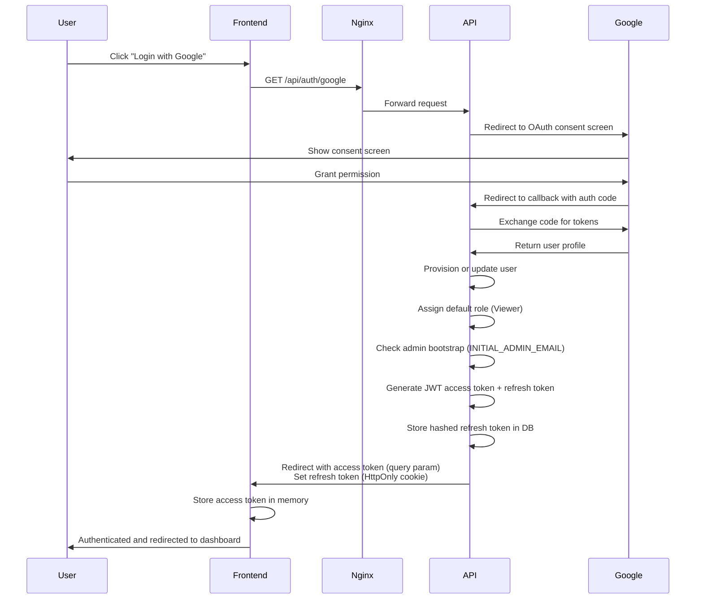
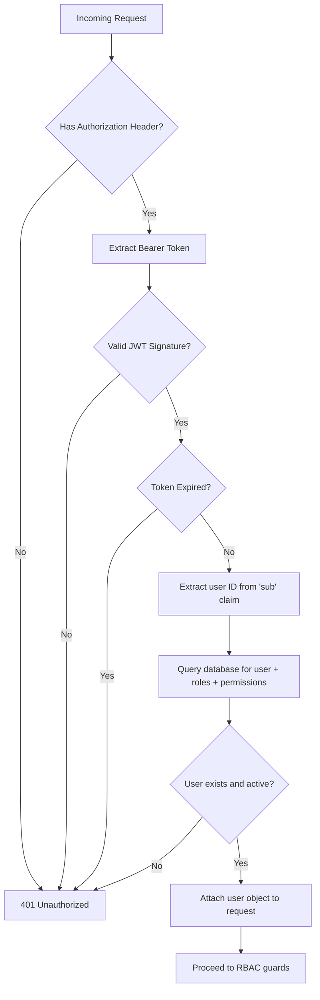
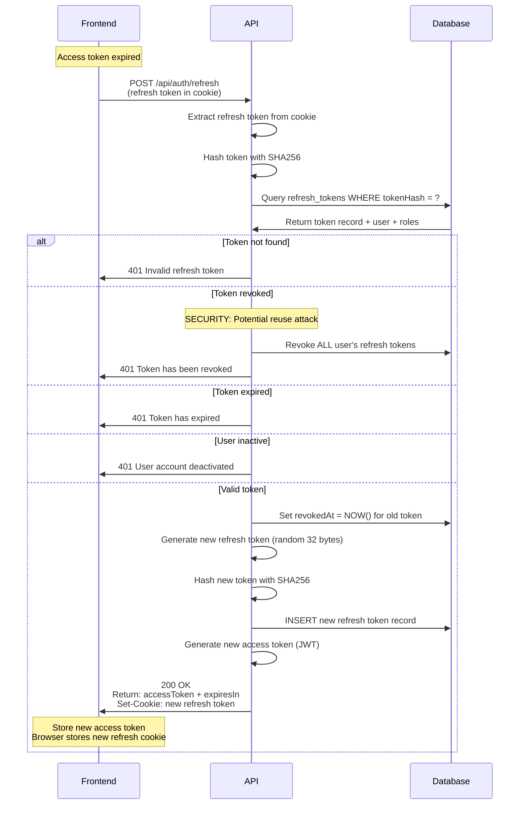
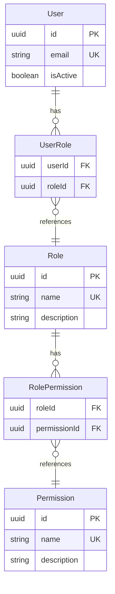
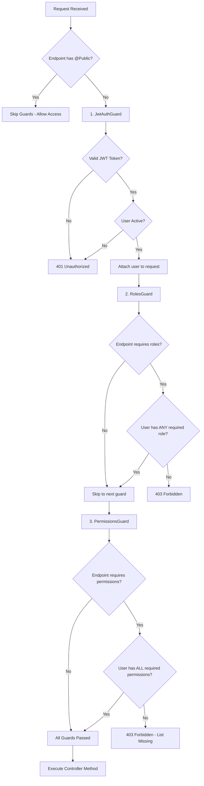
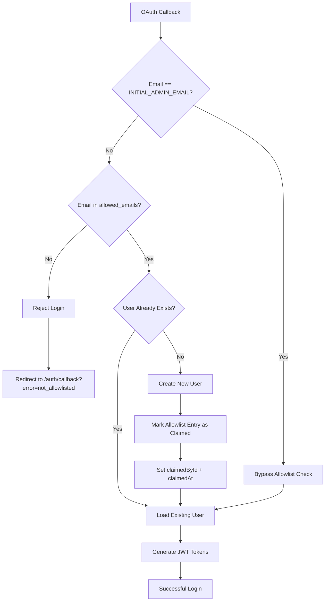
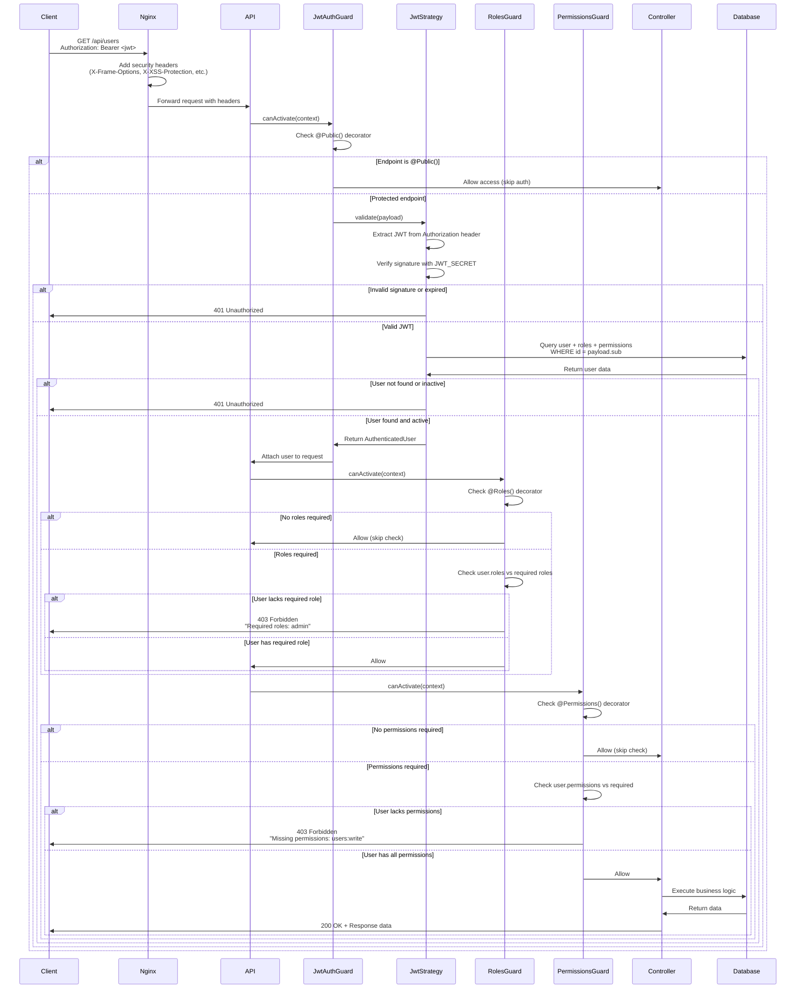
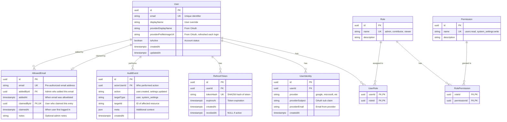

# Security Architecture

## Executive Summary

This document provides a comprehensive overview of the security architecture for this web application foundation. The system implements defense-in-depth security through multiple layers: OAuth 2.0 authentication with Google, JWT-based session management with token rotation, email allowlist access control, Role-Based Access Control (RBAC), and comprehensive audit logging.

> **Who owns what.** Sign-in, sessions, refresh-token rotation, personal access tokens, the device flow, users, roles and the allowlist are implemented by the platform identity slice (`IdentityModule.forRoot`, from the platform's identity package), which the app mounts in `apps/api/src/platform/identity/` in single-organization mode. The app has no `auth`, `users`, `allowlist`, `pat`, `device-auth` or `test-auth` module of its own. The design below describes the behaviour of that slice as this app runs it; the code is in the package, and the app's own pieces are the host-port bindings, the org-scoped domain permissions (`apps/api/src/app-registrations/permissions.ts`) and the allowlist reminder routes (`apps/api/src/allowlist-reminders/`). A missing `JWT_SECRET` is a boot error.

**Key Security Technologies:**
- **Authentication**: OAuth 2.0 / OpenID Connect (Google)
- **Access Control**: Email allowlist restricts access to pre-authorized users
- **Session Management**: JWT access tokens + HttpOnly refresh tokens with rotation
- **Authorization**: Role-Based Access Control (RBAC) with one system role (`admin`) and three organization roles (`org_admin`, `contributor`, `viewer`)
- **Token Storage**: SHA256 hashed refresh tokens in PostgreSQL
- **Infrastructure**: Nginx reverse proxy with security headers
- **Audit**: Comprehensive event logging for all security-relevant actions

**Security Posture**: Production-grade security suitable for enterprise applications handling sensitive user data.

---

## 1. Authentication Architecture

### OAuth 2.0 Flow with Google

The application uses OAuth 2.0 with OpenID Connect for authentication. All user authentication flows through Google's OAuth service, eliminating the need to store or manage passwords.



**OAuth Endpoints:**
- `GET /api/auth/google` - Initiates OAuth flow, redirects to Google
- `GET /api/auth/google/callback` - Handles OAuth callback, provisions user, returns tokens

**User Provisioning Logic:**
1. **Allowlist check**: Verify email is in `allowed_emails` table (or matches `INITIAL_ADMIN_EMAIL`)
2. If not in allowlist, reject login with "Email not authorized" error
3. Check if user identity exists (provider + subject)
4. If not, check if user exists by email (identity linking)
5. If neither, create new user with:
   - Default role: `viewer`
   - Default user settings (theme, locale)
   - Linked OAuth identity
   - Mark allowlist entry as claimed (`claimedById`, `claimedAt`)
6. Check if user email matches `INITIAL_ADMIN_EMAIL`
7. If match and no other admins exist, grant admin role
8. Update provider profile information (display name, profile image)
9. Generate JWT tokens

**Allowlist Security:**
- Only admins can add/remove emails from the allowlist
- The `INITIAL_ADMIN_EMAIL` bypasses allowlist check (bootstrap access)
- Allowlist entries that have been claimed cannot be removed (prevents accidentally removing existing user access)
- All allowlist operations are audit logged

### JWT Token Structure

**Access Token Payload:**
```json
{
  "sub": "user-uuid",
  "email": "user@example.com",
  "roles": ["viewer"],
  "iat": 1706123456,
  "exp": 1706124356
}
```

**Token Signing:**
- Algorithm: HS256 (HMAC with SHA-256)
- Secret: `JWT_SECRET` environment variable (minimum 32 characters)
- Signature validates token integrity and authenticity

**Token Validation Process:**


**Access Token Validation (JWT Strategy):**
- Verify signature using `JWT_SECRET`
- Check expiration (`exp` claim)
- Extract user ID from `sub` claim
- Load user from database with roles and permissions
- Validate user is active (`isActive = true`)
- Attach full user object to request for downstream guards

---

## 2. Token Management

### Access Tokens vs Refresh Tokens

| Aspect | Access Token | Refresh Token |
|--------|--------------|---------------|
| **Type** | JWT (signed JSON) | Random 32-byte hex string |
| **Storage (Client)** | Memory only (never localStorage) | HttpOnly cookie |
| **Storage (Server)** | None (stateless) | SHA256 hash in `refresh_tokens` table |
| **Lifetime** | 15 minutes (default) | 14 days (default) |
| **Purpose** | Authorize API requests | Obtain new access tokens |
| **Exposed to JS** | Yes (needed for Authorization header) | No (HttpOnly prevents access) |
| **Revocable** | No (stateless, valid until expiry) | Yes (database record can be revoked) |
| **Rotation** | New token on each refresh | New token on each refresh (old one revoked) |
| **Attack Surface** | XSS (if stored in localStorage) | CSRF (mitigated by SameSite) |

**Why This Design:**
- **Short-lived access tokens** minimize damage from token theft (15 min window)
- **HttpOnly cookies** protect refresh tokens from XSS attacks
- **Token rotation** limits refresh token reuse and enables reuse detection
- **Database storage** allows server-side revocation (logout, security breach)

### Token Rotation Mechanism

Refresh tokens are rotated on every use to detect token theft and limit the impact of compromised tokens.



**Rotation Benefits:**
1. **Reuse Detection**: If a revoked token is used, all tokens are invalidated (indicates theft)
2. **Limit Exposure**: Each token is single-use, limiting replay attack window
3. **Audit Trail**: Each refresh creates a database record for security monitoring

### Token Reuse Detection

The system implements refresh token reuse detection to identify potential token theft:

**Attack Scenario:**
1. Attacker steals refresh token from victim
2. Victim uses token normally (rotates to new token)
3. Attacker attempts to use old (revoked) token

**Detection & Response:**
```typescript
// Check if token is revoked
if (storedToken.revokedAt) {
  // SECURITY ALERT: Revoked token used - likely token theft
  await this.revokeAllUserTokens(storedToken.userId);
  logger.warn(`Refresh token reuse detected for user: ${userId}`);
  throw new UnauthorizedException('Refresh token has been revoked');
}
```

When a revoked token is used, the system:
1. **Revokes all refresh tokens** for that user across all devices
2. **Logs a security warning** for monitoring and alerting
3. **Forces re-authentication** on all sessions

This aggressive response ensures that if a token is stolen, the attacker's window is minimized and legitimate users are forced to re-authenticate.

### Cookie Security Settings

Refresh tokens are stored in HttpOnly cookies with strict security settings:

```typescript
const COOKIE_OPTIONS = {
  httpOnly: true,                          // Prevents JavaScript access
  secure: process.env.NODE_ENV === 'production', // HTTPS only in production
  sameSite: 'lax' as const,               // CSRF protection
  path: '/api/auth',                      // Limit scope to auth endpoints
  maxAge: 14 * 24 * 60 * 60 * 1000,      // 14 days in milliseconds
};
```

| Setting | Value | Purpose |
|---------|-------|---------|
| `httpOnly` | `true` | Prevents XSS attacks - JavaScript cannot read cookie |
| `secure` | `true` (prod) | Requires HTTPS - prevents MITM attacks |
| `sameSite` | `lax` | CSRF protection - blocks cross-site POST requests |
| `path` | `/api/auth` | Minimizes cookie scope - only sent to auth endpoints |
| `maxAge` | 14 days | Auto-expires after 14 days |

**SameSite Policy Explanation:**
- `lax`: Cookie sent on same-site requests and top-level navigation (safe GET)
- Blocks cookie on cross-site POST/PUT/DELETE (prevents CSRF on token refresh)
- Allows OAuth redirect callbacks (same-site navigation)

### Token Cleanup Task

Expired and revoked refresh tokens, and expired or long-revoked personal access tokens, are cleaned up by the `auth.token.cleanup` queue job:

- The platform's cron only **enqueues** the job; the handler runs through the app's job queue (registered by `apps/api/src/platform/identity/identity-jobs.adapter.ts`, which keeps the app's original type string so job history survives). A cron that worked inline would violate the queue rule in `AGENTS.md`.
- The job is **server-only**: it deletes credential rows, a privilege a worker node must never hold, so it declares no node-result members.
- It deletes refresh tokens that are expired or revoked, and personal access tokens that are expired or were revoked more than 30 days ago.
- The device-code counterpart is `device-auth.code.cleanup`, with the same shape.

---

## 3. Authorization & RBAC

### Roles and Permissions Model

The system implements a Role-Based Access Control (RBAC) model with two scopes of role. `admin` is a **system** role, held in `user_roles`. `org_admin`, `contributor` and `viewer` are **organization** roles, held on the user's membership of the (single, default) organization (`memberships.role_id`); platform migration `0024_split_system_org_roles` moved `contributor` and `viewer` there from `user_roles`. A user's effective permissions are the union of the permissions of their system roles and of the role on their active membership.



### Permissions Matrix

| Permission | Description | Admin | Contributor | Viewer |
|------------|-------------|-------|-------------|--------|
| `system_settings:read` | View system-wide settings | ✅ | ❌ | ❌ |
| `system_settings:write` | Modify system-wide settings | ✅ | ❌ | ❌ |
| `users:read` | View user list and details | ✅ | ❌ | ❌ |
| `users:write` | Modify user accounts (activate/deactivate, assign roles) | ✅ | ❌ | ❌ |
| `rbac:manage` | Assign roles to users | ✅ | ❌ | ❌ |
| `allowlist:read` | View allowlisted email addresses | ✅ | ❌ | ❌ |
| `allowlist:write` | Add/remove emails from allowlist | ✅ | ❌ | ❌ |
| `user_settings:read` | View own user settings (org-scoped) | ✅ (via `org_admin`) | ✅ | ✅ |
| `user_settings:write` | Modify own user settings (org-scoped) | ✅ (via `org_admin`) | ✅ | ✅ |
| `transcripts:read/write` | Transcripts (org-scoped) | ✅ (via `org_admin`) | ✅ | ✅ |
| `notes:read/write` | Notes (org-scoped) | ✅ (via `org_admin`) | ✅ | ✅ |
| `note_templates:read/write` | Note templates (org-scoped) | ✅ (via `org_admin`) | ✅ | ✅ |
| `graph:read/write` | Connected-knowledge graph (org-scoped) | ✅ (via `org_admin`) | ✅ | ✅ |

The matrix is abridged; the full catalog with each permission's scope and each role's grants is `apps/api/prisma/catalog/permissions.json`. The **Admin** column is the system role plus the `org_admin` membership every admin holds: the system role `admin` itself carries only the system-scoped permissions, and reaches the org-scoped rows (including all eight domain permissions) through `org_admin`. There is deliberately no `*:read_any` for transcripts, notes or the graph, for any role.

**Role Descriptions:**
- **Admin** (system): operate the deployment - manage users, roles, and all system settings
- **Org admin** (org): everything a contributor can do, plus manage the organization's members and invites
- **Contributor** (org): standard user capabilities - manage own settings (ready for future feature expansion)
- **Viewer**: Read-only access - minimal privileges, manage own settings (default role for new users)

**Default Role Assignment:**
- New users are assigned the `viewer` role automatically
- First user matching `INITIAL_ADMIN_EMAIL` receives `admin` role (bootstrap)
- Roles are assigned by admins via `PUT /api/users/{id}/roles` (`rbac:manage`): `admin` sets the system role and `org_admin` on the default-organization membership, `contributor` or `viewer` set the membership role. `GET /api/roles` lists the roles and which are assignable

### Guard Execution Flow

The authorization system uses three guards that execute in sequence:



**Guard Logic:**

1. **JwtAuthGuard** (applied per route by `@Auth()`; there is **no global JWT guard**)
   - A route carries `@Auth(...)` or `@Public()`; the `identity` conformance suite fails on a route with neither
   - `@Public()` skips all auth
   - Validates JWT token from `Authorization: Bearer <token>` header
   - Loads the user and builds the principal: system roles from `user_roles`, the org role from the active membership, and the permissions of both
   - Verifies user is active
   - Attaches `AuthenticatedUser` object to `request.user`

2. **RolesGuard** (OR Logic)
   - Checks for `@Roles()` decorator - if absent, allow access
   - Extracts required roles from decorator metadata
   - Checks if user has **ANY** of the required roles
   - Returns 403 if user lacks all required roles
   - Example: `@Roles('admin', 'contributor')` - user needs admin OR contributor

3. **PermissionsGuard** (AND Logic)
   - Checks for `@Permissions()` decorator - if absent, allow access
   - Extracts required permissions from decorator metadata
   - Checks if user has **ALL** required permissions
   - Returns 403 with list of missing permissions if check fails
   - Example: `@Permissions('users:read', 'users:write')` - user needs BOTH

**Why OR for Roles but AND for Permissions?**
- **Roles** are broad categories - "any admin or contributor can access"
- **Permissions** are specific capabilities - "needs both read AND write"
- This provides flexibility: `@Auth({ roles: ['admin'], permissions: ['system_settings:write'] })`

### Using Authorization Decorators

**Combined `@Auth()` Decorator (Recommended):**
```typescript
// Auth, CurrentUser and RequestUser come from the platform identity package
import { Auth, CurrentUser, type RequestUser } from '<platform identity package>';
import { ROLES, PERMISSIONS } from './common/constants/roles.constants';

// Just authentication, no role/permission requirements
@Auth()
@Get('profile')
async getProfile(@CurrentUser() user: RequestUser) { }

// Require the system admin role (a deployment operator; an org role never satisfies it)
@Auth({ roles: [ROLES.ADMIN] })
@Get('users')
async listUsers() { }

// Require specific permissions
@Auth({ permissions: [PERMISSIONS.SYSTEM_SETTINGS_WRITE] })
@Patch('system-settings')
async updateSystemSettings() { }

// Combine roles and permissions
@Auth({
  roles: [ROLES.ADMIN],
  permissions: [PERMISSIONS.USERS_WRITE]
})
@Patch('users/:id')
async updateUser() { }
```

**Individual Decorators:**
```typescript
import { UseGuards } from '@nestjs/common';
import { JwtAuthGuard, RolesGuard, Roles } from '<platform identity package>';

@UseGuards(JwtAuthGuard, RolesGuard)
@Roles('admin', 'contributor')
@Get('dashboard')
async getDashboard() { }
```

**Public Endpoints:**
```typescript
import { Public } from '<platform identity package>';

@Public()
@Get('auth/providers')
async getProviders() {
  // No authentication required
}
```

---

## 4. Email Allowlist Access Control

### Overview

The application implements an **email allowlist** as an additional security layer to restrict access to pre-authorized users only. This feature prevents unauthorized users from gaining access even if they successfully authenticate via OAuth.

**Security Benefits:**
- Prevents open registration - only invited users can access the application
- Provides administrative control over who can login
- Tracks when allowlist entries are claimed (first login)
- Prevents accidental removal of access for existing users

### Allowlist Enforcement Flow



### Allowlist Table Schema

```typescript
model AllowedEmail {
  id          String    @id @default(uuid())
  email       String    @unique              // Pre-authorized email
  addedById   String?                        // Admin who added this
  addedAt     DateTime  @default(now())      // When it was allowlisted
  claimedById String?   @unique              // User who claimed it
  claimedAt   DateTime?                      // When user first logged in
  notes       String?                        // Optional admin notes
}
```

**Key Fields:**
- `email` - Unique constraint ensures no duplicates
- `claimedById` - Unique constraint (one user per allowlist entry)
- `claimedAt` - Null = pending, populated = claimed

### Status Types

| Status | Description | claimedById | claimedAt |
|--------|-------------|-------------|-----------|
| **Pending** | Email added but user hasn't logged in yet | `null` | `null` |
| **Claimed** | User has successfully logged in | User ID | Timestamp |

### Admin Operations

#### Add Email to Allowlist

**Endpoint:** `POST /api/allowlist`

**Permission Required:** `allowlist:write` (Admin only)

**Request:**
```json
{
  "email": "newuser@example.com",
  "notes": "New team member starting next week"
}
```

**Business Logic:**
1. Validate email format
2. Check for duplicates (return 409 if exists)
3. Create allowlist entry with `addedById` = current admin
4. Audit log the addition

**Use Case:** Admins pre-authorize users before they attempt their first login.

---

#### Remove Email from Allowlist

**Endpoint:** `DELETE /api/allowlist/:id`

**Permission Required:** `allowlist:write` (Admin only)

**Validation:**
- ✅ Can remove if `claimedById` is `null` (pending entry)
- ❌ Cannot remove if `claimedById` is populated (claimed entry)

**Rationale:** Prevents admins from accidentally removing access for existing users. To revoke access for existing users, use the user deactivation feature instead (`PATCH /api/users/:id` with `isActive: false`).

**Business Logic:**
1. Check if entry is claimed
2. If claimed, return 400 Bad Request with error message
3. If pending, delete entry
4. Audit log the removal

---

#### List Allowlist Entries

**Endpoint:** `GET /api/allowlist`

**Permission Required:** `allowlist:read` (Admin only)

**Query Parameters:**
- `status` - Filter by: `all`, `pending`, `claimed`
- `search` - Search by email
- `sortBy` - Sort by: `email`, `addedAt`, `claimedAt`
- `sortOrder` - Order: `asc`, `desc`

**Response Includes:**
- Email address
- Status (pending/claimed)
- Admin who added it
- When it was added
- User who claimed it (if claimed)
- When it was claimed (if claimed)
- Optional notes

### Bootstrap Admin Bypass

The `INITIAL_ADMIN_EMAIL` environment variable provides a special bypass to enable the first admin to login without being pre-added to the allowlist.

**Bootstrap Logic:**
```typescript
async validateOAuthUser(profile: OAuthProfile) {
  const email = profile.email;

  // Special case: initial admin bypasses allowlist
  if (email === process.env.INITIAL_ADMIN_EMAIL) {
    // Allow login without allowlist check
    return this.provisionUser(profile);
  }

  // Check allowlist for all other users
  const allowlistEntry = await this.allowlistService.findByEmail(email);
  if (!allowlistEntry) {
    throw new UnauthorizedException('Email not authorized');
  }

  return this.provisionUser(profile);
}
```

**Why This is Secure:**
- The admin must have access to the `.env` file (server access)
- Only one email bypasses the check
- After initial admin logs in, they can add other users to the allowlist
- The initial admin email is automatically added to the allowlist during database seeding

### Integration with User Provisioning

When a user with a allowlisted email successfully authenticates:

1. **Check allowlist** before user provisioning
2. **Create user** if they don't exist
3. **Mark entry as claimed** by setting:
   - `claimedById` = new user's ID
   - `claimedAt` = current timestamp
4. **Update is idempotent** - if user logs in again, allowlist entry remains claimed

### Audit Trail

All allowlist operations are logged to the `audit_events` table:

| Action | Actor | Target | Description |
|--------|-------|--------|-------------|
| `allowlist.added` | Admin User ID | Allowlist Entry ID | Admin added email to allowlist |
| `allowlist.removed` | Admin User ID | Allowlist Entry ID | Admin removed pending entry |
| `allowlist.claimed` | User ID | Allowlist Entry ID | User claimed allowlist entry on first login |
| `allowlist.reminder_sent` | Admin User ID | Allowlist Entry ID | Admin re-sent an invitation (app-owned route, written through the platform audit sink) |

### Invitation Reminders (app-owned)

`POST /api/allowlist/{id}/reminder` (`allowlist:write`) re-emails an unclaimed invitee, and `GET /api/allowlist/reminders?ids=` (`allowlist:read`) reports the counts. The platform has no seam for them, so the app owns the routes (`apps/api/src/allowlist-reminders/`) and keeps the state in the side table `kvox_allowlist_reminders` (no foreign key to `allowed_emails`; orphans are deleted on read). Security properties:

- Both routes are `@Auth({ permissions })`-gated; an unauthenticated call is 401 and a missing permission is 403.
- A missing entry is 404 and a claimed entry is 409 (`details.reason: 'already_claimed'`): nothing is sent to an address that already has an account.
- Manual only: an administrator presses the button. There is no scheduler, so no automated mail loop exists to abuse.
- The `allowlist.invitation_reminder` notification is fired **after** the count write commits, outside any transaction, and the count means "requested", not "delivered".

### Security Considerations

**Protection Against:**
- ✅ Unauthorized access - Only allowlisted emails can login
- ✅ Open registration - No public signup, invitation-only
- ✅ Accidental removal - Cannot delete claimed entries

**Edge Cases Handled:**
- Email case-insensitivity (normalized to lowercase)
- Duplicate email prevention (unique constraint)
- Race condition on claim (unique constraint on claimedById)
- Orphaned allowlist entries (admin can clean up pending entries)

**Best Practices:**
- Add users to allowlist before sharing OAuth link
- Use notes field to track why user was allowlisted
- Regularly audit claimed vs pending entries
- Use user deactivation (`isActive: false`) instead of allowlist removal for revoking access

---

## 5. Request Lifecycle

### End-to-End Protected Request Flow

This diagram shows the complete security lifecycle of a protected API request:



**Security Checkpoints:**
1. **Nginx Layer**: Security headers, rate limiting (if configured)
2. **JWT Validation**: Signature, expiration, user exists and active
3. **Role Check**: User has required role (if specified)
4. **Permission Check**: User has all required permissions (if specified)
5. **Business Logic**: Controller executes with verified user context

**Request Object After Guards:**
```typescript
interface FastifyRequest {
  user: AuthenticatedUser;  // Full user object with relations
  requestUser: RequestUser; // Simplified user object
}

interface AuthenticatedUser {
  id: string;
  email: string;
  isActive: boolean;
  userRoles: Array<{
    role: {
      name: string;
      rolePermissions: Array<{
        permission: { name: string; }
      }>;
    };
  }>;
}

interface RequestUser {
  id: string;
  email: string;
  roles: string[];        // ['admin', 'viewer']
  permissions: string[];  // ['users:read', 'users:write', ...]
}
```

---

### Global Host Pipeline (platform host core)

Since issue #464 (epic #462) the cross-cutting request pipeline is the platform host core's (`PlatformHostCoreModule.forRoot`, `apps/api/src/platform/host-core.config.ts`), not app code. The app registers no `APP_GUARD`, `APP_FILTER` or `APP_INTERCEPTOR` of its own for these concerns, and the `host` conformance suite fails the build if an undeclared global guard appears.

| Stage | Behaviour | Security relevance |
|-------|-----------|--------------------|
| Request-id middleware | Every request gets an id (the incoming `x-request-id`, else a generated UUID), echoed in the `x-request-id` and `x-trace-id` response headers and carried into log lines and spans | Correlation across proxy, API and logs; clients cannot forge a trace relationship that the server trusts |
| `MaintenanceGuard` (the only `APP_GUARD`) | While a maintenance window is open, answers `503` with a stable marker and `Retry-After` to every route not marked `@AllowDuringMaintenance()`; an `admin` bypass applies only when `allowAdmins` is true, and `pat_` and `nod_` bearers never receive it. It decides from the token without populating `request.user` | Runs before any per-route guard, and cannot depend on the database being readable; design in [`specs/maintenance-mode.md`](specs/maintenance-mode.md) |
| Response interceptor | Wraps successful JSON in `{ data, meta }`; the request logger records method, URL and duration, never a body | Bodies and credentials are not logged. A `304` skips the envelope through `platform/http/not-modified.interceptor.ts` (a tracked shim) |
| `HttpExceptionFilter` | Rebuilds every error body from a fixed key set (`statusCode`, `code`, `message`, `details`, `timestamp`, `path`); a non-HTTP error is reported by its own message, with the stack in `details` outside production only; a registered error `code` is kept, a Zod error adds `details.issues` (path and message, never the submitted value) and a `429` adds `Retry-After` | A stray top-level field on a thrown payload cannot reach a client |

The authentication guards remain per route (`@Auth(...)` or `@Public()`), applied after this pipeline. `/api/docs` and `/api/openapi.json` are mounted outside Nest's router, so no guard sees them; this is deliberate (an operator wants the API reference during a maintenance window) and they expose the contract, never data.

The platform Doctor (`GET /api/admin/doctor`, `system_settings:read`) is the read-only configuration check. It reports `db.rls_role` as `pass` when the application connects as an ordinary `NOSUPERUSER NOBYPASSRLS` role (since #471; see "Tenant isolation (RLS)" in section 6) and as `fail` for a deployment that still connects as a superuser; see [`ARCHITECTURE.md`](ARCHITECTURE.md#78-platform-host-core-about-and-doctor). The support bundle passes every section through a central redaction pass before download.

---

## 6. Database Security Model

### Security Tables ERD



**Table Descriptions:**

| Table | Purpose | Security Features |
|-------|---------|-------------------|
| `users` | Core user accounts | `isActive` flag for soft deletion, prevents auth |
| `user_identities` | OAuth provider links | `provider + providerSubject` unique constraint |
| `roles` | Role definitions | Seeded at deployment, rarely modified |
| `permissions` | Permission definitions | Seeded at deployment, rarely modified |
| `role_permissions` | Role-to-permission mapping | Defines RBAC matrix |
| `user_roles` | User role assignments | Modified by admins via API, cascade delete |
| `refresh_tokens` | Active refresh tokens | SHA256 hashed, includes revocation timestamp |
| `allowed_emails` | Email allowlist | Restricts access, tracks claim status, prevents removal if claimed |
| `audit_events` | Security audit log | Immutable log of all security events |

### Tenant isolation (RLS)

**What is enforced.** Platform migration `0025_org_scoped_rls` forces row-level
security (`FORCE ROW LEVEL SECURITY`) on `storage_objects`,
`storage_object_chunks`, `ai_runs` and `ai_usage_events`; `0026` to `0029` do the
same for the group, grant and organization-settings tables. A policy admits a row
only when the session's `app.org_id` equals the row's `org_id`, or when the
session carries the system flag `app.rls_bypass = on`. With neither, a query
returns **zero rows**: it does not fail. Every KVox read of `storage_objects`
therefore goes through `runInOrg` (or the job's `JobScope`) in
`KvoxManagedObjects` (#469), and a tripwire spec fails when any other file
touches `prisma.storageObject`.

**The application role.** None of this works for a superuser or a `BYPASSRLS`
role: both skip every policy, `FORCE` included. The API therefore connects as an
ordinary role, `APP_DB_USER` (default `kvox_app`):

| Attribute | Value | Why |
|---|---|---|
| `NOSUPERUSER`, `NOBYPASSRLS` | required | so the policies apply to the API |
| owner of the database and every table | required | `FORCE ROW LEVEL SECURITY` is what applies the policies to an owner |
| `CREATEDB` | granted | restore creates, renames and drops databases |
| `CREATEROLE` | granted | the node-offload broker mints per-job roles (`guided` where a managed PostgreSQL denies it) |

The role is never granted `SUPERUSER` or `BYPASSRLS`, not to make a backup, a
restore or a migration work. The bootstrap login (`postgres`) is a superuser
and is used for administration only: it creates the role, creates the
`vector` and `pg_trgm` extensions (an ordinary role cannot create `vector`),
and runs the one-time ownership transfer on an existing database. A fresh volume
does this with `infra/compose/postgres-init/10-application-role.sh` (the
platform's script, byte for byte) and `20-kvox-extensions.sh`; an existing
deployment follows [`runbooks/application-role.md`](runbooks/application-role.md).

**`kvox_object_ownership`** has no row-level security of its own: it is protected
by its composite foreign key `(object_id, org_id)` into `storage_objects`
(unchanged from #469).

**Backups see every organization, safely.** A dump and a restore lift row-level
security for their own session only, with **both** `--enable-row-security` and
`PGOPTIONS=-c app.rls_bypass=on` (in the environment, never argv), over a direct
connection. The role itself never bypasses. See
[`specs/database-backup.md`](specs/database-backup.md) section 17.

**Verification.**

- Doctor `db.rls_role` (platform check, `GET /api/admin/doctor`) passes when the
  connecting role is `rolsuper = false AND rolbypassrls = false`; it fails for
  `postgres`. Do not loosen the check.
- Doctor `backup.rls-bypass` compares row counts of the four org tables over the
  system client and over a connection carrying the dump's startup option, to
  catch the day one half of the pair is lost.
- `apps/api/test/rls/storage-isolation.db.spec.ts` runs as the application role:
  with `app.org_id` unset `SELECT count(*) FROM storage_objects` returns 0, inside
  `runInOrg(defaultOrg)` it returns the real count, and a `KvoxManagedObjects`
  read works. `apps/api/test/db-backup/kvox-dump-rls.db.spec.ts` proves a dump
  taken as that role contains `storage_objects` and `kvox_object_ownership` rows.

**Rollback.** Set `POSTGRES_USER`/`POSTGRES_PASSWORD` back to `postgres` and
restart. Ownership can stay: a superuser ignores it. Row-level security is then
inert again and the Doctor reports it.

### Audit Logging

The `audit_events` table provides a comprehensive audit trail for compliance and security monitoring.

**Audited Events:**
- User account creation
- User role assignments/changes
- User activation/deactivation
- System settings modifications
- User settings modifications
- Allowlist email additions/removals
- Allowlist entry claims (when user first logs in)
- Authentication events (login, logout, token refresh)

**Audit Event Structure:**
```typescript
interface AuditEvent {
  id: string;
  actorUserId: string | null;  // null for system actions
  action: string;               // e.g., 'user.role_assigned'
  targetType: string;           // e.g., 'user', 'system_settings'
  targetId: string;             // ID of affected resource
  meta: Record<string, any>;    // Additional context (changes, IP, etc.)
  createdAt: Date;
}
```

**Example Audit Entries:**
```json
[
  {
    "action": "user.created",
    "actorUserId": null,
    "targetType": "user",
    "targetId": "uuid-123",
    "meta": {
      "email": "user@example.com",
      "provider": "google",
      "initialRole": "viewer"
    }
  },
  {
    "action": "user.role_assigned",
    "actorUserId": "admin-uuid",
    "targetType": "user",
    "targetId": "user-uuid",
    "meta": {
      "role": "admin",
      "previousRoles": ["viewer"]
    }
  }
]
```

**Indexed Fields** (for query performance):
- `actorUserId` - Find all actions by a user
- `targetType + targetId` - Find all events for a resource
- `createdAt` - Time-based queries and retention policies

---

## 7. File Storage Security

The storage system implements multiple layers of security to protect uploaded files and prevent unauthorized access.

### Upload Validation

All file uploads are validated before acceptance:

**MIME Type Validation:**
- Configurable allowlist of permitted file types
- Default: Common document and image formats
- Server-side validation (client-declared MIME type verified)
- Prevents upload of executable files and scripts

**File Size Limits:**
- Configurable maximum file size (default: 10GB)
- Enforced at both simple upload and multipart initialization
- Prevents storage abuse and DoS attacks
- Size validation before S3 upload begins

**Content Type Verification:**
- Validates that file content matches declared MIME type
- Uses magic number detection for common file types
- Prevents MIME type spoofing attacks

**Example Configuration (environment):**
```
MAX_FILE_SIZE=10737418240                           # 10GB in bytes; 413 above it
ALLOWED_MIME_TYPES=image/*,application/pdf,video/*,audio/*   # 415 outside it
STORAGE_PART_SIZE=10485760                          # 10MB parts; part size x 10,000 caps one object
```

The bucket, region, endpoint and access keys are **not** environment variables: they are runtime configuration, described under "Storage Configuration and Credentials" below.

### Access Control

The storage system enforces strict ownership and permission-based access:

**Owner-Only Access (Default):**
- Users can only access their own uploaded files
- Object queries filtered by `owner_id = current_user.id`
- Download URLs only generated for owned objects
- Delete operations restricted to owner

**Admin Override:**
- Users with `storage:delete_any` permission can access all objects
- Useful for moderation and content management
- All admin operations logged to audit trail

**Managed objects.** Objects another module owns (a transcript's source audio and exports, a note's source document and exports, a graph export or import) are recorded in the `kvox_object_ownership` table. They are uploaded in the owner's name, so they stay readable, downloadable and renamable by that owner, but two rules protect the owning record: the application's own list (`GET /api/kvox/files`) excludes them, and the generic `DELETE /api/storage/objects/:id` answers `409 { details: { reason: 'managed_by_module', module } }` before the platform handler runs, because the owner's table points at the object with a `Restrict` foreign key and deleting it would orphan the record. The veto is a Fastify `onRequest` hook (`apps/api/src/kvox-objects/managed-delete.hook.ts`) that reads one ownership row, makes no call to the provider, **passes an unauthenticated request on so the platform answers 401** (it never tells an anonymous caller which ids are managed), and **fails closed**: if the ownership read fails, the delete is refused with 503. The platform's `GET /api/storage/objects` still lists managed objects for a caller who hits it directly; that discloses only the caller's **own** objects and is accepted. Every KVox read or write of `storage_objects` runs inside an organization-scoped transaction (`runInOrg`), and the part-signing and part-listing routes answer **404, never 403**, for another user's upload.

**Permission Model:**
| Permission | Description | Granted To |
|------------|-------------|------------|
| `storage_config:read` / `storage_config:write` | View / change the object-storage configuration, test it and provision a bucket (platform permissions, system scope) | Admin only |
| `storage:read` | View own storage objects | All authenticated users |
| `storage:write` | Upload and update own objects | All authenticated users |
| `storage:delete` | Delete own storage objects | All authenticated users |
| `storage:read_any` | View all storage objects | Admin |
| `storage:write_any` | Update any storage object | Admin |
| `storage:delete_any` | Delete any storage object | Admin |

**Ownership Validation Example:**
```typescript
// Controller method enforces ownership
async getObject(objectId: string, userId: string) {
  const object = await this.objectsService.findById(objectId);

  // Check ownership (or admin permission)
  if (object.ownerId !== userId && !user.hasPermission('storage:read_any')) {
    throw new ForbiddenException('Access denied');
  }

  return object;
}
```

### Storage Configuration and Credentials

Where objects are stored is runtime configuration, edited at `/admin/settings/storage` by an administrator (`storage_config:write`, admin only, deliberately distinct from `storage:*` and `system_settings:*`):

- **Non-secret fields** (provider, bucket, region, endpoint, access key id, path-style flag) live in the `storage` system-settings namespace. The namespace holds no secret by construction.
- **The secret access key** lives in the encrypted credential store (`credentials`, purpose `storage`, name `default`), under the purpose-bound AES-256-GCM sub-key of section 14. The configuration endpoint **never returns it**: it reports only whether one is stored, and a blank value on save means "keep the stored key". Every error string that leaves the connection test passes through a redaction step, because most are authored by the AWS SDK.
- **Test and provisioning** (`POST /api/admin/storage-config/test` and `/bucket`) write one throwaway object under `storage-config-test/` and delete it; both write an audit event (`storage_config:test`, `storage_config:provision_bucket`) carrying the verdict only, never a detail or an error string. Saving writes `storage_config:replace`.
- **A relocation is gated.** Saving a different bucket, endpoint or provider while `storage_objects` or `database_backup_runs` rows still point at the old location is refused with 409 until the request carries the typed confirmation, because the application does not copy anything.
- **Until a configuration is saved** every route that needs the store answers 503 with the missing field names and the page to fix it; nothing falls back to environment credentials. The old `STORAGE_PROVIDER`, `S3_*` and `AWS_*` variables are not read, so a stale `.env` cannot silently override the saved configuration. (Since #470 Amazon SES email reads no environment credentials either: its access key ID is saved in the `email` settings row and its secret in the credential store (`email_ses`) at `/admin/settings/email`; `S3_REGION` is only a default region.)
- **The bucket's browser-facing origin** is the one storage value that stays in the environment (`STORAGE_CSP_ORIGIN`): nginx writes it into the Content Security Policy's `connect-src` and `media-src`, never a wildcard, and it must be set by hand. See [`runbooks/storage-configuration.md`](runbooks/storage-configuration.md) and [`runbooks/s3-cors.md`](runbooks/s3-cors.md).
- **Part size is a deployment-wide rule.** Parts are laid out at one `STORAGE_PART_SIZE`; changing it while uploads are in flight corrupts the objects they complete. This is an operator rule, not a control the application enforces.
- **Least privilege for the credential**: `s3:PutObject`, `s3:GetObject`, `s3:DeleteObject`, `s3:AbortMultipartUpload`, `s3:ListMultipartUploadParts` and `s3:ListBucket` on the one bucket; the bucket-provisioning permissions only for the window in which Create bucket is used. `s3:ListMultipartUploadParts` backs `GET /api/storage/objects/:id/upload/parts`, which exists so a browser never has to read a part's `ETag`; the route's errors map to a 502 with no provider text, and it never logs a key or a secret.

### Profile Picture Avatar Routes

> The routes in this section are served by the platform's `ProfileImageModule` (`@marinoscar/platform-api/storage`, mounted in `apps/api/src/platform/storage/storage.config.ts`); the application holds no avatar code. The properties described below are the platform's.

Uploaded profile pictures are avatar images stored in the same object storage as
other files, but they are exposed through two purpose-built routes rather than
the generic storage-object endpoints above, and the split between them is a
deliberate security boundary.

The **public** route, `GET /api/users/:userId/avatar/:objectId`, accepts no
bearer token — a plain `` cannot send one, so it never gets the
chance to. Because it is reachable by anyone, it is deliberately narrow: it
serves the requested object only while it is *exactly* that user's
currently-selected uploaded avatar (`profile.imageSource === "upload" &&
profile.imageObjectId === objectId`), and only after confirming the
underlying storage object is still `ready`, owned by that user, stored under
the `avatars/<userId>/` key prefix, and detected (by magic bytes) as a valid
avatar image type. Every failure path — a malformed UUID, an unknown user, a
stale or deselected object id, or missing bytes — returns an identical 404,
so the endpoint cannot be used to enumerate users or objects by probing which
inputs succeed.

That narrowness has a real UI cost: a settings page cannot use this route to
preview the uploaded picture while another source (`"none"` or `"provider"`)
is the active selection, because the moment a picture is deselected, this
route stops serving it. Loosening the public route to fix that would mean
anyone who learns or guesses an object id could fetch a user's uploaded
picture even while it is not the active selection — a strictly worse
posture, bounded only by how hard the UUID is to guess.

Instead, a second, **authenticated** route was added:
`GET /api/user-settings/profile-image` (bearer token required, gated on
`user_settings:read`). It can safely be broader than the public route — it
serves the caller's stored upload regardless of which source is currently
selected — precisely because the user whose picture is served is never taken
from a URL parameter; it is always the authenticated caller. There is no
`userId` or `objectId` in the path to substitute, so this route can never be
used to fetch anyone else's picture, no matter how broad its own matching
logic is.

Both routes are deliberately implemented against **one shared lookup and
streaming path** in `AvatarService` (a public `open()` entry point and an
authenticated `openStored()` entry point, both delegating to the same private
`openObject()`), rather than two independent implementations. This means the
ownership, readiness, key-prefix and mime-type checks are written once and
cannot silently drift between the public and authenticated entry points over
time.

The two routes also share the same response-hardening headers, because an
uploaded image is untrusted content being served same-origin and must never
be interpreted as anything other than an image: `X-Content-Type-Options:
nosniff`, `Content-Disposition: inline`, and a restrictive
`Content-Security-Policy: default-src 'none'; sandbox`. They differ only on
caching, and deliberately so: the public route sets `Cache-Control: private,
max-age=86400`, since its URL already encodes the specific object id and is
typically loaded through a cacheable ``; the authenticated preview
route sets `Cache-Control: private, no-store`, since its URL never changes
even though the underlying picture can (every new upload replaces it), and it
is fetched through the API client rather than a browser-cacheable image tag.

### Signed URLs

The storage system uses time-limited presigned URLs for secure file access:

**Download URLs:**
- Generated via S3 presigned GET URLs
- Default expiration: 1 hour (3600 seconds)
- Configurable per-request via `expiresIn` parameter
- URLs cannot be reused after expiration
- No AWS credentials exposed to client

**Upload URLs (Multipart):**
- Generated via S3 presigned PUT URLs for each part: the first ten by the platform's `upload/init`, the rest in batches of up to 100 by `POST /api/storage/objects/:id/upload/parts`
- Expiration: `SIGNED_URL_EXPIRY` (one hour by default), the same as downloads; a long upload asks for fresh batches as it goes
- Direct-to-bucket upload (bypasses the application server for performance)
- Only the uploader can ask for a batch: another user's upload id answers 404

**Security Properties:**
- URLs cryptographically signed by AWS credentials
- Tampering detected via signature validation
- Time-based expiration prevents long-lived access
- Scoped to specific S3 operation (GET or PUT)

**Example Presigned URL Generation:**
```typescript
async generateDownloadUrl(objectId: string, expiresIn = 3600): Promise<string> {
  const object = await this.findById(objectId);

  return this.storageProvider.getSignedDownloadUrl(
    object.storageKey,
    expiresIn,
  );
}
```

### S3 Security Configuration

**Recommended S3 Bucket Security Settings:**

**Credentials (Production):**
- The storage settings take an access key id and a secret access key (both are required; there is no environment or instance-role fallback in this configuration), so create a dedicated IAM user whose policy is limited to the one bucket
- Principle of least privilege: grant only the permissions listed under "Storage Configuration and Credentials"
- Rotate the access key by saving the new one on the storage page, then revoke the old one

**Server-Side Encryption:**
```typescript
// Enable SSE-S3 (AWS-managed keys)
ServerSideEncryption: 'AES256'

// Or SSE-KMS (customer-managed keys)
ServerSideEncryption: 'aws:kms'
KMSKeyId: 'arn:aws:kms:region:account:key/key-id'
```

**Block Public Access:**
```json
{
  "BlockPublicAcls": true,
  "IgnorePublicAcls": true,
  "BlockPublicPolicy": true,
  "RestrictPublicBuckets": true
}
```

**Access Logging:**
- Enable S3 access logs for audit trail
- Log bucket: separate from application bucket
- Review logs for suspicious access patterns

**Versioning:**
- Enable versioning for accidental deletion protection
- Configure lifecycle policy to archive old versions

**CORS Configuration** (what the storage page's Create bucket action applies; the full rule, and why `Range` matters for playback, is in [`runbooks/s3-cors.md`](runbooks/s3-cors.md)):
```json
{
  "CORSRules": [
    {
      "AllowedOrigins": ["https://yourdomain.com"],
      "AllowedMethods": ["PUT", "GET", "HEAD"],
      "AllowedHeaders": ["*"],
      "ExposeHeaders": ["ETag"],
      "MaxAgeSeconds": 3600
    }
  ]
}
```

**Bucket Policy Example:**
```json
{
  "Version": "2012-10-17",
  "Statement": [
    {
      "Effect": "Deny",
      "Principal": "*",
      "Action": "s3:*",
      "Resource": "arn:aws:s3:::bucket-name/*",
      "Condition": {
        "Bool": { "aws:SecureTransport": "false" }
      }
    }
  ]
}
```

### Audit Logging

All storage operations are logged to the `audit_events` table for security monitoring and compliance:

**Logged Events:**

| Event | Action | Description |
|-------|--------|-------------|
| Upload Started | `storage:upload:init` | Multipart upload initialized |
| Upload Completed | `storage:upload:complete` | File upload finalized successfully |
| Upload Aborted | `storage:upload:abort` | Upload cancelled by user or system |
| Object Downloaded | `storage:object:download` | Download URL generated |
| Object Deleted | `storage:object:delete` | Object and file removed |
| Metadata Updated | `storage:object:metadata:update` | Custom metadata modified |

**Audit Event Structure:**
```typescript
{
  actorUserId: 'user-uuid',
  action: 'storage:upload:complete',
  targetType: 'storage_object',
  targetId: 'object-uuid',
  meta: {
    objectName: 'document.pdf',
    size: 1048576,
    mimeType: 'application/pdf',
    storageProvider: 's3',
    ipAddress: '192.168.1.1',
    userAgent: 'Mozilla/5.0...'
  },
  createdAt: '2024-01-01T12:00:00Z'
}
```

**Monitoring Queries:**
```sql
-- Large file uploads
SELECT * FROM audit_events
WHERE action = 'storage:upload:complete'
  AND (meta->>'size')::bigint > 1073741824  -- 1GB
ORDER BY created_at DESC;

-- Suspicious deletion patterns
SELECT actor_user_id, COUNT(*) as delete_count
FROM audit_events
WHERE action = 'storage:object:delete'
  AND created_at > NOW() - INTERVAL '1 hour'
GROUP BY actor_user_id
HAVING COUNT(*) > 10;
```

### Security Best Practices

**Do's:**
- ✅ Use IAM roles instead of access keys in production
- ✅ Enable S3 server-side encryption
- ✅ Set short expiration times on presigned URLs
- ✅ Validate file types server-side (never trust client)
- ✅ Enforce file size limits to prevent abuse
- ✅ Monitor audit logs for suspicious patterns
- ✅ Block public access on S3 buckets
- ✅ Use HTTPS for all S3 operations
- ✅ Implement virus scanning for user uploads (recommended)

**Don'ts:**
- ❌ Never commit AWS credentials to source control
- ❌ Never allow unrestricted file uploads
- ❌ Never rely on client-side MIME type validation
- ❌ Never use long-lived presigned URLs (> 1 hour)
- ❌ Never skip ownership validation on operations
- ❌ Never expose S3 bucket names in error messages
- ❌ Never allow executable file uploads (.exe, .sh, .bat)

---

## Notifications, Email and Web Push (platform slices, #470)

Email, notifications, broadcasts and Web Push are the platform's slices
(`@marinoscar/platform-api/email` and `/notifications`); the application
registers events, templates and the brand mark and calls the dispatcher. The
security properties, and where each is enforced:

- **No secret leaves the server.** The SMTP password, the SES secret access key
  and the VAPID private key live in the encrypted credential store (purposes
  `smtp`, `email_ses`, `push_vapid`; the purpose is also the AES sub-key domain,
  so the strings are permanent). The settings responses carry only a masked
  status. The platform's `no-secret` conformance check pins it, and the push
  diagnostics response never carries `p256dh`, `auth` or a full endpoint.
- **No environment credentials.** The slices read no `VAPID_*`, `AWS_ACCESS_KEY_ID` or
  `AWS_SECRET_ACCESS_KEY` variable (`S3_REGION` is only a default SES region). Web Push and SES are configured only at `/admin/settings/push` and
  `/admin/settings/email`, so there is one source of truth for each secret.
- **Authorization is by permission.** `/api/admin/push-config/*` needs
  `push:read` or `push:write`; `/api/email-settings` needs `system_settings:read`
  (`GET`) or `system_settings:write` (`PUT`, `POST test`, which only ever mails
  the caller). `/api/admin/broadcasts/*` accepts `broadcasts:*` or the
  organization twin `org_broadcasts:*`, which the `org_admin` role holds; KVox's
  former code also required the `admin` role. In this single-organization
  deployment an organization audience is every active user (pending agent
  report: confirm in the RBAC coverage). `/api/notifications/*` is
  `@Auth()` with no permission and scoped to the caller's own rows.
- **Templates escape by construction.** Every email body is built with the
  `html` tag, which escapes each interpolation, and a link goes through
  `safeUrl`. A browser or push `link` is a root-relative path, sanitised by the
  platform's `sanitizeLink`.
- **`notify()` runs after the write commits**, outside any `$transaction`, and is
  detached: it never rejects and never joins a transaction. The `after-commit`
  conformance check scans for violations; this application's allowlist is empty.
- **The service worker never calls the API.** It has no credentials; the push
  payload carries everything it needs. `sw.js` is served `no-cache` so a fix
  reaches an installed client on the next navigation.

---

## 8. Infrastructure Security

### Nginx Security Headers

The Nginx reverse proxy applies security headers to all responses:

```nginx
# Security headers
add_header X-Frame-Options "SAMEORIGIN" always;
add_header X-Content-Type-Options "nosniff" always;
add_header X-XSS-Protection "1; mode=block" always;
add_header Referrer-Policy "strict-origin-when-cross-origin" always;
```

| Header | Value | Purpose |
|--------|-------|---------|
| `X-Frame-Options` | `SAMEORIGIN` | Prevents clickjacking - only allow framing from same origin |
| `X-Content-Type-Options` | `nosniff` | Prevents MIME sniffing - force declared content type |
| `X-XSS-Protection` | `1; mode=block` | Legacy XSS protection for older browsers |
| `Referrer-Policy` | `strict-origin-when-cross-origin` | Limit referrer info sent to external sites |

**Additional Headers (Recommended for Production):**
```nginx
# Add these for enhanced security
add_header Strict-Transport-Security "max-age=31536000; includeSubDomains" always;  # HTTPS only
add_header Content-Security-Policy "default-src 'self'; script-src 'self' 'unsafe-inline'; style-src 'self' 'unsafe-inline';" always;
add_header Permissions-Policy "geolocation=(), microphone=(), camera=()" always;
```

### CORS Configuration

The application uses same-origin architecture (frontend and API served from same host via Nginx), so CORS is disabled by default:

- Frontend: `http://localhost:3535/`
- API: `http://localhost:3535/api`
- API reference: `http://localhost:3535/api/docs`

**Benefits of Same-Origin:**
- No CORS configuration needed
- Cookies work without `withCredentials`
- Simplified security model
- No preflight requests

**If CORS is Needed (e.g., mobile app, separate domains):**
```typescript
// In main.ts
app.enableCors({
  origin: process.env.ALLOWED_ORIGINS?.split(',') || 'http://localhost:3000',
  credentials: true,  // Allow cookies
  methods: ['GET', 'POST', 'PUT', 'PATCH', 'DELETE', 'OPTIONS'],
  allowedHeaders: ['Authorization', 'Content-Type'],
});
```

### Environment Secrets

**Critical Secrets (Must Protect):**

| Variable | Purpose | Security Requirement |
|----------|---------|---------------------|
| `JWT_SECRET` | Signs JWT tokens | Min 32 chars, random, never commit |
| `COOKIE_SECRET` | Signs session cookies | Min 32 chars, random, never commit |
| `GOOGLE_CLIENT_SECRET` | OAuth with Google | From Google Console, never commit |
| `DATABASE_URL` | Database connection | Contains credentials, never commit |
| `POSTGRES_PASSWORD` | Database password | Strong password, never commit |

**Generate Secrets:**
```bash
# Generate strong secrets (32+ characters)
openssl rand -base64 32

# Or use Node.js
node -e "console.log(require('crypto').randomBytes(32).toString('base64'))"
```

**Environment File Security:**
```bash
# Never commit .env files
echo ".env" >> .gitignore
echo ".env.local" >> .gitignore
echo ".env.*.local" >> .gitignore

# Use .env.example for template (no real values)
cp .env.example .env
# Then fill in real values
```

**Production Secret Management:**
- Use secret management services (AWS Secrets Manager, Azure Key Vault, HashiCorp Vault)
- Inject secrets as environment variables at runtime
- Rotate secrets regularly (JWT_SECRET, GOOGLE_CLIENT_SECRET)
- Use different secrets per environment (dev, staging, prod)

---

## 9. Attack Mitigation Matrix

| Attack Vector | Mitigation Strategy | Implementation |
|--------------|---------------------|----------------|
| **SQL Injection** | Parameterized queries | Prisma ORM (prepared statements by default) |
| **XSS (Cross-Site Scripting)** | Output encoding, CSP headers | React automatic escaping, `X-XSS-Protection` header |
| **CSRF (Cross-Site Request Forgery)** | SameSite cookies, same-origin | `SameSite=lax` on refresh token cookie |
| **Token Theft (XSS)** | HttpOnly cookies for refresh tokens | Access token in memory only, refresh in HttpOnly cookie |
| **Token Theft (MITM)** | HTTPS only, Secure cookies | `secure: true` in production, HSTS header |
| **Brute Force (Password)** | No passwords (OAuth only) | Google OAuth, no password storage |
| **Session Hijacking** | Short-lived tokens, rotation | 15-min access tokens, refresh rotation on use |
| **Token Reuse Attack** | Reuse detection, revoke all | Revoke all user tokens when revoked token used |
| **Privilege Escalation** | RBAC enforcement, server-side validation | Roles/Permissions guards, database-driven RBAC |
| **Account Enumeration** | Generic error messages | "Invalid credentials" for all auth failures |
| **Clickjacking** | Frame-busting headers | `X-Frame-Options: SAMEORIGIN` |
| **MIME Sniffing** | Content-Type enforcement | `X-Content-Type-Options: nosniff` |
| **Insecure Direct Object Reference** | Authorization checks | Guards verify user permissions before data access |
| **Mass Assignment** | DTO validation | Class-validator on all DTOs, whitelist only |
| **Information Disclosure** | Generic errors, no stack traces | Production error handler, sanitized responses |
| **Denial of Service** | Rate limiting (recommended) | Can add rate limiter to Nginx or NestJS |

**Not Yet Implemented (Consider for Production):**
- **Rate Limiting**: Add `@nestjs/throttler` or Nginx rate limiting
- **Input Validation**: Add class-validator decorators to all DTOs
- **API Key Rotation**: Rotate Google OAuth credentials periodically
- **Anomaly Detection**: Monitor audit logs for suspicious patterns
- **IP Allowlisting**: Restrict admin endpoints to known IPs

---

## 10. Configuration Reference

### Environment Variables

**Authentication & JWT:**
```bash
# JWT Configuration
JWT_SECRET=your-super-secret-key-min-32-characters-long
JWT_ACCESS_TTL_MINUTES=15          # Access token lifetime (default: 15 minutes)
JWT_REFRESH_TTL_DAYS=14            # Refresh token lifetime (default: 14 days)

# Cookie Configuration
COOKIE_SECRET=your-cookie-secret-key-min-32-characters-long
```

**Credential Encryption:**
```bash
# Base64-encoded 32-byte AES-256 key. Encrypts secrets an administrator
# configures at runtime (e.g. an SMTP password) before they are stored in the
# `credentials` table. Does NOT apply to deploy-time secrets such as
# JWT_SECRET or GOOGLE_CLIENT_SECRET, which stay in the environment.
# Optional until a credential is stored; see section 14 below.
# Generate with: openssl rand -base64 32
SECRETS_ENCRYPTION_KEY=
```

**OAuth Providers:**
```bash
# Google OAuth (Required)
GOOGLE_CLIENT_ID=your-google-client-id.apps.googleusercontent.com
GOOGLE_CLIENT_SECRET=your-google-client-secret
GOOGLE_CALLBACK_URL=http://localhost:3535/api/auth/google/callback
```

Google is the only OAuth provider this application implements today — there
is no Microsoft (or other) Passport strategy, dependency, or route, and
`getEnabledProviders` only ever returns `google`. A Microsoft block was
removed from here in issue #241 for exactly this reason: it documented
configuration the application could not act on.

**Database:**
```bash
DATABASE_URL=postgresql://postgres:postgres@db:5432/appdb
POSTGRES_USER=postgres
POSTGRES_PASSWORD=your-strong-password-here
POSTGRES_DB=appdb
```

**Admin Bootstrap:**
```bash
# First user with this email becomes admin
INITIAL_ADMIN_EMAIL=admin@example.com
```

**Application:**
```bash
NODE_ENV=development              # development | production
PORT=3000                         # API server port
APP_URL=http://localhost:3535     # Base URL (for OAuth redirects)
```

### Recommended Security Settings

**Development:**
```bash
JWT_ACCESS_TTL_MINUTES=60         # Longer for convenience
JWT_REFRESH_TTL_DAYS=14
NODE_ENV=development
```

**Production:**
```bash
JWT_ACCESS_TTL_MINUTES=15         # Short-lived for security
JWT_REFRESH_TTL_DAYS=7            # Shorter refresh window
NODE_ENV=production
APP_URL=https://yourdomain.com    # HTTPS required
```

**High-Security Environment:**
```bash
JWT_ACCESS_TTL_MINUTES=5          # Very short access tokens
JWT_REFRESH_TTL_DAYS=1            # Require daily re-authentication
NODE_ENV=production
```

---

## 11. Implementation Notes: Fastify + Passport OAuth

### Challenge: OAuth Strategy Compatibility

This application uses NestJS with **Fastify adapter** instead of Express. Passport OAuth strategies (like `passport-google-oauth20`) are designed for Express and expect Express-style request/response objects, which creates a compatibility challenge.

### The Problem

Passport OAuth strategies perform these operations:
1. Redirect user to OAuth provider (Google)
2. Handle callback from provider
3. Extract user profile from provider response
4. Attach user object to request

Passport expects to work with Node.js `http.IncomingMessage` and `http.ServerResponse` objects directly, but Fastify wraps these in its own `FastifyRequest` and `FastifyReply` objects with different APIs.

**Key Differences:**
- Express/Node.js: `res.status(200).json(data)`, `res.redirect(url)`
- Fastify: `res.code(200).send(data)`, `res.redirect(url)`

### The Solution: Custom OAuth Guard

The `GoogleOAuthGuard` uses NestJS's execution context to provide Passport with the raw Node.js objects it expects, then copies the authenticated user back to the Fastify request.

**Implementation (the platform identity package's `GoogleOAuthGuard`; the app no longer carries a copy):**

```typescript
import { ExecutionContext, Injectable } from '@nestjs/common';
import { AuthGuard } from '@nestjs/passport';

@Injectable()
export class GoogleOAuthGuard extends AuthGuard('google') {
  // Provide raw Node.js request to Passport
  getRequest(context: ExecutionContext) {
    const request = context.switchToHttp().getRequest();
    return request.raw || request;  // request.raw is the underlying http.IncomingMessage
  }

  // Provide raw Node.js response to Passport
  getResponse(context: ExecutionContext) {
    const response = context.switchToHttp().getResponse();
    return response.raw || response;  // response.raw is the underlying http.ServerResponse
  }

  // After Passport authentication, copy user to Fastify request
  handleRequest<TUser = unknown>(
    err: Error | null,
    user: TUser | false,
    _info: unknown,
    context: ExecutionContext,
  ): TUser {
    if (err || !user) {
      throw err || new Error('Authentication failed');
    }

    // Copy user from raw request to Fastify request
    // so controllers can access req.user normally
    const fastifyRequest = context.switchToHttp().getRequest();
    fastifyRequest.user = user;

    return user;
  }
}
```

**How It Works:**

1. **`getRequest()`**: Returns `request.raw` - the underlying Node.js `IncomingMessage` object that Passport can work with
2. **`getResponse()`**: Returns `response.raw` - the underlying Node.js `ServerResponse` object
3. **OAuth Flow**: Passport performs the OAuth redirect and callback using these raw objects
4. **`handleRequest()`**: After successful authentication, copies the user profile from the raw request to the Fastify request object
5. **Controller Access**: Controllers can now access `req.user` as if using Express

**Controller Usage:**

```typescript
@Get('google/callback')
@Public()
@UseGuards(GoogleOAuthGuard)
async googleAuthCallback(
  @Req() req: FastifyRequest & { user?: GoogleProfile },
  @Res() res: FastifyReply,
) {
  // Guard has populated req.user with the Google profile
  const profile = req.user;

  // Process authentication...
  const tokens = await this.authService.handleGoogleLogin(profile);

  // Use Fastify methods for response
  return res.redirect(302, redirectUrl.toString());
}
```

### Error Handling in OAuth Callbacks

When OAuth callbacks fail, error messages must be safely embedded in redirect URLs.

**Challenge:** Error messages may contain newlines, special characters, or exceed URL length limits.

**Solution:** Sanitize error messages before adding to URL:

```typescript
try {
  // OAuth authentication logic...
} catch (error) {
  this.logger.error('Error in Google OAuth callback', error);
  const appUrl = this.configService.get<string>('appUrl');

  // Sanitize: remove newlines, URL encode, limit length
  const errorMessage = error instanceof Error
    ? encodeURIComponent(error.message.replace(/[\r\n]/g, ' ').substring(0, 100))
    : 'authentication_failed';

  return res.redirect(`${appUrl}/auth/callback?error=${errorMessage}`);
}
```

**Sanitization Steps:**
1. Extract error message safely (check `instanceof Error`)
2. Replace newlines with spaces: `replace(/[\r\n]/g, ' ')`
3. Limit length: `substring(0, 100)`
4. URL encode: `encodeURIComponent()`
5. Provide fallback: default to generic error code if not an Error object

### Key Takeaways for Developers

**When working with Passport OAuth in Fastify:**

1. ✅ **Override `getRequest()` and `getResponse()`** to return raw Node.js objects
2. ✅ **Override `handleRequest()`** to copy user from raw request to Fastify request
3. ✅ **Use Fastify response methods** in controllers: `res.code()` and `res.send()`
4. ✅ **Sanitize error messages** before embedding in redirect URLs
5. ✅ **Type request with user property**: `FastifyRequest & { user?: GoogleProfile }`

**This pattern applies to all Passport OAuth strategies**, not just Google. If you add Microsoft, GitHub, or other OAuth providers, use the same guard pattern.

---

## 13. Test Authentication (Development Only)

### Overview

The application provides a test authentication bypass mechanism that enables automated E2E testing with tools like Playwright without requiring real Google OAuth credentials.

**IMPORTANT:** This feature is completely disabled in production environments through multiple security layers.

### Security Layers

| Layer | Protection | Implementation |
|-------|------------|----------------|
| **Build-time** | Frontend route excluded from production bundle | `import.meta.env.PROD` check in App.tsx |
| **Module-level** | Backend route not mounted in production | `IdentityModule.forRoot({ enableTestAuth: process.env.NODE_ENV !== 'production' })` in `apps/api/src/platform/identity/identity.config.ts` |
| **Runtime guard** | Request rejected in production | The platform's `TestEnvironmentGuard` validates `NODE_ENV` |
| **Bootstrap validation** | App fails to start if misconfigured | The identity slice refuses `enableTestAuth` as a boot error when `NODE_ENV` is `production` |

### How It Works

1. Playwright navigates to `/testing/login` (frontend test page)
2. Test fills email and selects role (admin/contributor/viewer)
3. Form submits POST to `/api/auth/test/login`
4. Backend finds/creates user with the specified role (`admin` also becomes `org_admin` of the default organization; `contributor` and `viewer` become the membership's role)
5. Backend generates real JWT tokens (same as OAuth flow)
6. Backend sets HttpOnly refresh cookie and redirects to `/auth/callback?token=X`
7. Frontend handles callback (existing flow) and app is authenticated

### Test Auth Endpoint

**Endpoint:** `POST /api/auth/test/login` (Non-production only)

**Request:**
```json
{
  "email": "test@test.local",
  "role": "admin",
  "displayName": "Test Admin"
}
```

**Response:** HTTP 302. The access token is in the `Location` header: `/auth/callback?token=<accessToken>&expiresIn=<seconds>`; there is no JSON body.
- Sets HttpOnly refresh token cookie (same as OAuth)

### Security Considerations

- Test auth creates **real users** with **real tokens** - it only bypasses OAuth, not authorization
- Users created via test auth are fully functional in the system
- All RBAC guards still apply after authentication
- Audit logging still captures test auth events
- Consider using a test email pattern (e.g., `*@test.local`) for easy identification

---

## 12. File Reference

### Key Security Files

**Authentication & Authorization** (the implementation is the platform's; the app's bindings are):
```
apps/api/src/platform/
├── platform-host.ts                # definePlatformHost (Auth, Public)
├── platform-host.module.ts         # PlatformHostModule.forRoot (audit sink, settings store, PLATFORM_PRISMA)
├── audit-sink.adapter.ts           # AUDIT_SINK -> audit_events
├── system-settings-store.adapter.ts
├── host-core.config.ts             # PlatformHostCoreModule.forRoot (maintenance guard, envelope, error filter, request ids)
├── about/about.config.ts           # AboutModule.forRoot
├── http/not-modified.interceptor.ts   # shim: a 304 skips the envelope
└── identity/
    ├── identity.config.ts          # IdentityModule.forRoot
    ├── identity-host.module.ts     # binds the host ports
    ├── identity-notifier.adapter.ts   # IDENTITY_NOTIFIER -> platform NotificationsService
    ├── identity-jobs.adapter.ts       # IDENTITY_JOBS -> JobHandlerRegistry / JobsService
    └── identity-user.adapters.ts      # USER_DEFAULTS, IDENTITY_PROFILE_IMAGES
apps/api/src/app-registrations/
├── permissions.ts                  # KVOX_PERMISSIONS (org-scoped domain permissions)
├── registrations.ts                # registerPlatform* calls, imported first by every entry point
├── user-owned-models.ts            # user-owned model inventory (purge/export policy)
└── model-ownership.ts              # classification of every app model
```

**Allowlist Reminders (app-owned):**
```
apps/api/src/allowlist-reminders/
├── allowlist-reminders.controller.ts   # POST /allowlist/:id/reminder, GET /allowlist/reminders
├── allowlist-reminders.service.ts      # side-table writes, audit, notification after commit
├── allowlist-reminders.module.ts
└── dto/
apps/api/prisma/fragments/allowlist-reminders.prisma   # model KvoxAllowlistReminder
```

**Database & RBAC:**
```
apps/api/prisma/
├── fragments/, schema/             # the app's models and the composed schema (security tables are the platform's)
├── catalog/permissions.json        # roles, permissions and grants (generated: npm run catalog:permissions)
├── seed.ts                         # seedPlatform, then seedApp
├── seed-app.ts                     # app rows (built-in note templates)
└── migrations/                     # Database migration history
```

**Configuration:**
```
apps/api/src/
├── main.ts                         # Application bootstrap (imports app-registrations first)
├── doctor/doctor.config.ts         # DoctorModule.forRoot: GET /api/admin/doctor (read-only checks)
└── common/
    ├── constants/
    │   └── roles.constants.ts      # ROLES / PERMISSIONS derived from the registries
    └── maintenance/
        └── allow-during-maintenance.decorator.ts   # re-export of the core decorator
```

**Credential Encryption (see section 14):** the cipher, the boot-time key check and the encrypted store are the platform's, not the app code (issue #466). the app mounts and configures them:
```
@marinoscar/platform-api/core           # secret-cipher (AES-256-GCM, purpose-bound key derivation),
                                        # encryption-key-startup-check (boot-time SECRETS_ENCRYPTION_KEY validation)
@marinoscar/platform-api/credentials    # CredentialsService: the encrypted store (no HTTP controller)
apps/api/src/
├── main.ts                                       # calls verifyEncryptionKeyAtStartup
├── platform/credentials/
│   ├── credentials.config.ts                     # mounts CredentialsModule (+ user/org stores, unused)
│   └── credential-purposes.manifest.ts           # smtp, email_ses, push_vapid (the transcription purpose is in kvox.manifest.ts)
└── ai/user-ai-credentials.service.ts             # per-user AI keys, core encryptSecret/decryptSecret, purpose 'ai-key'
```

**Infrastructure:**
```
infra/
├── nginx/
│   └── nginx.conf                  # Reverse proxy, security headers
└── compose/
    ├── .env.example                # Environment variable template
    ├── base.compose.yml            # Core services (db, api, web, nginx)
    └── prod.compose.yml            # Production overrides
```

**Frontend (Security-Related):**
```
apps/web/src/
├── identity/
│   ├── IdentityProviders.tsx       # AuthProvider (platform) + app adapters
│   ├── LoginPage.tsx               # packaged login with the BrandMark logo slot
│   └── UsersPage.tsx               # packaged Users page + Reminders tab
└── services/
    └── api.ts                      # PlatformHttpClient (token handling, refresh)
```

---

## 13. Security Best Practices Summary

### For Developers

**Do's:**
- ✅ Always use `@Auth()` decorator on protected endpoints
- ✅ Validate all input with DTOs and class-validator
- ✅ Use Prisma for database queries (prevents SQL injection)
- ✅ Store access tokens in memory only (never localStorage)
- ✅ Test RBAC logic with integration tests
- ✅ Log security events to audit table
- ✅ Use environment variables for all secrets
- ✅ Keep dependencies updated (Dependabot is configured at `.github/dependabot.yml` for weekly npm, GitHub Actions, and Docker updates; `npm audit` currently reports 0 vulnerabilities on this branch — note there is no automated `npm audit` gate in CI, so run it manually before releases)
- ✅ Add users to allowlist before sharing OAuth login link
- ✅ Use user deactivation (`isActive: false`) instead of allowlist removal to revoke access

**Don'ts:**
- ❌ Never commit `.env` files to Git
- ❌ Never store passwords in plain text
- ❌ Never trust client-side authorization (always verify server-side)
- ❌ Never expose stack traces in production errors
- ❌ Never use `@Public()` without careful consideration
- ❌ Never bypass guards with custom middleware
- ❌ Never log sensitive data (tokens, passwords, secrets)

### Security Checklist

**Pre-Deployment:**
- [ ] All secrets generated with `openssl rand -base64 32`
- [ ] `NODE_ENV=production` set
- [ ] HTTPS enabled and enforced
- [ ] `secure: true` on cookies
- [ ] Database backups configured
- [ ] Rate limiting configured on Nginx or API
- [ ] Security headers enabled in Nginx
- [ ] Admin bootstrap email configured correctly
- [ ] Initial admin email added to allowlist during seeding
- [ ] OAuth credentials from production Google project
- [ ] Audit logging verified and monitored
- [ ] Error handler sanitizes responses (no stack traces; the platform `HttpExceptionFilter` shows `details.stack` outside production only)
- [ ] Doctor reviewed: every check passes, including `db.rls_role` (the API runs as the application role, not `postgres`)
- [ ] `SECRETS_ENCRYPTION_KEY` set before any credential-store consumer (e.g. SMTP settings) goes live

**Monitoring:**
- [ ] Set up alerts for `refresh token reuse detected` logs
- [ ] Monitor audit events for suspicious patterns
- [ ] Track authentication failure rates
- [ ] Monitor token refresh frequency
- [ ] Watch for unusual role assignment changes
- [ ] Monitor allowlist additions/removals for unauthorized changes
- [ ] Track "email not authorized" login failures

---

## 14. Encrypted Credential Storage (Runtime-Configured Secrets)

### Overview

Deploy-time secrets (`JWT_SECRET`, `GOOGLE_CLIENT_SECRET`, etc.) live in the environment and are covered by the configuration reference above. This section covers a different category: secrets an **administrator configures at runtime through the application** — an SMTP password, the VAPID private key, the transcription provider key and the object-storage secret access key (purpose `storage`) — which cannot come from an environment variable because changing an env var requires a redeploy.

These are stored in the `credentials` table (Prisma model `Credential`), encrypted at rest, and managed exclusively by the platform `CredentialsService` (`@marinoscar/platform-api/credentials`, mounted by `apps/api/src/platform/credentials/credentials.config.ts`). **The store has no HTTP controller** — it is consumed directly by backend code (the email, push and transcription settings write through it), and a consumer adds its own controller when it needs one. Each purpose must be registered before a write (`registerCredentialPurpose`); an unregistered purpose is refused. The platform also mounts a per-user and a per-organization store (`user_credentials`, `org_credentials`); this deployment keeps no secret in either (AI keys live in `user_ai_credentials`, under the same cipher with purpose `'ai-key'`).

### The Cipher

Implemented in the platform core (`@marinoscar/platform-api/core`, `secret-cipher`). It is byte-compatible with the cipher this app ran before it adopted the package: the variable name, the sub-key label, the IV and tag lengths, the payload layout and every error text are unchanged, and existing ciphertext decrypts without a migration (issue #466).

- **Algorithm**: AES-256-GCM.
- **Key**: `SECRETS_ENCRYPTION_KEY` — a base64-encoded 32-byte key. Generate with:
  ```bash
  openssl rand -base64 32
  ```
- **Payload layout** — concatenated, then base64-encoded into the single opaque string stored in the `credentials.secret` text column:
  ```
  [iv: 12 bytes][authTag: 16 bytes][ciphertext: variable]
  ```
  This is self-describing on purpose: because the whole payload lives in one column, the IV and the auth tag can never drift into separate columns from the ciphertext they authenticate.
- **IV**: a fresh `randomBytes(12)` on every encrypt call, never reused and never derived from the plaintext. Reusing a GCM IV under the same key exposes the GHASH subkey and lets an attacker forge auth tags for that key; a fresh IV per call is also what keeps the store from leaking equality (two credentials with the same secret must not produce the same ciphertext).
- **Auth tag**: the full 16 bytes (128 bits), always.
- **Decrypt failure**: any tampering (a flipped bit in the IV, tag, or ciphertext) or a purpose mismatch (see below) fails authentication and throws a flat error rather than returning corrupted plaintext:
  > `Failed to decrypt secret: the payload is corrupt, was encrypted under a different purpose, or the encryption key has changed.`

### Purpose-Bound Key Derivation

The master key (`SECRETS_ENCRYPTION_KEY`) is never used directly to encrypt or decrypt. Every encrypt/decrypt call goes through a purpose-bound sub-key:

```
derivedKey = HMAC-SHA256(masterKey, "enterpriseappbase:secret-cipher:v1:" + purpose)
```

`purpose` is a required, non-empty string (e.g. `'smtp'`, `'oauth'`) — never optional, never defaulted.

**Why this matters — the specific attack it stops**: without domain separation, a ciphertext lifted out of one purpose's row — by a SQL write with access to the table but not the key, or by a bug that copies a row across tables or purposes — would decrypt successfully wherever it landed, meaning nothing more than "some bytes that happen to authenticate." With purpose-bound derivation, that same ciphertext, pasted into a different purpose's context, fails GCM authentication instead of decrypting into a context where it means something else. This is domain separation used as a lateral-movement control: a stolen or misrouted ciphertext cannot cross purposes.

In `CredentialsService`, the store's address (`purpose`, `name`) and the cipher's sub-key domain are the same string by construction, not by convention — a row under purpose `'smtp'` can only ever be decrypted with the `'smtp'` sub-key.

HMAC-SHA256 is used rather than a password KDF (scrypt/argon2/PBKDF2) because the input is already 32 bytes of full-entropy `openssl rand` output, not a low-entropy password — there is nothing to brute-force, so a slow KDF would add latency without adding security. This is HKDF's extract step, the standard construction for deriving multiple independent keys from one high-entropy secret.

### Startup Validation

`@marinoscar/platform-api/core` exports `verifyEncryptionKeyAtStartup(countStoredSecrets, logger)`. `apps/api/src/main.ts` passes `() => app.get(PrismaService).credential.count()` and calls it after `NestFactory.create` (so `PrismaService` is connected) but before `app.listen` and before Fastify plugins are registered — so a deployment that cannot read its own stored credentials never binds the port or serves a request.

The decision table is deliberately not a simple "fails if missing" check — strictness is gated on whether the credential store is actually in use:

| Key state | Rows in `credentials` table | Behaviour |
|---|---|---|
| Present, malformed (bad base64 / wrong decoded length) | n/a | **Throws** — boot fails, in every environment |
| Present, well-formed | n/a | Logs that encrypted credential storage is available, and boots |
| Absent (unset or empty string) | ≥ 1 row | **Throws** — boot fails, in every environment, including development |
| Absent | 0 rows | **Warns** and boots normally |
| (any) | DB unreachable / `credentials` table not yet migrated (the row-count probe itself throws) | **Warns** (naming the possibility of an unmigrated table or unreachable DB) and boots normally — this is deliberately not reported as an encryption-key problem |

Notable properties of this behaviour:

- **`NODE_ENV` plays no role anywhere in this check.** There is no development-mode fallback key and no relaxed behaviour for non-production. A fixed fallback key would itself be a key sitting in this public repository, and whether that branch is safe would depend on `NODE_ENV` being set correctly on every deployment — which it is not guaranteed to be (Node leaves it unset by default). A deployment that forgot to set `NODE_ENV=production` would otherwise silently encrypt real secrets under a constant anyone could read off GitHub.
- **"Absent, rows exist" is fatal in every environment on purpose.** Rows can only exist because `CredentialsService.setSecret` successfully called `encryptSecret`, which itself throws without a valid key — so rows existing is proof a key was working at some point, and its current absence is a regression, not first-time setup.
- **"Absent, zero rows" warns and boots** because that is the state every deployment of this repository is in today — no compose file, `.env.example`, or CI job sets `SECRETS_ENCRYPTION_KEY` yet, and the credential store has no consumer yet either.
- **The check does not attempt to decrypt any row.** It only counts rows via that `credential.count()` callback, and counts the `credentials` table alone: rows in `user_ai_credentials` do not make a missing key fatal. A key that is present and well-formed but is the *wrong* key for existing rows (e.g. a partially completed rotation) still passes startup validation cleanly — the failure only surfaces later, when `CredentialsService.getSecret` actually tries to decrypt that row. See the rotation runbook, [`docs/runbooks/rotate-secrets-encryption-key.md`](runbooks/rotate-secrets-encryption-key.md), for the operational implications.
- An empty string (`SECRETS_ENCRYPTION_KEY=` with nothing after it — exactly what an uncommented but unfilled `.env.example` line produces) is treated as **absent**, not malformed.

### The Key Must Never Live in the Database or the Repository

`SECRETS_ENCRYPTION_KEY` protects every row in the `credentials` table and every per-user AI key in `user_ai_credentials`. Storing it anywhere the ciphertext it protects also lives — the database, a config table, a committed file in this repository — would defeat encryption at rest entirely: anyone with read access to the data would also have the key that unlocks it. The **only** correct location for this key is the deployment's environment (a secret manager, an orchestrator secret, or an `.env` file that is never committed), matching every other secret in this application. It must never be committed to Git, never be embedded in application code, and never be written to the database.

### Read Paths Never Touch the Ciphertext

`CredentialsService.describe(purpose, name)` and `.list(purpose)` — the presentation reads used to show what credentials exist — select only `{ purpose, name, hint, label, updatedByUserId, createdAt, updatedAt }` and never select the `secret` column at all. Consequently they work correctly with no encryption key configured, and would keep working even if the configured key could never decrypt a single row, because the ciphertext is never fetched. Only `getSecret(purpose, name)` — server-side only, never called from a controller — returns plaintext, and on a decrypt failure it throws rather than silently returning `null`, so a key change or corruption cannot silently disable a feature.

---

## Conclusion

This security architecture provides defense-in-depth through multiple layers:
1. **Authentication**: OAuth 2.0 eliminates password risks
2. **Session Management**: Short-lived access tokens + rotated refresh tokens
3. **Authorization**: Fine-grained RBAC with roles and permissions
4. **Infrastructure**: Security headers and same-origin architecture
5. **Audit**: Comprehensive logging for compliance and monitoring

The system is designed for production use and follows industry best practices for web application security. Regular security audits and updates are recommended to maintain security posture.
