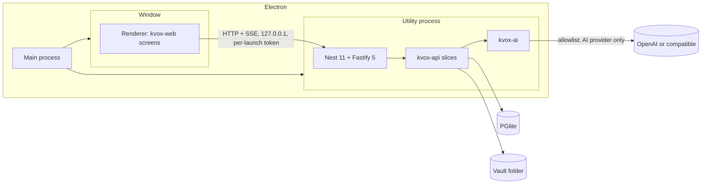

<!-- This file seeds the README of the repository marinoscar/kvox-desktop. It is kept here, in marinoscar/kvox, until that repository exists. -->

# KVox Desktop

Single-user, offline-first desktop application for meeting notes and a personal knowledge graph. Links to ADRs and guides are relative to `docs/desktop/` in the `kvox` repository.

## What it is

- Inputs: PDF transcripts, KVox transcript export JSON, Markdown or text, and KVox note exports. There is no transcription ([ADR-0006](../decisions/0006-desktop-inputs-no-transcription.md)).
- Outputs: AI notes, a connected-knowledge graph, search, and Ask.
- AI: OpenAI or an OpenAI-compatible base URL. GitHub Copilot is an extension ([ADR-0005](../decisions/0005-ai-architecture-shared-harness.md)).
- Data stays on the device. The AI provider is the only cloud egress ([ADR-0004](../decisions/0004-desktop-data-local-only.md)).

## Core principle

**This repository contains no domain logic.** All domain behaviour lives in the published `@marinoscar/kvox-*` packages ([ADR-0001](../decisions/0001-packages-first.md)).

| Belongs here | Belongs in the packages |
|---|---|
| Port bindings (the ten ports of `@marinoscar/kvox-api/ports`, `KvoxWebHost`) | Transcripts, notes, search, graph, Ask |
| The shell: navigation, settings hub, theme | Prompts, pipelines, structured-output rules, the tool loop, budgets |
| Packaging and updates | Schemas, parsers, importers |
| Host glue: settings namespaces, onboarding | Task-to-model choice, error mapping (`@marinoscar/kvox-ai`, #579) |

If Desktop needs different behaviour, add an option or a port to the package. Do not fork.

## Architecture



## Tech stack

| Concern | Choice | Source |
|---|---|---|
| Shell | Electron, pinned, bundled Node 24 or later | [ADR-0002](../decisions/0002-desktop-shell-electron.md) |
| Build | electron-vite | ADR-0002 |
| Server | Nest 11, Fastify 5, in a `utilityProcess` | ADR-0002 |
| Renderer | React 19, MUI 9, React Router 7 | ADR-0002 |
| Database | PGlite (Postgres in WebAssembly) with vector, pg_trgm, uuid-ossp | [ADR-0003](../decisions/0003-graph-store-postgresql-everywhere.md) |
| Packaging | electron-builder, electron-updater | ADR-0002 |
| Tests | Vitest, Playwright for Electron | ADR-0002 |

## Data and privacy

Data folder (`app.getPath('userData')`):

| OS | Folder |
|---|---|
| Windows | `%APPDATA%\KVox` |
| macOS | `~/Library/Application Support/KVox` |
| Linux | `~/.config/KVox` |

Documents, transcripts, notes, the graph and settings live there; documents are copied into a local vault. Nothing is uploaded. What leaves the device:

- Text sent to the configured AI provider when you generate a note or extract the graph. A `sensitive` PersonFact never leaves.
- A request to GitHub Releases, only if you enable update checks (default off).

No telemetry, no crash upload. The loopback server requires a per-launch token. For fully offline use, point the OpenAI-compatible base URL at a local model server (Ollama, LM Studio).

## AI providers

| Provider | Setup | Status |
|---|---|---|
| OpenAI | Paste the API key in settings; it is stored in the OS keychain | First release |
| OpenAI-compatible | Set the base URL (and key if needed) | First release |
| GitHub Copilot | One more provider adapter (#581) | Later, if its requirements can be met |

## Repository layout

```
src/main/        Electron main process
src/preload/     Preload bridge
src/renderer/    React app (mounts kvox-web)
src/server/
  ports/         Port bindings
  ai/            AI runtime binding
  modules/       Nest wiring of kvox-api slices
tests/e2e/       Playwright for Electron
docs/decisions/  Desktop ADRs; the shared ones are in the kvox repository
```

## Getting started

Target commands, established by #582. Prerequisites: Node 24 or later, npm 11 or later.

```bash
npm ci
npm run dev      # run the app with hot reload
npm test         # unit tests
npm run e2e      # Playwright for Electron
npm run dist     # build installers
```

## Package versions

Pin the `@marinoscar/kvox-*` packages to exact versions and bump them together; they are one release group. Until #577 publishes them, install the `kvox-tarballs` artifact from the kvox CI.

## Roadmap

| Issue | Step | Scope |
|---|---|---|
| #577 | D0 | Publish the packages |
| #582 | D1 | Stack spike |
| #583 | D2 | Ports and local data |
| #584 | D3 | AI wiring |
| #585 | D4 | Imports |
| #586 | D5 | Graph and Ask |
| #587 | D6 | Packaging |

Package-side work in the kvox repository: #570 (PR #575), #571, #572, #573, #578, #579, #580, #581.

Version 1 acceptance bar: the app answers both reference questions from imported meetings.

1. "What are the action items from Joe?"
2. "What meetings have we had with Jenny's boss?"

## More

- [KVox Desktop guide](../guides/kvox-desktop.md)
- [Host ports spec](../specs/kvox-ports.md)
- [Packages](../PACKAGES.md)
- [Architecture decisions](../decisions/README.md)
