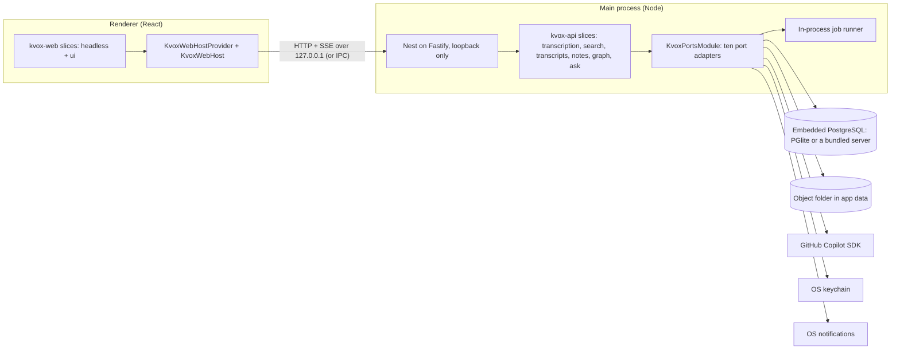

# KVox Desktop: consuming the KVox domain packages

This guide is for the engineers who build KVox Desktop: an offline application with a React renderer, a Node main process, an embedded PostgreSQL and the GitHub Copilot SDK for AI. It takes you from an empty Node + React project to a running KVox domain (transcripts, notes and search; then the graph and Ask) without reading KVox source. It names every port and web host member you implement, sketches the Copilot `KVOX_AI` adapter, states what changes offline feature by feature, and points to the conformance kits that prove an implementation correct.

Everything here is grounded in code that exists: the packages (`packages/kvox-{contract,db,api,ai,web}`), the ports spec ([kvox-ports.md](../specs/kvox-ports.md)) and the reference host in [`examples/bare-host/`](../../examples/bare-host/README.md), a Nest app that installs the packed tarballs with no platform package, binds every port to a small local class and passes an end-to-end test on PostgreSQL 16 + pgvector and on PGlite in CI. Where this guide quotes code, it is copied from that app and says so; the one block that is not real code (the Copilot adapter) is marked illustrative. Package standard: [PACKAGES.md](../PACKAGES.md).

> Decisions behind this guide: [ADR-0001 to ADR-0006](../decisions/README.md) (packages first, Electron shell, PostgreSQL and PGlite, local-only data, AI layering, Desktop inputs). The Desktop repository starts from [../desktop/README.md](../desktop/README.md).

## Who this is for and what you get

**The four packages.** One Changesets `fixed` group: they always share one version.

| Package | Format | What it is | Desktop uses it for |
|---|---|---|---|
| `@marinoscar/kvox-contract` | dual ESM + CommonJS | The Zod schemas of every request and response, the error and reason catalogue, the ontology, the transcript export JSON schema. No framework, no Node built-in. | Main process and renderer share the wire shapes. |
| `@marinoscar/kvox-db` | CommonJS + the `kvox-db` command | The Prisma fragments, the 19 domain migrations byte for byte, the inventory of raw-SQL objects and extensions, and `sync` / `check` / `promote`. | Builds the embedded database. |
| `@marinoscar/kvox-api` | CommonJS (Nest, decorator metadata) | The ten host ports and their tokens (`ports`), `KvoxPortsModule` and shared helpers (`core`), fakes and conformance kits (`testing`), and the slices below. | The main process: the domain's controllers, services and job handlers. |
| `@marinoscar/kvox-web` | ESM | One `KvoxWebHost` port and, per slice, a `headless` entry (clients, hooks; no MUI) and a `ui` entry (MUI pages). | The renderer. |

**The slices.**

| Domain | API (`@marinoscar/kvox-api/...`) | Web (`@marinoscar/kvox-web/...`) |
|---|---|---|
| Transcription (provider framework, settings) | `transcription` | `transcription/{headless,ui}` (merged) |
| Search | `search` (query side and `SearchIndexingModule`) | `search/{headless,ui}` (merged) |
| Transcripts (upload, pipeline, editing, exports) | `transcripts` | `transcripts/{headless,ui}` (merged) |
| Notes (templates, generation, exports) | `notes`, `notes/templates` | `notes/{headless,ui}` (merged) |
| Graph (connected knowledge) | `graph`, `graph-extraction`, `graph-rdf` | `graph/{headless,ui,testing}` (merged) |
| Ask (agent over the graph) | `ask` | `ask/{headless,ui}` (merged) |

All six web slices are merged. `packages/kvox-web/README.md` and each slice's own README (`packages/kvox-web/src/<slice>/README.md`) are the source of truth for what is exported.

**What is host-neutral.** All slice code. A slice imports `@marinoscar/kvox-contract` and `@marinoscar/kvox-api/{ports,core}`, never a `@marinoscar/platform-*` package (the `host-neutral` rule, enforced by `npm run check:kvox-slice-peers`). The web slices read their host only through `KvoxWebHost`.

**What is not, and is yours.**

- The ten ports ([Ports to implement](#ports-to-implement)) and the web host ([Wiring the web](#wiring-the-web)).
- The four host tables `users`, `organizations`, `storage_objects`, `jobs`, and the seed rows ([Database](#database)).
- Duties no port states (found by the bare host, written down in [kvox-ports.md](../specs/kvox-ports.md#38-kvox_settings) and [section 6.1](../specs/kvox-ports.md#61-what-the-bare-host-and-the-desktop-guide-added-issues-505-506)): declare the system `ai` settings namespace (with `graphEnabled` and `reasoningEffort` once the graph is mounted); install a global `ZodValidationPipe`; serve the upload-completion route; register a content-type parser for binary bodies; with the graph, register `@fastify/multipart`, read an unwritten `defaults: undefined` setting as `undefined`, tick four housekeeping enqueuers, and answer the graph's structured-output schemas from `KVOX_AI`.
- The renderer's shell: router, theme, navigation, settings hub. Slices export cards, destinations and routes as data; you place them.
- The transcription provider, ffmpeg, fonts for PDF export.

### Rules a Desktop host still honours

These are the web edition's rules, enforced by tests in the packages. A Desktop host inherits them, and an adapter that breaks one fails a conformance kit.

- **Long-running work is a job.** Anything that outlives the request that started it is a registered `KvoxJobHandler` enqueued through `KVOX_JOBS`, so it resumes after the application restarts ([Jobs offline](#jobs-offline)). A `@Cron` only enqueues.
- **An AI key never leaves the main process.** The port context carries a user id; the adapter resolves the credential on its own side and drops it after the call. No event, error message or capability may hold a key-shaped string. The renderer never calls an AI provider, and the Copilot sign-in token never reaches a slice, a log line or the renderer.
- **Refuse, never silently truncate.** The slices compute a token budget from `KvoxAiTarget.contextWindowTokens`, `maxOutputTokens` and `countTokens`, and refuse a prompt that does not fit (`KvoxAiBudgetError`). An adapter reports `truncated` when the answer hit the output ceiling; it never trims a prompt to make it fit.
- **A `sensitive` PersonFact never leaves the device**, for any purpose: not to a model, not into an export, not into any sync or telemetry channel you add. The graph slices already drop it before a prompt is built and from the RDF export; a Desktop feature must not reintroduce it.
- **No access answers 404, never 403.** A foreign id and a missing id are the same answer. There is no `*:read_any` permission for transcripts, notes or the graph; a single-user host does not need one.
- **AI jobs stay server-only.** `note.generate`, `note.retitle`, `transcript.name_check`, `search.index`, `kg.extract`, `kg.resolve`, `kg.embed`, `kg.entity_digest`, `ask.respond` run in the main process. Desktop has no worker nodes; the node members of the other job types are never used.

**Telemetry.** The slices emit no OpenTelemetry spans or metrics themselves. They log through Nest's `Logger` (the Ask and graph handlers log counts, never a question, an answer, a tool argument, a result or a key), and the search slice offers one hook, `SearchModule.forRoot({ semantic: { onSemanticOff } })`, called at most once per request with the reason the vector arm did not run (the web edition records it as the span attribute `kvox.search.semantic_reason`). Whether any log or measurement leaves the device is the Desktop host's decision; nothing in the packages sends anything anywhere except the calls you bind to the ports (the AI adapter and a transcription provider).

## Architecture at a glance



- The renderer holds no data model, no key and no AI client. It calls the API through `KvoxWebHost.http` and reads streams through `KvoxWebHost.sse`.
- The main process owns the database, the files, the job runner and every credential. The Nest server listens on loopback only; the shell hands its own window a per-launch token, which `KVOX_IDENTITY` checks (the bare host uses a fixed header instead, see [KVOX_IDENTITY](#kvox_identity)).
- A request is: renderer, `KvoxWebHost.http`, Nest controller, slice service, `KVOX_PRISMA` (the database) and, for slow work, `KVOX_JOBS`, whose runner calls the handler, which calls `KVOX_AI`, `KVOX_OBJECT_STORE` and the others.

## Install

Print the per-slice peer data any time with `node scripts/kvox-packages/check-slice-peers.mjs --table` (in the KVox repository); the rule is in [PACKAGES.md](../PACKAGES.md#peer-dependencies-per-slice). Packages are `0.x` on the `next` dist-tag; until the first release is published, pack the workspace packages as `examples/bare-host/run.mjs --from pack` does.

**Main process, minimal set (transcription, search, transcripts, notes).**

```bash
npm install --save-exact @marinoscar/kvox-contract@next @marinoscar/kvox-api@next
npm install --save-dev --save-exact @marinoscar/kvox-db@next
# Required by every slice, plus what the four slices import (OpenAPI decorators, DTO classes, Fastify types).
npm install @nestjs/common@^11.1.12 @nestjs/core@^11.1.12 @nestjs/platform-fastify@^11.1.12 \
  @nestjs/swagger@^11.2.5 fastify@^5.0.0 nestjs-zod@^5.4.0 reflect-metadata@^0.2.2 rxjs@^7.8.1 zod@^4.4.3
# The database layer (the same list as examples/bare-host/package.json).
npm install @prisma/client@^7.8.0 @prisma/adapter-pg@^7.8.0 @prisma/client-runtime-utils@^7.8.0 pg@^8.23.0
npm install --save-dev prisma@^7.8.0
npm install --save-exact @marinoscar/platform-db@0.1.0-next.5   # the version kvox-db was tested with; see Version policy
```

Add your embedded database (`@electric-sql/pglite` 0.5.10, `@electric-sql/pglite-pgvector` 0.0.11 and `@electric-sql/pglite-socket` 0.2.13 are the versions the bare host runs on) when you choose PGlite ([Database](#database)).

**Optional peers, per feature.** Each is loaded lazily, so a host that switches the feature off installs nothing. This is the list the bare host leaves out on purpose (it asserts they are not installed and that the app boots).

| Feature | Peer | Switch it off with |
|---|---|---|
| Housekeeping crons (`transcripts`, `notes`, `graph`, `graph-rdf`; four enqueuers) | `@nestjs/schedule@^6.1.0` | `schedules: false`; call the enqueuers on your own timer ([Jobs offline](#jobs-offline)) |
| Transcript PDF export | `pdfkit@>=0.17.0` | `exporters: { pdf: false }` |
| Note PDF export | `pdfkit` | `exporters: { pdf: false }` |
| Note Word export | `docx@>=9.0.0` | `exporters: { docx: false }` |
| PDF as a note source | `unpdf@>=1.0.0` | `documentSources: { pdf: false }` |
| Shared `EventEmitter2` as `KVOX_EVENTS` | `@nestjs/event-emitter@^3.0.1` | leave it out; `KvoxEventEmitterEvents` falls back to its own emitter |

**Full set: add the graph and Ask.** `graph`, `graph-extraction`, `graph-rdf` and `ask` need the same required peers plus:

```bash
npm install graphology@>=0.26.0 graphology-communities-louvain@>=2.0.2 graphology-layout@>=0.6.1 graphology-layout-forceatlas2@>=0.10.1   # graph overview layout
npm install n3@>=2.7.0 jsonld@>=9.0.0 rdf-validate-shacl@>=0.6.0   # graph-rdf: RDF export and SHACL-validated import
```

The layout libraries are required in practice: any `GET /api/graph/overview` on a non-empty graph schedules `kg.graph_layout`. Also install `@fastify/multipart@^10.0.0` and register it on the Fastify app: `POST /api/graph/imports` and the notes document-source upload read `request.file()`, no slice registers it, and it is in no slice's peers list, so `check-slice-peers` cannot catch its absence (`examples/bare-host/src/bootstrap.ts`). `rdf-validate-shacl` is ESM-only and runs in a child process; the `graph-rdf` module refuses to start, naming it, when the import is on and it cannot be resolved (`GraphRdfModule.forRoot({ import: false })` leaves it out). `ask` adds no peer of its own.

**Renderer.**

```bash
npm install --save-exact @marinoscar/kvox-contract@next @marinoscar/kvox-web@next
npm install react@^19.2.7 react-dom@^19.2.7
# Only for the `ui` entries (and core/testing) of the slices you mount; headless-only hosts install none of these:
npm install @mui/material@^9.1.0 @mui/icons-material@^9.1.0 react-router-dom@^7.17.0
```

MUI also needs its own peers, `@emotion/react` and `@emotion/styled`. Some slices declare more optional peers on their `ui` entry only: `@tanstack/react-virtual` for transcripts; `react-markdown` and `remark-gfm` for notes, and `react-markdown` for Ask (one copy only: the citation plugin walks the tree it builds); `@tiptap/*` for the note editor (loaded lazily); `sigma`, `@react-sigma/core`, `graphology` and `graphology-layout-forceatlas2` for the graph canvas (loaded lazily, `graphology` one copy only). The table in the [package README](../../packages/kvox-web/README.md#install-and-peer-dependencies) lists the versions and the entries; `node scripts/kvox-packages/check-slice-peers.mjs --table` prints the per-slice data. Optional peers are not installed by npm for you: the application lists them itself.

Singletons (Nest, Zod, the contract, Prisma, React, MUI) must exist once. A second copy breaks dependency injection, `instanceof ZodError` or hooks; see [Troubleshooting](#troubleshooting).

## Database

### Choosing the embedded PostgreSQL

| | PGlite | A bundled PostgreSQL server |
|---|---|---|
| What the bare host proved | The whole history (37 platform and 19 domain migrations) applies in about three seconds on PGlite 0.5.10 (PostgreSQL 18.6, `vector` 0.8.7, `pg_trgm` 1.6); `kvox-db check --database` passes; transcripts, notes and search pass the end-to-end test; the graph, graph-extraction, graph-rdf and Ask slices run over the same host (extraction, review and commit, the overview, RDF export and import, the Ask tool loop) against a scripted model. | The CI `service` leg runs `pgvector/pgvector:pg16`. A server you ship must have `vector` and `pg_trgm` available. |
| Cost | One session only (see below); the socket quirk. | You ship, start, stop and upgrade a server, and a `vector` build per platform. |
| Recommendation | Start here. | Choose it if any migration fails on PGlite, or when you need more than one connection. |

Required extensions (`packages/kvox-db/extensions.json`): `vector` 0.5.0 or newer (search, graph) and `pg_trgm` (graph). A **superuser** creates them before the first migration; the package never does. The platform's first migration also runs `CREATE EXTENSION "uuid-ossp"`, so PGlite must load `uuid_ossp` as well. The bare host loads the three PGlite extensions and runs `CREATE EXTENSION IF NOT EXISTS vector; CREATE EXTENSION IF NOT EXISTS pg_trgm;` (`examples/bare-host/src/db.ts`).

**PGlite rules** (all from the bare host, repeated in the [kvox-db README](../../packages/kvox-db/README.md#data)):

- PGlite is one session. Give Prisma's driver adapter a pool of one (`new PrismaPg({ connectionString, max: 1 })`) and the socket one connection (`connection_limit=1` in the URL). Never await a query on the pool while a transaction holds the connection: on PGlite that is a deadlock, on a server a slow query. This is why the bare host's job claim is one statement and no handler runs inside a transaction.
- `prisma migrate deploy` and `kvox-db check --database` are separate processes, so they need the database on a socket. After any SQL error, `@electric-sql/pglite-socket` 0.2.13 closes the connection and the next query on it fails once with `Connection terminated unexpectedly` (the pool recovers on the following one). The application can instead run PGlite in its own process with an in-process driver adapter; the bare host does not exercise that path, so it is unverified.
- With `skipLibCheck: false`, add `@types/emscripten`: PGlite's declarations use the global Emscripten types.

### The host tables

The domain references four tables it does not create: `users` (every owner column), `organizations` (`transcripts.org_id` and `storage_objects.org_id` are NOT NULL), `storage_objects` (`transcripts.source_object_id`, `notes.source_object_id`, ...) and `jobs` (`kg_proposals.job_id`, `ask_messages.job_id`, `kg_exports.job_id`). In v1 Desktop gets them by applying the `@marinoscar/platform-db` migrations; the only alternative is writing equivalent tables and foreign keys yourself, which nothing checks. The platform history creates more tables than Desktop uses; they stay empty. It also creates the default organization (one row, `is_default`), which the host adopts rather than inserting a second.

Seed before the first request (`examples/bare-host/src/seed.ts`): the one `users` row, the adopted default `organizations` row (its id goes in the principal), and the built-in note templates through `seedNoteTemplates` from `@marinoscar/kvox-api/notes/templates` (no Nest import). After the application initialises, turn transcription on and store the provider's key, because the `transcription` namespace and its secret purpose are declared by the slice's `onModuleInit`.

`storage_objects` is under forced row-level security (`org_id = ...`). The bare host connects as a superuser, which bypasses it. A host that connects as an ordinary role must set `app.org_id` (or `app.rls_bypass`) per transaction, as the web edition's application role does; for a single-user, single-process Desktop, connecting as the bootstrap superuser, as the bare host does, is the simple choice.

### The prepare sequence

This is `examples/bare-host/scripts/prepare-db.mjs`. It needs no database: composing a schema and installing migrations only write files under `prisma/`, which is generated and git-ignored.

```bash
npx platform db sync    --root . --timestamp 2024-01-01T00:00:00Z   # 1. install the platform migrations (byte copies), pinned before the domain ids
npx platform db compose --root .                          # 2. compose the platform schema; kvox-db refuses a host without User, StorageObject, Job
npx kvox-db sync        --root . --names stable           # 3. install the domain fragments and migrations
npx platform db compose --root .                          # 4. compose again, now with the domain fragments
npx prisma generate --config prisma.config.ts             # 5. generate the client
```

Then, at application start or install time, with `DATABASE_URL` set and the extensions created:

```bash
npx prisma migrate deploy --config prisma.config.ts       # platform history, then domain history
npx kvox-db check --root . --database                     # exit 1 if an extension or a raw-SQL object is missing
```

Why `--names stable` and the pinned timestamp: the domain migrations are dated September 2026. Under their original names they would sort before the platform migrations a fresh host installs first and run before `users` exists. The pin `--timestamp 2024-01-01T00:00:00Z` dates the platform migrations before them, so the platform tables come first and the platform names are deterministic. `stable` names each domain migration `<the id's timestamp>_kvox_<slug>`, a pure function of the package migration id, never of build time or other packages' migration counts. `after-host` is deprecated: its names are the newest host directory plus one second, so a platform upgrade on a host that builds `prisma/` from scratch shifts every domain name and breaks databases that recorded the old ones. A host that already ran the migrations under the original names (the web edition) keeps `original`; a host with a lock keeps the policy the lock records. Upstream gap: `platform db sync` still derives names from the clock or `--timestamp` and the newest directory; see [marinoscar/EnterpriseAppBase#992](https://github.com/marinoscar/EnterpriseAppBase/issues/992). Rule: [migration folder names](../runbooks/kvox-domain-migration.md#migration-folder-names). (The issue text lists `platform db sync` last; the working order is the one above.)

`prisma.config.ts` points `schema` at `prisma/schema` and `migrations.path` at `prisma/migrations`, and reads `DATABASE_URL`; copy it from the bare host.

### Upgrades

1. Bump the four packages together, and `@marinoscar/platform-db` to the version `@marinoscar/kvox-db` was tested with.
2. `npx platform db sync` (new platform migrations), `npx kvox-db sync --root . --names stable` (it installs only migrations `prisma/kvox.lock` does not record), `npx platform db compose`, `npx prisma generate`.
3. `npx prisma migrate deploy`, then `npx kvox-db check --root . --database`.

Never edit, rename or reformat an installed migration or a generated `prisma/fragments/kvox.*.prisma`: `kvox-db check` fails with `INSTALLED_MODIFIED` or `FRAGMENT_MODIFIED`, and comments count toward the hash. Exclude `**/migration.sql` from any formatter. A fix is a new migration released in a package, never an edit. Details: [kvox-db README](../../packages/kvox-db/README.md#upgrade-notes).

## Ports to implement

A port is an interface and an injection token in `@marinoscar/kvox-api/ports`. The token is `Symbol.for('@marinoscar/kvox/<NAME>')` and its description is permanent. You bind each with `KvoxPortsModule.forRoot({ ports, brand })` from `@marinoscar/kvox-api/core`; the call throws at start-up, naming every required port left unbound. (The issue lists `KvoxPortsModule` under `/ports`; the code has it in `/core`, because its default `KVOX_EVENTS` is a `core` class.) Eight are required (`ai`, `objectStore`, `jobs`, `identity`, `notify`, `prisma`, `settings`, `secrets`), two optional (`events`, `audit`), plus `imports` for the modules your bound classes need. The contract in prose is [kvox-ports.md](../specs/kvox-ports.md); the web edition's bindings, a worked example against a real platform, are `apps/api/src/platform-kvox/*` ([ports README, extension-point catalog](../../packages/kvox-api/src/ports/README.md#extension-point-catalog)).

The bare host's classes are reference code, not a package. "Desktop recommendation" below says what to replace. Each interface below is copied from its `*.port.ts` file with the TSDoc removed and some lines joined (a few trailing comments are added); the file is the source of truth.

### KVOX_AI

Source: [`ai.port.ts`](../../packages/kvox-api/src/ports/ai.port.ts). Desktop does not implement this interface. It binds `KVOX_AI` to `createKvoxAi` of [`@marinoscar/kvox-ai`](../../packages/kvox-ai/README.md) over `createDirectRuntime`, so the strict-schema round trip, the one-step chat mapping, the truncation and refusal rules, the error classes and the token estimate are the same code as the web edition's (no second copy of the model logic). What Desktop supplies is a `KvoxTaskModelSource` (a local settings file), a `keys` reader backed by the OS keychain, and the provider adapters; the Copilot mapping is [the next section](#the-copilot-sdk-kvox_ai-adapter-sketch).

```ts
export interface KvoxAiPort {
  capabilities(ctx: KvoxAiContext): Promise<KvoxAiCapabilities>;
  resolveTask(ctx: KvoxAiContext, task: string, opts?: { model?: string; requireKey?: boolean }): Promise<KvoxAiTarget>;
  generateText(ctx: KvoxAiContext, req: { target: KvoxAiTarget; system: string; user: string; maxOutputTokens?: number }): AsyncIterable<KvoxTextEvent>;
  generateStructured<T>(ctx: KvoxAiContext, req: {
    target: KvoxAiTarget; system: string; user: string;
    schema: z.ZodType<T>; schemaName: string; jsonSchema?: Record<string, unknown>; maxOutputTokens?: number;
  }): Promise<KvoxStructuredResult<T>>;
  chat(ctx: KvoxAiContext, req: {
    target: KvoxAiTarget; messages: KvoxChatMessage[]; tools: KvoxToolDef[]; toolChoice: 'auto' | 'none';
  }): AsyncIterable<KvoxChatEvent>;
  embed(ctx: KvoxAiContext, req: { inputs: string[] }): Promise<KvoxEmbedResult>;
  countTokens(target: KvoxAiTarget, text: string): number;
}
```

Rules:

- **Graph schemas.** Extraction calls `generateStructured` under the schema names `kg_extraction`, `kg_adjudication`, `kg_item_adjudication` and `entity_digest`; an entity digest with no surviving citation fails its job. With `embeddings: null`, resolution works by name only and `kg.embed` jobs are no-ops. Ask needs `chat` with tool calling. The bare host's scripted model is `examples/bare-host/src/fake-ai.ts`.
- `capabilities()` never throws. It reports `available`, `structuredOutput`, `toolCalling`, `embeddings` (`{ model, dimensions }` or `null`) and `graphEnabled`.
- `resolveTask` throws `KvoxAiError` of class `not_configured`, `key_missing` or `capability`; `requireKey: false` names the model without needing a key (a token estimate).
- A text stream is `delta*` then exactly one `done`. A chat call is one model step: `delta` or `tool_call` events, then `step_end`, then exactly one `done`; **no text of a step after one of its `tool_call`s**. `done.finishReason` is `stop`, `length` or (chat only) `content_filter`.
- Every failure is a `KvoxAiError` with an `errorClass` from `KVOX_AI_ERROR_CLASSES`: `auth`, `refusal`, `rate_limit` (carry `retryAfterMs`), `budget`, `timeout`, `not_configured`, `key_missing`, `capability`, `truncated`, `invalid_output`, `other`. A failed structured call is still billed: set `usage` on the error.
- A key never crosses the port; nothing the port returns holds a key-shaped string (`sk-...`, `ghp_`, `gho_`, `github_pat_`).
- The context carries `userId`, `orgId`, the `feature` (`notes.generate`, `notes.title`, `transcripts.name_check`, `search.embed`, `graph.extract`, `graph.adjudicate`, `graph.digest`, `graph.embed`, `ask.respond`), an optional `AbortSignal` and the queue `jobId`. Honour the signal.
- `embeddings.dimensions` other than 1536 makes search semantic-off (the index column is `vector(1536)`).

Binding sketch (the signatures are in the [package README](../../packages/kvox-ai/README.md#quick-start)):

```ts
// Illustrative, not compiled
import { createKvoxAi, createDirectRuntime } from '@marinoscar/kvox-ai';

const runtime = createDirectRuntime({
  adapters: { openai: openAiAdapter, copilot: copilotAdapter }, // AiProviderAdapter per provider id
  keys: async (provider) => {                                    // fetched per call, never held
    const apiKey = await keychain.get(`ai:${provider}`);
    return apiKey ? { apiKey } : null;                           // null: the user has no key (key_missing)
  },
});
const kvoxAi = createKvoxAi({ runtime, taskModels: localTaskModelSource, requestTimeoutMs: 600_000, graphEnabled: () => true });
// bind it: KvoxPortsModule.forRoot({ ports: { ai: { useValue: kvoxAi }, ... } })
```

Reference: `createFakeKvoxAi` from `@marinoscar/kvox-api/testing`, scripted to stream a fixed note body and report `embeddings: null` (`examples/bare-host/src/bootstrap.ts`); `createScriptedRuntime` from `@marinoscar/kvox-ai/testing` scripts provider events beneath the real `createKvoxAi`.

### KVOX_OBJECT_STORE

Source: [`object-store.port.ts`](../../packages/kvox-api/src/ports/object-store.port.ts).

```ts
export interface KvoxObjectStorePort {
  initUpload(ctx: { userId: string }, req: { name: string; mimeType?: string | null; size: number; managedBy: KvoxManagedBy; allowedMimeTypes?: readonly string[] }): Promise<KvoxInitUploadResult>;
  signParts(objectId: string, partNumbers: number[]): Promise<KvoxUploadPart[]>;
  completeUpload(objectId: string, parts?: { partNumber: number; etag: string }[]): Promise<void>;
  abortUpload(objectId: string): Promise<void>;
  put(req: { ownerId: string; key: string; body: NodeJS.ReadableStream | Buffer; contentType: string; managedBy: KvoxManagedBy; name?: string; metadata?: Record<string, unknown> }): Promise<KvoxPutResult>;
  adopt(req: { ownerId: string; key: string; name: string; contentType: string; size: number; managedBy: KvoxManagedBy; metadata?: Record<string, unknown> }): Promise<KvoxAdoptResult>;
  openRead(objectId: string): Promise<NodeJS.ReadableStream>;
  head(objectId: string): Promise<KvoxObjectHead | null>;
  describe(objectIds: readonly string[]): Promise<Map<string, KvoxObjectInfo>>;
  setMetadata(objectId: string, metadata: Record<string, unknown>): Promise<void>;
  listManaged(query: { ownerId: string; managedBy: KvoxManagedBy; keyPrefix?: string; limit: number }): Promise<string[]>;
  signedDownloadUrl(objectId: string, opts: { ttlSeconds: number; filename?: string }): Promise<string>;
  delete(objectId: string): Promise<void>;
  onUploaded(handler: (e: KvoxUploadedEvent) => Promise<void>, options?: KvoxUploadedOptions): void;
  onAborted(handler: (e: KvoxAbortedEvent) => Promise<void>): void;
}
```

Rules:

- Every object has an owning module (`KvoxManagedBy`: `transcripts`, `notes`, `graph`). Every object is also a `storage_objects` row, because the domain tables reference it by foreign key.
- Streams are never collected whole: `put` and `openRead` move streams; a 6 MiB stream must pull in order.
- `put` is idempotent on its key (a retried job answers the first object). `adopt` records bytes already at a key and throws `KvoxObjectMissingError` when they never landed. `delete` and `abortUpload` are idempotent; `head` answers `null` for a missing object; `describe` answers every id it knows in one call.
- `onUploaded` fires once per completed upload, after the commit; a handler decides from `managedBy` whether the object is its own. `onAborted` fires once for a cancelled upload.
- A signed URL must reject a tampered, foreign or expired signature.

Reference: [`src/ports/local-fs-object-store.ts`](../../examples/bare-host/src/ports/local-fs-object-store.ts) and [`src/local-store.controller.ts`](../../examples/bare-host/src/local-store.controller.ts): a `storage_objects` row plus a file under `.data/objects/<key>`, loopback part URLs with an HMAC (random per-process key, 15-minute expiry), keys that leave the folder refused. The bare host keeps `managedBy` as a reserved key of the row's `metadata` (the web edition uses a side table). **The host owns the upload completion route** (`POST /api/storage/objects/{id}/upload/complete`, `LocalUploadsController`): `POST /api/transcripts` answers with part URLs and nothing else seals the upload. Desktop: the same folder in the application-data directory; a shell may let the renderer write straight to disk and call `adopt`, instead of loopback part URLs.

### KVOX_JOBS

Source: [`jobs.port.ts`](../../packages/kvox-api/src/ports/jobs.port.ts).

```ts
export interface KvoxJobsPort {
  enqueue(input: KvoxEnqueueInput): Promise<KvoxEnqueueResult>;                 // { id, deduplicated }
  enqueueWithin(tx: unknown, input: KvoxEnqueueInput): Promise<KvoxEnqueueResult>; // inside the caller's $transaction
  registerHandler(handler: KvoxJobHandler): void;
  isRegistered(type: string): boolean;
  onSettled(listener: (event: KvoxJobSettledEvent) => void): void;
  findActive(query: KvoxActiveJobQuery): Promise<KvoxActiveJob[]>;
  findLatest(query: { type: string; subjectType: string; subjectId?: string }): Promise<KvoxJobSnapshot | null>;
  runNow(jobId: string): Promise<boolean>;
  tempPath(suffix?: string): string;
}
```

Rules (details in [Jobs offline](#jobs-offline)): dedup on `type`, `subjectType`, `subjectId` while pending or running unless `skipDedup`; a handler declares `profile: { maxRuntimeMs, maxAttempts }` only; `KvoxRateLimitError` defers a job without spending an attempt; the web edition passes the default organization's id on every enqueue. Reference: [`src/ports/pg-table-jobs.ts`](../../examples/bare-host/src/ports/pg-table-jobs.ts). Desktop: the same, plus the gaps listed below.

### KVOX_IDENTITY

Source: [`identity.port.ts`](../../packages/kvox-api/src/ports/identity.port.ts).

```ts
export interface KvoxPrincipal { userId: string; orgId: string | null; roles: readonly string[]; permissions: ReadonlySet<string> }
export interface KvoxIdentityPort {
  authenticate(context: ExecutionContext): Promise<KvoxPrincipal | null>;
  hasPermission(userId: string, permission: string): Promise<boolean>;
}
```

Rules: `null` without valid credentials (so `@KvoxAuth` answers 401); a principal's `permissions` is a `ReadonlySet`; `userId` names a real `users.id` and `orgId` a real `organizations.id`; a slice never reads permissions off a raw user object.

Reference: [`src/ports/local-single-user-identity.ts`](../../examples/bare-host/src/ports/local-single-user-identity.ts): one seeded user holding every permission, recognised by the header `x-local-user: 1`. Desktop: single local user with every kvox permission, authenticated by a **per-launch token** the shell hands only to its own window (`Authorization: Bearer <token>` on every call, `http` and `sse` alike), compared in constant time. Return `null` for everything else so the 401 path stays real.

### KVOX_NOTIFY

Source: [`notify.port.ts`](../../packages/kvox-api/src/ports/notify.port.ts).

```ts
export interface KvoxNotifyPort {
  registerEvents(defs: KvoxNotificationEventDef[]): void;   // idempotent per key
  notify(eventKey: string, userId: string, data: unknown): void;   // detached: returns at once, never throws
}
```

Rules: `notify` returns before delivery and never throws; the slices call it after the triggering write commits, never inside a transaction. Event keys, channel ids and template names are persisted: never rename. Reference: `createRecordingKvoxNotify` from `/testing`. Desktop: map the events the slices register (for example `notes.note_ready`, `notes.note_failed`, `transcripts.transcript_ready`, `transcripts.transcript_failed`) to operating-system notifications whose click opens `links.transcript(id)` or `links.note(id)`.

### KVOX_EVENTS

Source: [`events.port.ts`](../../packages/kvox-api/src/ports/events.port.ts).

```ts
export interface KvoxEventsPort {
  emit(name: string, payload: unknown): void;
  subscribe(name: string, handler: (payload: unknown) => Promise<void> | void): () => void;
}
```

Optional. In-process domain events after commit (`graph.changed`, `transcript.speakers_identified`, `kvox.notes.note_ready`). A listener must survive throwing and only decide whether work is due and enqueue it. Reference and Desktop: leave it unbound; the default is `KvoxEventEmitterEvents` over Nest's `EventEmitter2` when `@nestjs/event-emitter` is installed.

### KVOX_PRISMA

Source: [`prisma.port.ts`](../../packages/kvox-api/src/ports/prisma.port.ts).

```ts
export interface KvoxPrismaClientLike {
  $queryRaw<T = unknown>(query: TemplateStringsArray | KvoxSql, ...values: unknown[]): Promise<T>;
  $executeRaw(query: TemplateStringsArray | KvoxSql, ...values: unknown[]): Promise<number>;
  $transaction<T>(fn: (tx: any) => Promise<T>, options?: KvoxTransactionOptions): Promise<T>;
  $transaction<const Q extends readonly unknown[]>(queries: [...Q], options?: KvoxTransactionOptions): Promise<{ -readonly [K in keyof Q]: Awaited<Q[K]> }>;
}
```

The host's generated Prisma client, structurally. A slice never imports a generated client; it narrows this port with the delegates it uses. Both hosts run PostgreSQL, so slices keep `tsvector`, `tstzrange`, `pg_trgm` and `vector`. Reference (`src/bootstrap.ts`, `src/db.ts`): `{ prisma: { useValue: prisma as never } }` over `new PrismaClient({ adapter: new PrismaPg({ connectionString, max: leg === 'pglite' ? 1 : 10 }) })`. Desktop: the same.

### KVOX_SETTINGS

Source: [`settings.port.ts`](../../packages/kvox-api/src/ports/settings.port.ts).

```ts
export interface KvoxSettingsPort {
  registerNamespace(def: KvoxSettingsNamespaceDef): void;   // { scope: 'system' | 'user', name, schema, defaults }
  readSystem<T>(name: string, options?: KvoxReadSystemOptions): Promise<KvoxVersionedSettings<T>>;
  patchSystem<T>(name: string, patch: Partial<T>, ctx: { actorUserId: string; ifMatchVersion?: number }): Promise<KvoxVersionedSettings<T>>;
  readUser<T>(userId: string, name: string): Promise<T>;
  patchUser<T>(userId: string, name: string, patch: Partial<T>): Promise<T>;
}
```

Rules: the slices declare two namespaces themselves (system `transcription` in `onModuleInit`, user `graph`); a missing row reads as the defaults at version 0; a patch is a JSON Merge Patch validated against the schema before anything is written; system patches are versioned (`ifMatchVersion`). **The host declares a third namespace the slices only read: the system `ai` namespace.** Fields read today: `maxInputTokens`, `maxOutputTokens` (both `number | null`, `null` means the model's own limit), `maxDocumentBytes` (notes), and, when the graph is installed, `graphEnabled` (the connected-knowledge switch; `false` or absent answers the graph's 409 `graph_disabled`) and `reasoningEffort`. Without the namespace `POST /api/notes` is a 500 (`Unknown system settings namespace "ai"`).

Reference: [`src/ports/file-settings.ts`](../../examples/bare-host/src/ports/file-settings.ts) (one JSON file, atomic rewrite, versions for the system scope) and the `ai` declaration in `src/bootstrap.ts`, copied here:

```ts
// Copied from examples/bare-host/src/bootstrap.ts (comments trimmed).
settings.registerNamespace({
  scope: 'system',
  name: 'ai',
  schema: z.object({
    maxInputTokens: z.number().int().positive().nullable().default(null),
    maxOutputTokens: z.number().int().positive().nullable().default(null),
    maxDocumentBytes: z.number().int().positive().default(10 * 1024 * 1024),
    graphEnabled: z.boolean().default(false),
    reasoningEffort: z.enum(['none', 'low', 'medium', 'high', 'xhigh']).default('none'),
  }),
  defaults: { maxInputTokens: null, maxOutputTokens: null, maxDocumentBytes: 10 * 1024 * 1024, graphEnabled: false, reasoningEffort: 'none' },
});
```

Turn `graphEnabled` on once at start-up (`settings.patchSystem('ai', { graphEnabled: true }, ...)`, as `seedRuntime` does in `examples/bare-host/src/seed.ts`), or the graph answers 409 `graph_disabled` and no digest is queued.

**`defaults: undefined`.** The graph slice registers its per-user `graph` namespace with `defaults: undefined` (absent means the slice's own defaults). Your port must read an unwritten one as `undefined` and parse only stored values; parsing the defaults throws "expected object, received undefined" on the first graph read (`parsedOrDefaults` in `examples/bare-host/src/ports/file-settings.ts`). The conformance kit does not test this yet.

Desktop: the same file in the user's application-data folder, or a table.

### KVOX_SECRETS

Source: [`secrets.port.ts`](../../packages/kvox-api/src/ports/secrets.port.ts).

```ts
export interface KvoxSecretsPort {
  registerPurpose(purpose: string, label: string): void;
  get(purpose: string, name: string): Promise<string | null>;
  set(purpose: string, name: string, value: string, actorUserId: string, meta?: { label?: string }): Promise<void>;
  delete(purpose: string, name: string, actorUserId: string): Promise<void>;
  status(purpose: string, name: string): Promise<KvoxSecretStatus>;   // never returns material
}
```

Rules: `status` returns `{ configured, hint, updatedAt, updatedByUserId? }` and never the value; a purpose is never renamed. A user's AI credential is not here: the AI adapter resolves it. What the slices store here today is the transcription provider's key (purpose `transcription`, named after the provider id). Reference: [`src/ports/memory-secrets.ts`](../../examples/bare-host/src/ports/memory-secrets.ts) (a map). Desktop: the operating-system keychain through a keytar-like module of your choice (Electron's `safeStorage` is another option); the value never reaches the renderer or a log.

### KVOX_AUDIT

Source: [`audit.port.ts`](../../packages/kvox-api/src/ports/audit.port.ts).

```ts
export interface KvoxAuditPort {
  record(e: KvoxAuditEvent): Promise<void>;   // { actorUserId, action, targetType, targetId, meta? }
}
```

Optional; the default records nothing (`NOOP_KVOX_AUDIT`). Settings changes and destructive actions are recorded (for example `ask.conversation_deleted`, `graph.purged`), with counts and ids only. Desktop: a local log file, or leave the default.

### KVOX_BRAND

Not a port: a value you pass as `KvoxPortsModule.forRoot({ ports, brand: { appName, appSlug } })` (`KvoxBrand`, token `KVOX_BRAND`, both from `@marinoscar/kvox-api/core`). It is the product name a document carries (the PDF export footer) and the slug names are built from. Omitted, `DEFAULT_KVOX_BRAND` (`KVox` / `kvox`) applies.

## The Copilot SDK `KVOX_AI` adapter (sketch)

Note: per [ADR-0005](../decisions/0005-ai-architecture-shared-harness.md), the Copilot integration targets an `AiProviderAdapter` plugged into `createDirectRuntime` of `@marinoscar/kvox-ai` (#579, #581), not a `KvoxAiPort` implementation. The sketch below maps the same behaviour at the port level and is kept for history: it shows what the adapter plus the shared mechanics must add up to, not a class to write.

The code below is **illustrative and not compiled**. It maps each port method onto a Copilot session at the level of the port contract. The SDK's API changes; this sketch declares a tiny `CopilotLike` stand-in instead of naming SDK methods, so replace it with calls from the SDK's own documentation. What is fixed is the right-hand side: the port types, the event order and the error classes.

```ts
// Illustrative — not compiled
import type { z } from 'zod';
import {
  KvoxAiBudgetError, KvoxAiError,
  type KvoxAiCapabilities, type KvoxAiContext, type KvoxAiPort, type KvoxAiTarget, type KvoxChatEvent,
  type KvoxChatMessage, type KvoxEmbedResult, type KvoxStructuredResult, type KvoxTextEvent, type KvoxToolDef,
} from '@marinoscar/kvox-api/ports';

/** Stand-in for the Copilot SDK. Replace with the SDK's real client; keep it inside the main process. */
interface CopilotLike {
  isSignedIn(): Promise<boolean>;
  models(): Promise<Array<{ id: string; contextTokens: number; maxOutputTokens: number; tools: boolean; json: boolean; embeds?: number }>>;
  /** One model step; yields text deltas and tool calls, then the usage and why it stopped. */
  step(args: { model: string; system?: string; messages: unknown[]; tools?: unknown[]; maxOutputTokens?: number; signal?: AbortSignal }):
    AsyncIterable<
      | { kind: 'text'; text: string }
      | { kind: 'tool'; id: string; name: string; args: unknown }
      | { kind: 'end'; inputTokens: number | null; outputTokens: number | null; reason: 'stop' | 'length' | 'filtered' }
    >;
  embed?(args: { model: string; inputs: string[] }): Promise<number[][]>;
}

export class CopilotKvoxAi implements KvoxAiPort {
  // The sign-in token lives inside `copilot`, in the main process. It is never a field here,
  // never in a log line, never in an error message, never sent to the renderer.
  constructor(private readonly copilot: CopilotLike, private readonly graphEnabled: () => boolean) {}

  async capabilities(_ctx: KvoxAiContext): Promise<KvoxAiCapabilities> {
    try {                                                    // never throws
      if (!(await this.copilot.isSignedIn())) return this.off('ai_key_missing');
      const models = await this.copilot.models();
      const embed = models.find((m) => m.embeds === 1536);   // only a 1536-wide model keeps search semantic
      return {
        available: models.length > 0, structuredOutput: models.some((m) => m.json), toolCalling: models.some((m) => m.tools),
        embeddings: embed ? { model: embed.id, dimensions: 1536 } : null,   // null: full-text search only
        graphEnabled: this.graphEnabled(),
      };
    } catch { return this.off('ai_not_configured'); }
  }

  async resolveTask(ctx: KvoxAiContext, task: string, opts?: { model?: string; requireKey?: boolean }): Promise<KvoxAiTarget> {
    if (opts?.requireKey !== false && !(await this.copilot.isSignedIn())) throw new KvoxAiError('key_missing', 'Sign in to GitHub Copilot.');
    const models = await this.copilot.models();
    const pick = models.find((m) => m.id === opts?.model) ?? models.find((m) => (task.startsWith('ask') || task.includes('extract') ? m.tools : true));
    if (!pick) throw new KvoxAiError('not_configured', 'No Copilot model is available.');
    if ((task.startsWith('ask') && !pick.tools) || (task.includes('extract') && !pick.json)) throw new KvoxAiError('capability', 'The model cannot do this task.');
    return { provider: 'copilot', model: pick.id, contextWindowTokens: pick.contextTokens, maxOutputTokens: pick.maxOutputTokens, source: 'copilot' };
  }

  async *generateText(ctx: KvoxAiContext, req: { target: KvoxAiTarget; system: string; user: string; maxOutputTokens?: number }): AsyncIterable<KvoxTextEvent> {
    for await (const e of this.run(ctx, { model: req.target.model, system: req.system, messages: [{ role: 'user', content: req.user }], maxOutputTokens: req.maxOutputTokens })) {
      if (e.kind === 'text') yield { type: 'delta', text: e.text };
      if (e.kind === 'end') yield { type: 'done', usage: { inputTokens: e.inputTokens, outputTokens: e.outputTokens }, finishReason: e.reason === 'length' ? 'length' : 'stop' };
    }                                                         // exactly one `done`
  }

  async generateStructured<T>(ctx: KvoxAiContext, req: { target: KvoxAiTarget; system: string; user: string; schema: z.ZodType<T>; schemaName: string; jsonSchema?: Record<string, unknown>; maxOutputTokens?: number }): Promise<KvoxStructuredResult<T>> {
    // Prompt with the JSON Schema, parse with the caller's Zod schema, one repair attempt, then give up.
    let text = await this.collect(ctx, req, `${req.user}\n\nAnswer with JSON only, matching: ${JSON.stringify(req.jsonSchema)}`);
    for (let attempt = 0; ; attempt += 1) {
      try { return { value: req.schema.parse(JSON.parse(text.value)), usage: text.usage }; }
      catch (error) {
        if (attempt === 1) throw new KvoxAiError('invalid_output', 'The model did not return the requested JSON.', undefined, text.usage);
        text = await this.collect(ctx, req, `${req.user}\n\nYour last answer was invalid (${String(error).slice(0, 200)}). Answer with valid JSON only.`);
      }
    }
    // If the chosen model cannot return JSON at all, resolveTask already threw KvoxAiError('capability').
  }

  async *chat(ctx: KvoxAiContext, req: { target: KvoxAiTarget; messages: KvoxChatMessage[]; tools: KvoxToolDef[]; toolChoice: 'auto' | 'none' }): AsyncIterable<KvoxChatEvent> {
    // One model step per call: the caller owns the loop and sends the whole history each time.
    let sawTool = false;
    for await (const e of this.run(ctx, { model: req.target.model, messages: req.messages, tools: req.toolChoice === 'none' ? [] : req.tools })) {
      if (e.kind === 'text' && !sawTool) yield { type: 'delta', text: e.text };   // never text after a tool call of the step
      if (e.kind === 'tool') { sawTool = true; yield { type: 'tool_call', id: e.id, name: e.name, arguments: e.args }; }
      if (e.kind === 'end') {
        yield { type: 'step_end' };
        yield { type: 'done', usage: { inputTokens: e.inputTokens, outputTokens: e.outputTokens }, finishReason: e.reason === 'length' ? 'length' : e.reason === 'filtered' ? 'content_filter' : 'stop' };
      }
    }
  }

  async embed(ctx: KvoxAiContext, req: { inputs: string[] }): Promise<KvoxEmbedResult> {
    const caps = await this.capabilities(ctx);
    if (!caps.embeddings || !this.copilot.embed) throw new KvoxAiError('capability', 'No embeddings model.');
    const vectors = await this.copilot.embed({ model: caps.embeddings.model, inputs: req.inputs });
    return { model: caps.embeddings.model, dimensions: caps.embeddings.dimensions, vectors };   // one vector per input
  }

  countTokens(_target: KvoxAiTarget, text: string): number {
    return Math.ceil(text.length / 4);   // synchronous; replace with the model's tokenizer. Over-count rather than under-count.
  }

  /** Maps the SDK's failures to port errors; the retry-after of a 429 rides on the error. */
  private async *run(ctx: KvoxAiContext, args: Parameters<CopilotLike['step']>[0]) {
    try { yield* this.copilot.step({ ...args, signal: ctx.signal }); }
    catch (error) { throw toKvoxAiError(error); }
  }
  private off(reason: KvoxAiCapabilities['reason']): KvoxAiCapabilities {
    return { available: false, reason, structuredOutput: false, toolCalling: false, embeddings: null, graphEnabled: false };
  }
  private async collect(_ctx: KvoxAiContext, _req: unknown, _prompt: string): Promise<{ value: string; usage: { inputTokens: number | null; outputTokens: number | null } }> {
    throw new Error('Illustrative: gather generateText-style deltas into one string.');
  }
}

function toKvoxAiError(error: unknown): KvoxAiError {
  const e = error as { status?: number; code?: string; retryAfterMs?: number; name?: string };
  if (e.status === 401 || e.status === 403) return new KvoxAiError('auth', 'Copilot rejected the credentials.');          // never include the token
  if (e.status === 429) return new KvoxAiError('rate_limit', 'Copilot is rate limiting.', e.retryAfterMs ?? 5000);          // the job defers on the user's own bucket
  if (e.code === 'content_filter') return new KvoxAiError('refusal', 'The model declined to answer.');
  if (e.code === 'context_length_exceeded') return new KvoxAiBudgetError(0, 0);   // fill in the real numbers; do not truncate
  if (e.name === 'AbortError' || e.code === 'ETIMEDOUT') return new KvoxAiError('timeout', 'The model call timed out.');
  return new KvoxAiError('other', 'The model call failed.');   // a scrubbed message: no tokens, no request bodies
}
```

Points the sketch must keep, because the slices depend on them:

- **Offline behaviour.** Everything that calls the model is unavailable without a network and without a Copilot sign-in. When the SDK is offline, `capabilities()` still answers (never throws) with `available: false` and a `reason`; `resolveTask` then throws `key_missing` or `not_configured`. The slices turn those into the product's 409s with `details.reason`; reading and editing existing data keeps working ([Offline constraints](#offline-constraints-feature-by-feature)). A queued AI job that fails with `rate_limit` defers; one that fails with another class fails the job with its message.
- **Rate limits.** The adapter throws `KvoxAiError('rate_limit', message, retryAfterMs)`. The handlers translate it into `KvoxRateLimitError` on the user's own throttle bucket, which defers the job without spending an attempt. (The issue text says the adapter throws `KvoxRateLimitError`; the code puts that error class in the job handlers' hands.)
- **Embeddings.** With `embeddings: null`, search answers with full text only and the reason `embeddings_unavailable`, `search.index` records why nothing was embedded, and the graph's resolution skips the vector candidate source. A model whose vectors are not 1536 wide gets the same answer and a one-time warning.
- **Structured output.** The port returns a value validated against the caller's Zod schema or throws; `invalid_output` is the class for "the answer was not the requested JSON", `capability` for "this model cannot do structured output at all".
- **The token budget** uses `target.contextWindowTokens`, `target.maxOutputTokens` and the synchronous `countTokens`. Be conservative: an under-count turns into a provider error mid-job.
- **Prove it** with `describeKvoxPortsConformance` and `describeAskConformance` ([Prove it](#prove-it-conformance)).

## Jobs offline

`KVOX_JOBS` is where the offline guarantees are made. The bare host's `PgTableJobs` is the model (`examples/bare-host/src/ports/pg-table-jobs.ts`); it is an in-process runner over the platform `jobs` table.

- **A job is a real row.** `jobs.id` is referenced by `kg_proposals.job_id`, `ask_messages.job_id` and `kg_exports.job_id`. The columns a host must fill (NOT NULL, no database default): `id` (raw SQL supplies the uuid), `type`, `reason`.
- **Dedup is the partial unique index**, not a check. `dedup_key` is `type:subjectType:subjectId`; the platform migrations create `jobs_active_dedup_uniq_idx` (one row per key while `pending` or `running`), and `enqueue` is `INSERT ... ON CONFLICT DO NOTHING`, answering `{ id, deduplicated: true }` for the existing job. `skipDedup` writes no key. **`transcription.poll` must pass `skipDedup: true`**: it re-enqueues itself while its own job is still `running`, and without the flag the insert would collide with itself and the transcript would never finish.
- **Claiming** is one statement (`UPDATE ... WHERE id = (SELECT ... FOR UPDATE SKIP LOCKED LIMIT 1) RETURNING`), outside any transaction, so no handler runs inside one (essential on PGlite). It honours `scheduled_for`; the runner settles a job `succeeded` or `failed`, retries up to the handler's `profile.maxAttempts` (default 3 when absent) and fires `onSettled` after the write.
- **Rate limits.** A handler throws `KvoxRateLimitError(throttleKey, retryAfterMs)`; the runner reschedules the job (`retryAfterMs`, or 5 s) without spending an attempt. `runNow(jobId)` asks for a pending job to run at once (`false` when it already settled).
- **`enqueueWithin(tx, input)`** inserts inside the caller's open `$transaction`, so a row and its job commit together or not at all.
- **Crons are explicit calls.** With `schedules: false` the slices register no `@nestjs/schedule` task. You call, on your own timer (a period of an hour is a reasonable start): `TranscriptsHousekeepingEnqueuer.enqueue()` (`@marinoscar/kvox-api/transcripts`), `NotesHousekeepingEnqueuer.enqueue()` (`/notes`) and, with the graph installed, `KgExportExpiryEnqueuer.enqueue()` (`/graph-rdf`; it exists only while `export` is on). Four enqueuers in all; the bare host ticks them hourly from `examples/bare-host/src/housekeeping.ts`, each resolved with `app.get(T, { strict: false })` because it lives in a slice module, not the root. The graph adds `KgMigrateEnqueuer.enqueue()` (`/graph`, `@stability experimental`): it queues one `kg.migrate` per owner whose rows a declared ontology migration would touch, returns at once without a query while no migration is declared (a fresh database, every build so far), and drains a backlog of more than 200 owners over successive ticks. Resolve it from the container (`app.get(KgMigrateEnqueuer)`; `GraphModule` exports it) and call it on the same timer. A cron only decides whether work is due and enqueues it.
- **Why everything is still a job:** a job is a row, so work interrupted by quitting the application is still there on the next start. The 200 ms loop (`jobs.start()`) resumes it; tests call `drain()` instead.

What the bare host's runner does **not** do, and Desktop must decide: it does not enforce `maxRuntimeMs` (a hung handler hangs the drain); a failed attempt retries at once instead of with a back-off; and a crash leaves a `running` row that nothing resets (the platform queue has a lease and a reaper). A Desktop runner should, on start, return `running` rows to `pending` (this process is the only runner), and enforce a timeout derived from `profile.maxRuntimeMs`.

The job types the slices register (permanent strings; a type is never renamed once jobs of it exist):

| Slice | Job types |
|---|---|
| transcripts | `media.audio.transcode`, `transcription.submit`, `transcription.poll`, `transcription.ingest`, `transcript.snapshot`, `transcript.export`, `transcript.name_check`, `transcript.purge`, `transcripts.housekeeping` |
| search | `search.index` |
| notes | `note.generate`, `note.source.extract`, `note.export`, `note.retitle`, `note.purge`, `notes.housekeeping` |
| graph | `kg.speaker_link`, `kg.purge`, `kg.graph_layout`, `kg.migrate`, `kg.entity_digest` |
| graph-extraction | `kg.extract`, `kg.resolve`, `kg.embed` |
| graph-rdf | `kg.export`, `kg.import` |
| ask | `ask.respond` |

## Wiring the API

The complete application module of the bare host (transcription, search, transcripts, notes), copied from [`examples/bare-host/src/app.module.ts`](../../examples/bare-host/src/app.module.ts) with its comments trimmed:

```ts
// Copied from examples/bare-host/src/app.module.ts
@Module({})
class BareHostModule {}

export function createBareHostModule(options: BareHostModuleOptions): DynamicModule {
  const transcription = TranscriptionModule.forRoot({
    providers: { assemblyai: false },
    extraProviders: [BareHostTranscriptionProvider],
  });
  const searchIndexing = SearchIndexingModule.forRoot();
  const transcripts = TranscriptsModule.forRoot({
    schedules: false,
    media: { transcode: false },
    exporters: { pdf: false },
    peers: { transcription, searchIndexing },
  });
  const notes = NotesModule.forRoot({
    schedules: false,
    exporters: { pdf: false, docx: false },
    documentSources: { pdf: false },
    peers: { transcripts, searchIndexing },
  });

  return {
    module: BareHostModule,
    imports: [
      KvoxPortsModule.forRoot({ ports: options.ports, brand: { appName: 'BareHost', appSlug: 'barehost' } }),
      transcription,
      SearchModule.forRoot(),
      searchIndexing,
      transcripts,
      notes,
    ],
    controllers: [LocalStoreController, LocalUploadsController],
    providers: [
      { provide: LOCAL_FS_OBJECT_STORE, useValue: options.objectStore },
      { provide: APP_PIPE, useClass: ZodValidationPipe },
    ],
  };
}
```

Order matters: the ports module first (it is global), then the slices in dependency order (`packages/kvox-slices.json`). The `peers` option passes the very module objects the host imports, so the container sees one `TranscriptionModule` and one `SearchIndexingModule` and each job handler registers once; without it a slice builds its own copy with defaults, which is only right when you import the defaults too. The global `ZodValidationPipe` is the host's: `TranscriptionSettingsController` takes its body as a `nestjs-zod` DTO.

Boot it as the bare host does (`examples/bare-host/src/bootstrap.ts`):

```ts
// Copied from examples/bare-host/src/bootstrap.ts (the `ports` object is abbreviated)
app = await NestFactory.create<NestFastifyApplication>(
  createBareHostModule({ objectStore, ports: { /* the eight bindings above */ } }),
  new FastifyAdapter({ bodyLimit: 64 * 1024 * 1024 }),
  { logger: ['error', 'warn'] },
);

// The API under /api; the signed-URL endpoints of the object store at the origin.
app.setGlobalPrefix('api', { exclude: ['local-store/*path'] });
// Upload parts arrive with the file's own content type (audio/mpeg, ...): hand the bytes through.
app.getHttpAdapter().getInstance().addContentTypeParser('*', { parseAs: 'buffer' }, (_request, body, done) => done(null, body));

await app.listen(options.port ?? 0, '127.0.0.1');
```

**Adding the graph and Ask.** The bare host mounts them (`examples/bare-host/src/app.module.ts`, copied here). Each slice takes its peers' module objects:

```ts
// Copied from examples/bare-host/src/app.module.ts
const search = SearchModule.forRoot();
const graph = GraphModule.forRoot({ schedules: false, peers: { transcripts, notes, search } });
const extraction = GraphExtractionModule.forRoot({ autoExtract: false, peers: { graph, notes } });
const rdf = GraphRdfModule.forRoot({ schedules: false, peers: { graph, extraction, transcripts, notes } });
const ask = AskModule.forRoot({ peers: { graph, notes, search } });
// imports: [..., transcription, search, searchIndexing, transcripts, notes, graph, extraction, rdf, ask]
```

Build `SearchModule.forRoot()` once and share it. `autoExtract` (default `true`) makes the graph extract a note the moment it becomes ready, spending the user's Copilot quota; the bare host sets it `false`, which keeps extraction on `POST /api/graph/notes/:noteId/extract`. Also: set `ai.graphEnabled`, register `@fastify/multipart` (`await app.register(multipart, { limits: { fileSize: 64 * 1024 * 1024, files: 1 } })`), and tick the four enqueuers.

**Options that matter offline**, per slice (full tables in each slice README):

| Slice | Option | Desktop |
|---|---|---|
| `transcription` | `providers: { assemblyai: false }`, `extraProviders: [YourLocalProvider]` | No AssemblyAI unless the user opts in to uploading audio to a third party. |
| `transcripts` | `schedules: false`, `media: { transcode: false }` or `media.ffmpegPath` / `media.ffprobePath`, `exporters: { pdf, json, markdown, extra }`, `pdf.fontDir`, `playbackUrlTtlSeconds`, `sharing` | Ship ffmpeg or turn transcode off. The default `sharing` (`OwnerOnlyTranscriptSharing`) fits a single user. |
| `search` | `semantic: { enabled, provider, onSemanticOff }`, `transcriptVisibility` (default: the owner's own), `typePermissions` | Leave semantic on; it switches itself off when the embeddings model is missing or not 1536 wide. |
| `notes` | `schedules`, `exporters: { markdown, pdf, docx, extra }`, `documentSources: { pdf, text }`, `stream`, `appUrl` | Same switches as the bare host. |
| `graph`, `graph-rdf`, `ask` | `schedules`, `layout`, `export` / `import` / `maxImportBytes`, `limits` (may only be lowered) | See [Jobs offline](#jobs-offline). |

**Permission strings.** The slices export their permission sets as data; the single local user holds all of them, and the defaults are right, so pass nothing:

| Declared in | Permissions |
|---|---|
| `TRANSCRIPTS_PERMISSIONS` (`@marinoscar/kvox-api/transcripts`) | `transcripts:read`, `transcripts:write` |
| `NOTES_PERMISSIONS`, `NOTE_TEMPLATES_PERMISSIONS` (`/notes`) | `notes:read`, `notes:write`, `note_templates:read`, `note_templates:write` |
| `GRAPH_PERMISSIONS` (`/graph`) | `graph:read`, `graph:write` (Ask routes need `graph:read`; there is no `ask:*`) |
| `TranscriptionModule` defaults | `system_settings:read`, `system_settings:write` (the admin settings routes), `transcripts:read` (the config route) |
| Search | `transcripts:read` and `notes:read` per type; the index routes need authentication only |

The bare host builds its principal exactly like this (`src/bootstrap.ts`): the three exported arrays mapped to their `id`, plus the two `system_settings` strings.

## Wiring the web

The renderer mounts one `KvoxWebHostProvider` above the router outlet. Every slice reads the host through hooks; a packaged page rendered without it throws `KvoxHostMissingError`. `host.ts` is the source of truth ([`host.tsx`](../../packages/kvox-web/src/core/headless/host.tsx)); the web edition's binding is [`apps/web/src/platform-kvox/KvoxHostBinding.tsx`](../../apps/web/src/platform-kvox/KvoxHostBinding.tsx).

**Every `KvoxWebHost` member, its rule, and where a working version is:**

| Member | Rule | Web edition |
|---|---|---|
| `http.request(method, path, init?)` | JSON request. Resolves with the payload with the API's `{ data }` envelope already removed; rejects with an error that has a numeric `status` and, when sent, `code` and `details` (the core helpers wrap it as `KvoxApiError`). Apply `init.query` with `buildKvoxUrl`. Token, refresh and app-wide error handling are yours. | `appKvoxHttp.request` over the app's single API client |
| `http.requestBlob(method, path, init?)` | `GET` or `POST`; resolves `{ blob, headers }` (exports need `Content-Disposition`). | `appKvoxHttp.requestBlob` |
| `http.postFormData(path, body, init?)` | `multipart/form-data` POST; **do not set `Content-Type`**. | `appKvoxHttp.postFormData` |
| `http.requestWithMeta('GET', path, init?)` | Resolves `{ status, headers, data }`; resolves (does not throw) on `304`, for the conditional polls that read an `ETag`. | `requestWithMeta` in the same file |
| `sse.connect(path, { lastEventId?, signal, onOpen?, onEvent })` | ONE attempt of a GET event stream; resolves when the stream ends, rejects when it fails; send `Last-Event-ID`. A rejection with status 401 or 403 (after you tried to renew) ends the reconnect loop. Reconnection and backoff are `connectKvoxSse`'s job. | `createFetchSseConnect({ baseUrl, authorization, reauthenticate })` from `core/headless` |
| `sse.post(path, body, { onFrame, signal? })` | A POST that answers with an event stream (a generation that streams its tokens). | the platform's `postSse` |
| `upload?.putPart(url, body, signal?)` | Optional. How one part reaches its URL; resolves `{ etag }`, rejects with a `status`. Without it the engine uses `XMLHttpRequest`, which reports byte-level progress; with it progress moves per part. | left out |
| `viewer()` | `{ userId, permissions: ReadonlySet<string> }` or `null`; read per render. | the signed-in user |
| `links.{transcript,note,entity,conversation}(id)` | A path your router serves. | `/transcripts/:id`, `/notes/:id`, `/graph/entities/:id`, `/ask/:id` |
| `features()` | `{ graphEnabled: boolean \| undefined }`; `undefined` while unknown keeps the graph UI hidden. | the connected-knowledge switch |

A Desktop host over the local server is small. This sketch is illustrative; the symbols it imports (`KvoxWebHost`, `buildKvoxUrl`, `createFetchSseConnect`, `KvoxApiError`) exist in `@marinoscar/kvox-web/core/headless`:

```ts
// Illustrative — not compiled
import { KvoxApiError, buildKvoxUrl, createFetchSseConnect, type KvoxWebHost } from '@marinoscar/kvox-web/core/headless';

const BASE = `http://127.0.0.1:${window.kvoxDesktop.port}/api`;     // handed over by the shell's preload script
const authorization = (): string => `Bearer ${window.kvoxDesktop.token}`;   // the per-launch token; KVOX_IDENTITY accepts it

async function json<T>(method: string, path: string, init?: { body?: unknown; query?: Record<string, unknown>; headers?: Record<string, string>; signal?: AbortSignal }): Promise<T> {
  const response = await fetch(`${BASE}${buildKvoxUrl(path, init?.query)}`, {
    method, signal: init?.signal,
    headers: { Authorization: authorization(), ...(init?.body === undefined ? {} : { 'content-type': 'application/json' }), ...init?.headers },
    body: init?.body === undefined ? undefined : JSON.stringify(init.body),
  });
  if (!response.ok) {
    const problem = await response.json().catch(() => ({}));
    throw new KvoxApiError(problem.message ?? 'Request failed', response.status, problem.code, problem.details);
  }
  if (response.status === 204) return undefined as T;
  const body = await response.json();
  return (body?.data ?? body) as T;                                  // unwrap { data }
}

export const desktopHost: KvoxWebHost = {
  http: { request: json, requestBlob: /* fetch + blob + headers */ undefined as never, postFormData: /* fetch with FormData */ undefined as never, requestWithMeta: /* fetch that resolves 304 */ undefined as never },
  sse: { connect: createFetchSseConnect({ baseUrl: BASE, authorization, reauthenticate: async () => false }), post: /* fetch POST + SseParser */ undefined as never },
  viewer: () => ({ userId: window.kvoxDesktop.userId, permissions: new Set(window.kvoxDesktop.permissions) }),
  links: { transcript: (id) => `/transcripts/${id}`, note: (id) => `/notes/${id}`, entity: (id) => `/graph/entities/${id}`, conversation: (id) => `/ask/${id}` },
  features: () => ({ graphEnabled: window.kvoxDesktop.graphEnabled }),
};
```

Build the host object once, at module scope or with `useMemo`: hooks key on its identity. If you carry traffic over IPC instead of loopback HTTP, implement the same members over the IPC channel; nothing in a slice assumes a URL. `createFetchSseConnect` sends `Accept`, `Last-Event-ID` and the `Authorization` value its `authorization` callback returns, so use the `Authorization: Bearer <per-launch token>` scheme in `KVOX_IDENTITY` and the same callback for `http`; a different header needs your own `connect` (a thin wrapper over `fetch` plus the exported `SseParser`). `reauthenticate` has nothing to renew for a per-launch token: return `false`.

**Routes, destinations and settings cards are data.** A slice exports `KvoxRouteDef[]` (`path`, optional `permission`, lazy `Component`), `KvoxSettingsCard` records and `KvoxDestination` records (types in `@marinoscar/kvox-web/core/ui`). Today: `kvoxTranscriptionAdminSections` and `kvoxTranscriptionRoutes` (`@marinoscar/kvox-web/transcription/ui`; the card needs `system_settings:read`), `kvoxSearchUserSettingsSections` and `kvoxSearchRoutes` (`search/ui`; no permission, by design), `kvoxTranscriptsDestinations`, `kvoxTranscriptsRoutes`, `kvoxNotesDestinations`, `kvoxNotesUserSettingsSections`, `kvoxNotesRoutes`, `kvoxGraphDestinations` (the `knowledge` tab, shown only while `graphEnabled`), `kvoxGraphUserSettingsSections`, `kvoxGraphRoutes` and `kvoxAskRoutes` (`/ask/:conversationId?`; Ask adds a route under the graph slice's `knowledge` destination and no destination of its own). The app spreads them where its own literal entries are. The web edition renders a route with its own guard (`apps/web/src/platform-kvox/renderKvoxRoutes.tsx`); a Desktop router does the same with `useHasPermission(permission)` from `core/headless`:

```tsx
// Illustrative — not compiled
import { Navigate, Route } from 'react-router-dom';
import { useHasPermission } from '@marinoscar/kvox-web/core/headless';
import type { KvoxRouteDef } from '@marinoscar/kvox-web/core/ui';

function Gate({ permission, children }: { permission?: string; children: JSX.Element }) {
  const allowed = useHasPermission(permission ?? '');
  return permission === undefined || allowed ? children : <Navigate to="/" replace />;
}
export const renderRoutes = (routes: readonly KvoxRouteDef[]) =>
  routes.map(({ path, permission, Component }) => (
    <Route key={path} path={path} element={<Gate permission={permission}><Component /></Gate>} />
  ));
```

A card's `permission` is the exact string the API enforces, so the Desktop settings hub can hide a card with the same viewer it uses for routes.

**Slots.** The cross-slice screens (the notes section of a transcript, the graph actions on a note, the Ask panel on an entity) are **slots** the host fills, so a lower slice does not import a higher one (transcripts does not import notes, graph does not import ask). They are optional props on the packaged pages that take a component and render nothing when absent, with the higher slice shipping ready-made slot components gated on `graphEnabled` and the `graph:*` permissions. The names: `TranscriptPageSlots` (`NotesSection`, `useSpeakerPeople`, `SelectionActions`, `HeaderActions`) and `TranscriptsLibrarySlots` (`SearchPrefix`) in `transcripts/ui`; `NotePageSlots` (`Provider`, `useAsideWidth`, `HeaderActions`, `ProposalActions`, `SelectionActions`) and `NotesLibrarySlots` (`SearchPrefix`) in `notes/ui`; the graph slice's ready-made fillers `graphTranscriptPageSlots`, `graphNotePageSlots`, `graphTranscriptsLibrarySlots` and `graphNotesLibrarySlots`; and `GraphEntityPageSlots` (`AskButton`, `AskPanel`) on the entity page, filled by the ask slice's `AskEntityButtonSlot` and `AskEntityPanelSlot`. The signatures are in each slice's README. A Desktop host that mounts only transcription and search needs no slots.

**Permissions and the graph switch.** `useHasPermission` reads the same `viewer()` you provide. `features().graphEnabled` should mirror the main process's `ai.graphEnabled` and the adapter's `capabilities().graphEnabled`; when it is `false` or `undefined` the graph UI stays hidden.

**Tests.** `@marinoscar/kvox-web/core/testing` gives `createFakeKvoxWebHost({ routes, sse, ssePost, viewer, features, links, upload })` (route keys `"METHOD /path"`, `:param`, trailing `/*`), `renderWithKvoxHost(ui, host)` and `describeKvoxWebConformance`.

## Offline constraints, feature by feature

"Offline" means no network. The local server, the database, the files and the job runner keep working; what needs a remote service does not.

| Feature | Works offline | Needs the network or something you ship | What the user sees without it |
|---|---|---|---|
| **Transcription** | Reading, editing and exporting existing transcripts; uploading audio to the local store. | A speech-to-text provider. AssemblyAI is online-only (it uploads the audio to a third party: decide whether Desktop offers it). A local provider registers through `extraProviders` and must pass `describeTranscriptionProviderConformance`. It needs a stored key under purpose `transcription` (a placeholder for a local engine, as the bare host does) before the config reports `available`. | `GET /api/transcription/config` reports `available: false`, so the client does not offer to transcribe. |
| **Transcode / playback** | Playback of the original upload. | `ffmpeg` and `ffprobe` (`media.ffmpegPath`, `media.ffprobePath`), or `media: { transcode: false }`. | With transcode off, playback uses the original and transcription never waits for a rendition. |
| **Notes** | Reading, editing, versions, templates, Markdown export; uploading a document source. | Generation and re-titling call `KVOX_AI` (Copilot: online and signed in). PDF/Word export need `pdfkit` / `docx` and fonts; a PDF source needs `unpdf`. | Generating a note is refused (the adapter's `not_configured` or `key_missing` surfaces as the slice's refusal); existing notes open and edit. |
| **Search** | Full text over transcripts and notes (generated `tsvector` columns, GIN). | Semantic search only with a local 1536-dimension embedder behind `KVOX_AI.embed`. Plainly: if you have none, there is no semantic search. | Results carry `semanticReason: embeddings_unavailable` and the UI says "Results match your words exactly." `search.index` records why it embedded nothing. |
| **Graph** | Reading the graph, entity pages, the overview layout (`kg.graph_layout`, `graphology*`), editing and merging entities, proposals already extracted, RDF export and import (`n3`, `jsonld`, `rdf-validate-shacl`). | Extraction, resolution (`kg.extract`, `kg.resolve`, `kg.embed`) and entity briefs (`kg.entity_digest`) call `KVOX_AI` (structured output; embeddings for the vector candidate source). Needs the `ai.graphEnabled` setting. | Extraction answers 409 `graph_disabled` / `ai_*`; resolution skips the vector candidates when `embeddings` is `null`. |
| **Ask** | Reading saved conversations. | A turn calls `KVOX_AI.chat` with tool calling, repeatedly (up to 8 steps, 4 calls per step, 240 s). | A new question cannot be answered; saved conversations and the answers already stored stay readable. |
| **Exports** | Transcript JSON and Markdown; note Markdown; graph RDF (Turtle, JSON-LD). | Transcript PDF and note PDF need `pdfkit` and the font directory (`pdf.fontDir`); note Word needs `docx`. | The format is simply not offered when its exporter is switched off. |
| **Sharing** | Not applicable: single user, the default `OwnerOnlyTranscriptSharing`. | | |
| **Notifications** | OS notifications from your `KVOX_NOTIFY` adapter. | An event def may name an email channel and template; a Desktop adapter ignores it or maps it to a local notification. | |

Two things hold everywhere. A feature that needs a model degrades by refusing the new work, never by corrupting stored data. And the jobs that were queued while offline stay queued; they run when the capability returns.

## Prove it: conformance

The kits are the executable definition of correct. Add these files to the Desktop repository. The first two are the ones only you can run, because only you write those adapters; the third proves a custom provider; the fourth keeps the happy path honest.

1. **Ports.** `describeKvoxPortsConformance` against your real adapters (Jest or Vitest):

   ```ts
   // Illustrative — not compiled (desktop/test/ports-conformance.spec.ts; createFakeKvoxPortsUnderTest is a worked example)
   import { describe, it, expect } from 'vitest';
   import { describeKvoxPortsConformance, type KvoxPortsUnderTest } from '@marinoscar/kvox-api/testing';

   describeKvoxPortsConformance('desktop adapters', async (): Promise<KvoxPortsUnderTest> => ({
     ai: { port: copilotAdapter, failNextWith: (errorClass) => makeNextCallFail(errorClass) },
     objectStore: { port: localObjectStore, ownerId: LOCAL_USER_ID, uploadParts: putPartsToLocalServer },
     jobs: { port: pgTableJobs, drain: () => pgTableJobs.drain().then(() => undefined) },
     identity: { port: identity, anonymous: anonymousContext(), authenticated: tokenContext(), permissions: { granted: 'transcripts:read', notGranted: 'nope:read' } },
     notify: { port: osNotify },
     settings: { port: fileSettings },
     secrets: { port: keychain, purpose: 'conformance', name: 'k', actorUserId: LOCAL_USER_ID },
     dispose: async () => { /* stop timers */ },
   }), { describe, it, expect });
   ```

   One `it` per rule; a hook that is absent skips its rule, a port the factory omits fails its section unless named in `options.skip`. The rules are listed in [kvox-ports.md §5](../specs/kvox-ports.md#5-the-conformance-suite). The package runs it against the fakes (`packages/kvox-api/test/ports-conformance.spec.ts`) and the bare host runs it against its local ports ([`examples/bare-host/test/ports-conformance.test.ts`](../../examples/bare-host/test/ports-conformance.test.ts): the object store, jobs, identity, settings and secrets; `ai`, `notify`, `events` and `audit` are skipped there), so that file is the worked example of a factory over real adapters. Two things it shows: a store that checks its parts when an upload is sealed needs the object-store hook `uploadParts(init, size)` (PUT the bytes to the signed part URLs; the fakes accept an empty upload), and `ownerId` must be a seeded `users` row because every owner column is a foreign key. `test/local-ports.test.ts` keeps the rules the kit does not state (path escapes, signed-URL tampering, retries, merge patches).
2. **The AI adapter and Ask.** `describeAskConformance(name, aiFactory, { describe, it, expect })` from `@marinoscar/kvox-api/ask/testing`: any adapter that passes the ports kit and this suite runs a full Ask turn (`scriptedAiUnderTest()` is the package's own factory and the worked example).
3. **A local transcription provider.** `describeTranscriptionProviderConformance(name, () => new YourProvider(), { describe, it, expect }, { scenarios, settings })` from `@marinoscar/kvox-api/transcription/testing`; its first rule is a stable lowercase id matching `^[a-z][a-z0-9_-]*$`. An extra exporter: `describeTranscriptExporterConformance` (`/transcripts/testing`) or `describeNoteExporterConformance` (`/notes/testing`).
4. **The slice suites** the web edition also runs over its own binding: `describeTranscriptsConformance`, `describeNotesConformance`, `describeSearchConformance` (with `{ permissions }` if you changed the strings), and for the graph `describeGraphConformance`, `describeGraphExtractionConformance`, `describeGraphRdfConformance`. They take a target built from your module wiring (job handlers as you register them), so they catch a wiring that drops a handler or an `ai` flag. Their TSDoc and slice READMEs show the target shape.
5. **A copy of the bare-host happy path.** [`examples/bare-host/test/happy-path.e2e.test.ts`](../../examples/bare-host/test/happy-path.e2e.test.ts) drives one recording through the domain with `fetch`: config 401 without the identity header and `available: true` with it; create a transcript and PUT the bytes to the part URL; seal the upload; drain the jobs; the transcript is `ready` with the provider's segments; edit a segment; generate a note and replay its stream; search finds both on full text with `embeddings_unavailable`; export Markdown; delete and see the rows and files go. Copy it, point it at your app, and keep it green in CI on both database legs. Run the bare host itself to confirm the quoted code still works: `node examples/bare-host/run.mjs --from pack --db pglite` from a KVox checkout.
6. **Web.** `describeKvoxWebConformance({ describe, it, expect }, { createHost: () => desktopHost })` from `@marinoscar/kvox-web/core/testing` checks that every port is present, links return paths and the viewer has the right shape (the `srcDir` option scans the package's own sources and is for the package).

## Version policy

- The packages are `0.x`, published on the `next` dist-tag (`0.1.0-next.N`) with Changesets in pre mode. **Pin exact versions** (`--save-exact`); a caret range on a `0.x` prerelease can move to a newer prerelease on its own.
- The `fixed` group means one version for all four: never mix `kvox-api@0.1.0-next.3` with `kvox-contract@0.1.0-next.2`. Upgrade all four in one commit. `@marinoscar/kvox-contract` is a peer of the other three with the range `>=0.0.0-0 || >=0.1.0-0`, so any release satisfies it; the fixed group is the real constraint.
- Read each package's `CHANGELOG.md` (it ships in the tarball) before upgrading. A new migration arrives as a new file in `@marinoscar/kvox-db` and is installed by `kvox-db sync`; an installed migration never changes.
- Pin `@marinoscar/platform-db` to the version `@marinoscar/kvox-db` was tested with. The bare host pins it to the repository's own platform version (`examples/bare-host/package.json`, `0.1.0-next.5` today) and `run.mjs` fails when they differ.
- Every declaration is `@stability experimental` until the first stable release; TypeDoc output (`npm run docs:kvox-packages`) is the API reference. Token description strings, job type strings, event keys and permission strings are permanent.
- Keep this guide in step: a new slice also updates the Install and Offline tables here ([PACKAGES.md, Adding a slice](../PACKAGES.md#adding-a-slice)).

## Troubleshooting

**Nest can't resolve dependencies of a slice provider.** Two causes. (1) A port is not bound: `KvoxPortsModule.forRoot` throws at start-up naming the unbound port (`no binding for ports KVOX_JOBS (ports.jobs)`); bind it. (2) Two copies of a package: a second `@nestjs/common` or `@marinoscar/kvox-api` makes tokens or decorators differ. Run `npm ls @nestjs/common @nestjs/core zod @marinoscar/kvox-contract` and dedupe; in a KVox checkout `node scripts/kvox-packages/check-single-instance.mjs --root <project>` does the same. Also check that a slice that depends on another received the very module object (`peers`).

**`type "vector" does not exist` / `EXTENSION_MISSING`.** The extension was not created before the migrations, or the database is not pgvector-enabled. As a superuser run `CREATE EXTENSION IF NOT EXISTS vector;` and `CREATE EXTENSION IF NOT EXISTS pg_trgm;` (`kvox-db check --database` prints the exact statement). A migration that needs `vector` fails loudly at `20260915130000_add_search_embeddings` by design. On PGlite, load the extension modules when creating the database, and `uuid_ossp` too.

**`Unknown transcription provider "x". Known providers: ...` (a provider id rejected).** The settings only accept an id some registered class declares. Register it through `TranscriptionModule.forRoot({ extraProviders: [YourProvider] })` (a class the container builds, not an instance), keep `id` lowercase `[a-z][a-z0-9_-]*`, and store a key for it under the `transcription` secret purpose. A settings row that names a provider this build lacks reads as unavailable.

**A migration out of order / `relation "users" does not exist`.** The domain migrations ran before the platform's. Install with `platform db sync --timestamp 2024-01-01T00:00:00Z`, then `kvox-db sync --names stable`, and never rename an installed directory. A database that already ran them under the original names keeps `--names original`; one that recorded `after-host` names keeps the policy its lock records.

**`kvox-db check`: `INSTALLED_MODIFIED`, `FRAGMENT_MODIFIED`, `NOT_INSTALLED`, `LOCK_MISSING`.** Someone edited, formatted or lost an installed file. Restore it from version control, or run `kvox-db sync`; edit nothing under `prisma/migrations` or `prisma/fragments/kvox.*`.

**`POST /api/notes` answers 500: `Unknown system settings namespace "ai"`.** The host did not declare the system `ai` namespace ([KVOX_SETTINGS](#kvox_settings)).

**`column "org_id" of relation "transcripts" does not exist`.** An old `@marinoscar/kvox-db`. The migration `20261016120000_transcripts_org_id` fixes it; upgrade and `kvox-db sync`.

**Every provider job fails with `settings ... are not valid: (root)`.** An old `@marinoscar/kvox-api` (fixed since the bare host); upgrade.

**`TS2307: Cannot find module 'pdfkit'` from a package `.d.ts`.** An old `@marinoscar/kvox-api` (fixed since the bare host); upgrade, or install `pdfkit`.

**An upload never completes, or `audio/mpeg` is refused (415).** The host owns the completion route (`POST /api/storage/objects/{id}/upload/complete`) and Fastify refuses unregistered binary bodies: register the `'*'` content-type parser shown in [Wiring the API](#wiring-the-api).

**`Connection terminated unexpectedly` once, or a query that never returns, on PGlite.** The socket closes after an SQL error (the pool recovers on the next query), and a pool query awaited while a transaction holds PGlite's single connection deadlocks. See [Database](#database).

**The stream never ends (a note stays `generating`, a transcript stays `pending`).** The job runner is not draining: `jobs.start()` was never called, a handler is hung (no `maxRuntimeMs` enforcement), or a crash left a `running` row. Inspect `jobs` (`status`, `last_error`, `attempts`), reset stale `running` rows, and check that the handler for the type is registered (`jobs.isRegistered(type)`).

**Search shows keyword results only.** That is the designed answer without a 1536-wide embeddings model: see `semanticReason`.

**Everything answers 401.** `KVOX_IDENTITY.authenticate` returned `null`: the renderer is not sending the per-launch token, or the loopback port changed.

### Open points

- Package gaps found by the graph run (issue #573): `@fastify/multipart` is missing from the slice peers data. (The other one, a proposal commit not publishing `graph.changed`, is fixed by #591: commits, imports, reverts, merges and merge reversals now publish it after commit.)
- The web slices for transcripts, notes, graph and Ask (issues #500, #502, #503, #504) were not merged when this guide was written.
